# Báo cáo bài tập lớn: Xây dựng hệ thống quản lý chứng chỉ số và thời hạn sử dụng

<!-- File này là khung của báo cáo nộp. scripts/tao_bao_cao.py ghép nó với SPEC.md, ERD.md, USECASE.md, KIEM_THU.md
     (các dòng "chen:") thành một file Word và một file PDF. Khối "bia" là trang bìa; "muc-luc" là chỗ đặt mục lục. -->

<!-- bia
truong: HỌC VIỆN AN NINH NHÂN DÂN
loai: BÁO CÁO BÀI TẬP LỚN
mon: Môn học: Lập trình máy tính
de: ĐỀ TÀI 69
ten: XÂY DỰNG HỆ THỐNG QUẢN LÝ CHỨNG CHỈ SỐ / VÀ THỜI HẠN SỬ DỤNG
phu: Sản phẩm: Cipher Cert · https://cert.cipher.id.vn
lop: Lớp: B12D57
nhom: Nhóm thực hiện:
tv: Nguyễn Đức Trung
tv: Phan Tuấn Anh
tv: Nguyễn Chí Kiên
noi: Hà Nội, tháng 11 năm 2026
-->

<!-- muc-luc -->

# Phần I. Giới thiệu

## 1. Đề tài và mục tiêu

Mỗi website dùng HTTPS đều cần một **chứng chỉ số SSL/TLS**: tấm "giấy chứng nhận" do một tổ chức cấp chứng chỉ ký,
xác nhận máy chủ đúng là chủ của tên miền. Chứng chỉ nào cũng có hạn, và hạn ngày càng ngắn: từ 15/03/2026 chứng
chỉ công khai chỉ còn được cấp tối đa 200 ngày, tới năm 2029 là 47 ngày. Một tổ chức có vài chục website, máy chủ
thư, dịch vụ nội bộ thì rất dễ quên một chứng chỉ; chứng chỉ hết hạn là trình duyệt chặn trang, dịch vụ ngừng.

**Đề tài 69** yêu cầu xây dựng hệ thống quản lý chứng chỉ số SSL/TLS của website, máy chủ và các dịch vụ trong tổ
chức. Sản phẩm của nhóm tên là **Cipher Cert**: một trang web để quản trị viên biết chứng chỉ nào còn bao nhiêu
ngày, cái nào sắp hết hạn, ai đã gia hạn, khi nào. Hệ thống tự tính số ngày còn hiệu lực, tự cảnh báo ở các mốc
30, 15 và 7 ngày, lưu lịch sử gia hạn, có thống kê bằng biểu đồ và xuất báo cáo.


Mục tiêu nhóm đặt ra:

- Làm đủ **19 chức năng** đề yêu cầu: 9 chức năng riêng của đề 69 và 10 chức năng nền tảng chung.
- Đạt 3 tiêu chí của đề: mỗi chứng chỉ có mã quản lý hoặc fingerprint; tự động tính số ngày còn hiệu lực; cảnh báo
  theo mốc 30, 15 và 7 ngày.
- Làm thêm 3 chức năng mở rộng gần với nghiệp vụ thật: nhật ký hoạt động, đọc chứng chỉ thật từ máy chủ, chấm hạng
  an toàn chứng chỉ.
- Bảo mật làm thật, vì web chạy thật trên internet.

## 2. Sản phẩm nộp

| Yêu cầu bàn giao của đề | Nằm ở đâu |
|---|---|
| a) Mã nguồn | File nén `cipher.zip`: thư mục `public/`, `src/`, `views/`, `config/` |
| b) File SQL tạo CSDL và dữ liệu mẫu | `database/schema.sql`, `database/seed.sql`, `database/seed_demo.sql` trong file nén |
| c) Tài liệu phân tích yêu cầu, mô tả chức năng | Phần II của báo cáo này |
| d) Sơ đồ ERD | Phần III |
| e) Sơ đồ Use Case | Phần IV, kèm đặc tả 14 use case và 4 sơ đồ trình tự |
| f) Hướng dẫn cài đặt, cấu hình, sử dụng | Phần VI; bản rút gọn là file `README.md` trong file nén |
| g) Báo cáo kết quả kiểm thử | Phần VII |
| Dữ liệu để người chấm tự nhập thử | `DU_LIEU_NHAP_TAY.xlsx` trong file nén: 7 trang tính, 34 dòng đúng và sai |
| Bản chạy thật trên mạng | <https://cert.cipher.id.vn>, cùng dữ liệu mẫu và tài khoản như file nén trong thời gian chấm |

## 3. Công nghệ sử dụng

| Lớp | Công nghệ | Ghi chú |
|---|---|---|
| Giao diện | HTML5, CSS3, JavaScript thuần | Không dùng framework JavaScript |
| Thư viện giao diện | Tabler 1.7.3 (dựa trên Bootstrap 5), Chart.js 4.6.1, font Inter | Đều là mã nguồn mở, chép sẵn vào `public/assets/`, không tải từ mạng |
| Xử lý phía máy chủ | PHP 8 thuần, mỗi trang một file | Không dùng framework PHP, để mọi dòng code đều do nhóm viết và hiểu |
| Truy cập CSDL | PDO với Prepared Statements | Một cửa duy nhất: hàm `ketNoiCsdl()` |
| CSDL | MySQL/MariaDB của XAMPP | XAMPP thực chất cài MariaDB 10.4; bản chạy thật dùng MariaDB 10.11 |
| Chạy trên máy | XAMPP 8.2.12 (PHP 8.2.12) | Bấm `CHAY.bat` hoặc chép vào `htdocs` |
| Bản chạy thật | Ubuntu 24.04, Caddy, PHP-FPM, HTTPS | <https://cert.cipher.id.vn> |

| Thư viện | Dùng cho | Giấy phép |
|---|---|---|
| [Tabler](https://tabler.io) | Giao diện (CSS, JS), dựa trên Bootstrap 5 | MIT |
| [Chart.js](https://www.chartjs.org) | Biểu đồ | MIT |
| [Inter](https://rsms.me/inter/) | Font chữ | SIL Open Font License |

Phần cốt lõi (đăng nhập, phân quyền, kiểm tra dữ liệu, tính trạng thái, cảnh báo, gia hạn, thống kê, xuất báo cáo,
đọc chứng chỉ) đều do nhóm tự viết bằng PHP và SQL; thư viện chỉ lo phần trình bày và vẽ biểu đồ.

## 4. Tổng quan chức năng

| Nhóm | Chức năng |
|---|---|
| Chứng chỉ | Thêm, sửa, xem, xoá (chỉ Admin), thu hồi; mỗi chứng chỉ có mã quản lý, fingerprint SHA-256, serial, tên miền, tổ chức cấp, thuật toán |
| Thời hạn | Tự tính số ngày còn lại và trạng thái: Còn hiệu lực, Sắp hết hạn, Đã hết hạn, Chưa hiệu lực, Đã thu hồi |
| Cảnh báo | Tự tạo cảnh báo ở mốc 30, 15, 7 ngày; đánh dấu đã xem; số cảnh báo mới hiện trên menu |
| Gia hạn | Cập nhật hạn mới, giữ lại hạn, fingerprint, serial cũ trong lịch sử gia hạn |
| Danh mục | Tên miền, máy chủ, tổ chức cấp (CA) |
| Thống kê, báo cáo | Dashboard; 5 biểu đồ kèm bảng số; xuất CSV và bản in |
| Người dùng | Đăng nhập, phân quyền Admin / Nhân viên quản trị, khoá, xoá tài khoản, chặn khi sai mật khẩu 5 lần |
| **Mở rộng 1** | Nhật ký hoạt động: ai làm gì, lúc nào, từ IP nào, ở mức Thông tin, Cảnh báo hay Nguy hiểm; CSDL chặn sửa, xoá nhật ký |
| **Mở rộng 2** | Đọc chứng chỉ thật từ máy chủ: gõ tên miền (hoặc dán tối đa 50 địa chỉ), hệ thống kết nối tới máy chủ, đọc chứng chỉ, tự điền form và tự tạo tên miền, máy chủ, tổ chức cấp còn thiếu |
| **Mở rộng 3** | Chấm hạng an toàn A, B, C, F cho từng chứng chỉ theo quy định quốc tế, mỗi phát hiện kèm nguồn |

# Phần II. Phân tích yêu cầu và mô tả chức năng

<!-- chen: SPEC.md -->

# Phần III. Thiết kế cơ sở dữ liệu (ERD)

<!-- chen: ERD.md -->

# Phần IV. Use Case

<!-- chen: USECASE.md -->

# Phần V. Thiết kế và hiện thực

## 1. Kiến trúc tổng thể

Hệ thống có ba lớp. Trình duyệt chỉ hiển thị và báo lỗi nhanh; mọi quy tắc nằm ở PHP phía máy chủ; CSDL là lớp chặn
cuối cùng. Không tin bất cứ thứ gì gửi từ trình duyệt: dữ liệu nào cũng được PHP kiểm lại.

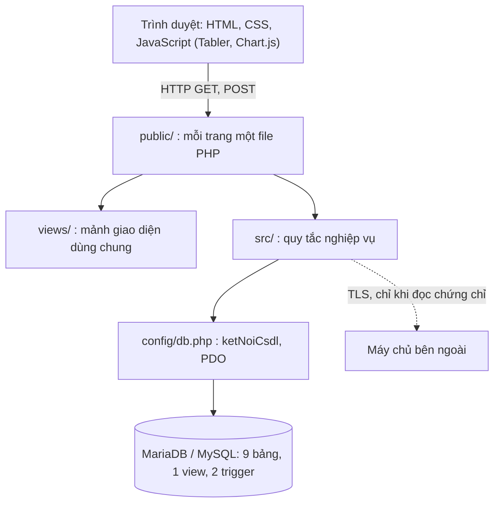

## 2. Cấu trúc thư mục

```
cipher/
├── CHAY.bat                Bấm đúp là chạy: bật MySQL, nạp CSDL, chạy web, mở trình duyệt
├── README.md               Hướng dẫn cài đặt và sử dụng cho người chấm
├── DU_LIEU_NHAP_TAY.xlsx   Dữ liệu mẫu để tự nhập tay, có dòng đúng và dòng sai
├── config/db.php           Cửa duy nhất tới CSDL: ketNoiCsdl(), múi giờ, chế độ strict
├── database/               schema.sql (bảng, view, trigger), seed.sql, seed_demo.sql
├── src/                    Toàn bộ quy tắc nghiệp vụ, không in HTML
│   ├── khoi_dong.php       Mọi trang gọi đầu tiên: nạp CSDL, phiên, nhật ký; hàm e(), ô form
│   ├── auth.php            Đăng nhập, đăng xuất, phiên, phân quyền, mã CSRF
│   ├── chung_chi.php       Chứng chỉ, lọc, sắp xếp, gia hạn, cảnh báo, thống kê, CSV,
│   │                       chấm hạng an toàn, đọc chứng chỉ thật
│   ├── danh_muc.php        Máy chủ, tên miền, tổ chức cấp
│   ├── nguoi_dung.php      Người dùng, vai trò, đổi mật khẩu
│   └── nhat_ky.php         Ghi và đọc nhật ký hoạt động, ba mức
├── public/                 Thư mục duy nhất mở ra web; mỗi file là một trang
│   ├── index.php           Trang giới thiệu
│   ├── login.php, logout.php
│   ├── admin/              Các trang sau đăng nhập
│   └── assets/             app.css, app.js; Tabler, Chart.js, font Inter (kèm LICENSE)
└── views/                  Mảnh giao diện dùng chung: đầu trang và menu, bộ lọc...
```

Ngoài gói nộp, nhóm còn giữ bộ test tự động (`tests/chay.php`, 135 test) và các tài liệu gốc của báo cáo này.

**Quy ước để đọc code nhanh:**

- Trang trong `public/` chỉ nhận dữ liệu, gọi hàm trong `src/`, rồi hiện kết quả. Quy tắc nằm trong `src/`,
  nên muốn biết "hệ thống kiểm tra gì" thì đọc `src/`. Đầu mỗi trang có chú thích: ai dùng, làm gì, luồng chính.
- Tên hàm, tên biến bằng tiếng Việt không dấu: `luuChungChi()` là lưu chứng chỉ, `$loi` là lỗi. Mỗi hàm có
  chú thích tiếng Việt giải thích **vì sao** làm vậy.
- Hàm lưu trả về mảng lỗi `['tên ô' => 'câu lỗi']`; mảng rỗng là thành công. Hàm thao tác (xoá, thu hồi) trả
  về câu lỗi, hoặc `null` nếu thành công.
- Thành công thì trang lưu một thông báo rồi chuyển hướng (`datThongBao()` rồi `chuyenHuong()`), để bấm F5
  không gửi lại form.
- Dữ liệu được kiểm tra ở 3 lớp: JavaScript báo lỗi nhanh trên form (`public/assets/app.js`), PHP kiểm
  tra lại tất cả (`src/`), CSDL chặn lần cuối bằng `UNIQUE`, `CHECK`, khoá ngoại (`database/schema.sql`).

## 3. Sổ tay: mỗi luồng chính chạy qua đâu

Đọc mục nào thì mở đúng file, đúng hàm ghi ở đó.

### 3.1. Mọi trang quản trị: kiểm tra đăng nhập, quyền, CSRF

1. Dòng đầu mọi file trong `public/admin/` nạp `src/khoi_dong.php`: mở kết nối, bắt đầu
   phiên bằng `batDauPhien()` (cookie `HttpOnly`, `SameSite=Lax`).
2. Ngay sau đó gọi `yeuCauDangNhap()` hoặc `yeuCauAdmin()` (`src/auth.php`). Hai hàm này đọc
   lại người dùng từ CSDL **ở mỗi yêu cầu** (`nguoiDungHienTai()`): ai bị khoá, bị xoá, hay đổi mật khẩu ở nơi khác
   thì bị đẩy ra ngay. Chưa đăng nhập thì về `login.php`; không phải Admin mà vào trang của Admin thì nhận lỗi 403.
3. Mọi form đổi dữ liệu gửi bằng POST kèm mã CSRF (`maCsrf()`); trang nhận gọi `yeuCauCsrf()` trước khi làm
   gì. Mã sai thì từ chối, để trang web lạ không mượn phiên của mình gửi lệnh.
4. Mọi dữ liệu in ra trang đều qua hàm `e()` (chống chèn mã độc). Mọi câu SQL có dữ liệu người dùng đều dùng
   prepared statement (chống SQL Injection).

Có test bắt quy tắc này cho **mọi** file: `moi_trang_quan_tri_deu_kiem_tra_dang_nhap`,
`moi_trang_nhan_post_deu_kiem_tra_csrf`. Thêm trang mới mà quên một trong hai là test đỏ.

### 3.2. Đăng nhập, đăng xuất

| Bước | File | Hàm |
|---|---|---|
| Người dùng gửi form | `public/login.php` | `yeuCauCsrf()` |
| Kiểm tra tên, mật khẩu, khoá, tạm chặn; chỉ xét tài khoản còn dùng | `src/auth.php` | `dangNhap()` |
| Sai mật khẩu: tăng đếm, đủ 5 lần thì chặn 15 phút | `src/auth.php` | `ghiNhanSaiMatKhau()` |
| Đúng: đổi mã phiên, lưu id người dùng và dấu mật khẩu | `src/auth.php` | `ghiNhanDangNhap()`, `dauMatKhau()` |
| Ghi nhật ký đăng nhập đúng, sai, hoặc khi đang bị chặn | `src/nhat_ky.php` | `ghiNhatKy()` |
| Đăng xuất (chỉ bằng POST), về trang giới thiệu | `public/logout.php` | `dangXuat()` |

Sai tên, sai mật khẩu hay đang bị tạm chặn đều báo **cùng một câu**, và khi tên không tồn tại vẫn chạy
`password_verify` trên một mã băm giả, để kẻ dò không biết tên đăng nhập nào có thật. Phiên nhớ một "dấu mật khẩu"
(mã băm SHA-256 của mã băm mật khẩu): đổi mật khẩu thì dấu đổi, các phiên cũ không khớp nữa và bị đẩy ra.

### 3.3. Thêm, sửa chứng chỉ

| Bước | File | Hàm |
|---|---|---|
| Form thêm (không có `?id=`) và sửa (có `?id=`); hai tab của trang Thêm | `public/admin/chung_chi_form.php` | `tabThemChungChi()` |
| Gợi ý mã kế tiếp `CERT-051` | `src/chung_chi.php` | `maChungChiKeTiep()` |
| Ô gõ Tên miền, Tổ chức cấp: đổi tên thành mã | `src/danh_muc.php` | `idTheoTen()` |
| Chuẩn hoá fingerprint, serial, ngày | `src/chung_chi.php` | `chuanHoaFingerprint()`, `chuanHoaSerial()`, `chuanHoaNgay()` |
| Kiểm tra từng ô | `src/chung_chi.php` | `kiemTraChungChi()` |
| Ghi CSDL; trùng mã hoặc fingerprint thì báo đúng ô; từ chối sửa chứng chỉ đã thu hồi | `src/chung_chi.php` | `luuChungChi()` |
| Dán ngày dạng ngày/tháng/năm vào ô ngày | `public/assets/app.js` | `docNgayDan()` |

Form sửa chỉ để sửa thông tin nhập sai, không ghi lịch sử. Chứng chỉ được cấp lại thì dùng Gia hạn (3.6).

### 3.4. Đọc chứng chỉ thật từ máy chủ (mở rộng 2)

| Bước | Hàm trong `src/chung_chi.php` |
|---|---|
| Tách tên máy và cổng từ chữ người dùng gõ | `phanTichDiaChi()` |
| Hỏi DNS lấy mọi IP của tên miền | `phanGiaiDiaChi()` |
| Chặn cổng ngoài danh sách TLS, chặn nếu **bất kỳ** IP nào là nội bộ | `kiemTraDiaChiDoc()`, `laDiaChiNoiBo()` |
| Kết nối TLS tới đúng IP vừa kiểm (chờ tối đa 10 giây), lấy chứng chỉ | `docChungChiTuMayChu()` |
| Đổi chứng chỉ thành giá trị các ô của form | `giaTriTuChungChi()` |
| Tên hãng gọn (GlobalSign nv-sa thành GlobalSign), quốc gia, hãng có đáng tin không (kiểm chuỗi với kho CA gốc) | `tenHang()`, `tenQuocGia()`, `laChuoiTinCay()` |
| Kế hoạch danh mục: tên miền, máy chủ (theo IP), tổ chức cấp có sẵn thì chọn, chưa có thì ghi "sẽ tạo"; tên miền đã có mà IP khác thì chỉ ghi chú | `keHoachDanhMuc()`, `mayChuTheoIp()` |
| Báo nếu đã có chứng chỉ cùng fingerprint | `chungChiTheoFingerprint()` |
| Gộp các bước trên và ghi nhật ký, đọc được hay không cũng ghi | `docChungChiChoForm()` |
| Bấm Thêm: tạo phần danh mục còn thiếu cùng chứng chỉ trong **một giao dịch** (hỏng bước nào thì không bước nào được ghi) | `luuChungChiKemDanhMuc()` |
| Nút "Cập nhật IP máy chủ" khi IP lúc đọc khác IP đã lưu; không có gì tự dò IP chạy ngầm | `capNhatIpMayChu()` |
| Nhập hàng loạt (`public/admin/chung_chi_nhap.php`): tối đa 50 địa chỉ, đánh dấu dòng trùng, xem trước có ô tick rồi mới lưu; kết quả đọc giữ trong phiên | `formNhapHangLoat()`, `tachDanhSachDiaChi()`, `danhDauTrungTrongLuot()` |

Vì sao chặn địa chỉ nội bộ: web chạy chung máy với các dịch vụ khác. Không chặn thì người đăng nhập có thể
nhờ web kết nối tới `127.0.0.1` hoặc mạng nội bộ để dò xem có gì (kiểu tấn công này gọi là SSRF). Kết nối tới
đúng IP đã kiểm, không tra DNS lần hai, để kẻ xấu không kịp đổi tên miền sang `127.0.0.1` giữa hai lần tra.

### 3.5. Trạng thái và số ngày còn lại

Không lưu trong bảng. View `v_certificates` (`database/schema.sql`) tính lại mỗi lần đọc
bằng `DATEDIFF(valid_to, NOW())` và một câu `CASE`: đã thu hồi → chưa hiệu lực → đã hết hạn → sắp hết hạn (còn
tối đa 30 ngày) → còn hiệu lực. Nhờ vậy trạng thái không bao giờ bị cũ. Mọi danh sách đều đọc từ view này.

### 3.6. Gia hạn

| Bước | File | Hàm |
|---|---|---|
| Form gia hạn | `public/admin/chung_chi_gia_han.php` | |
| Mở giao dịch, khoá dòng chứng chỉ (`SELECT ... FOR UPDATE`) | `src/chung_chi.php` | `giaHanChungChi()` |
| Chặn chứng chỉ đã thu hồi; hạn mới phải sau hạn cũ và sau hiện tại | `src/chung_chi.php` | `kiemTraGiaHan()` |
| Chép hạn, fingerprint, serial cũ vào `renewals`, rồi cập nhật chứng chỉ, ghi nhật ký, `COMMIT` | `src/chung_chi.php` | `giaHanChungChi()` |
| Xem lịch sử | `public/admin/chung_chi_xem.php` | `lichSuGiaHan()` |

Cả chuỗi nằm trong **một giao dịch**: lỗi ở bước nào thì không bước nào có hiệu lực.

### 3.7. Cảnh báo

| Bước | File | Hàm |
|---|---|---|
| Mở Dashboard hoặc trang Cảnh báo thì tạo cảnh báo còn thiếu | `public/admin/index.php`, `public/admin/canh_bao.php` | `taoCanhBao()` |
| Danh sách cảnh báo của chu kỳ hiện tại, mỗi chứng chỉ một dòng; số cảnh báo mới trên menu | `src/chung_chi.php` | `danhSachCanhBao()`, `demCanhBaoMoi()` |
| Bấm Đã xem | `public/admin/chung_chi_thao_tac.php` | `danhDauDaXem()` |

`taoCanhBao()` là một câu `INSERT ... SELECT` lấy mọi chứng chỉ Sắp hết hạn từ view, chọn mốc gần nhất đã
chạm (7, 15 hoặc 30). Khoá `UNIQUE (certificate_id, valid_to, threshold_days)` của bảng `alerts` bảo đảm mỗi
mốc chỉ tạo một lần trong một chu kỳ, nên chạy lại bao nhiêu lần cũng không sinh thêm dòng. Gia hạn đổi
`valid_to`, nên các mốc được tính lại từ đầu. Khi hiện, mỗi chứng chỉ chỉ lấy mốc gấp nhất của chu kỳ. Không cần
chạy lịch nền (cron), vì cảnh báo chỉ hiện trong web.

### 3.8. Thu hồi, xoá chứng chỉ

Cả hai đi qua `public/admin/chung_chi_thao_tac.php`:

- `thuHoiChungChi()`: đặt `is_revoked = 1`, giữ nguyên dữ liệu, không hoàn tác được. Sau đó `luuChungChi()` và
  `giaHanChungChi()` đều từ chối chứng chỉ này.
- `xoaChungChi()`: chỉ Admin. Quyền kiểm tra **ngay trong hàm**, nên nhân viên gửi lệnh thẳng tới trang cũng bị
  từ chối. Xoá kèm cảnh báo và lịch sử gia hạn (`ON DELETE CASCADE`).

### 3.9. Danh sách, tìm kiếm, lọc, sắp xếp

`public/admin/chung_chi.php` → trong `src/chung_chi.php`:
`docBoLoc()` đọc bộ lọc từ địa chỉ trang (giá trị sai coi như chưa chọn) → `dieuKienLoc()` dựng điều kiện SQL
có tham số → `docSapXep()`, `menhDeSapXep()` chỉ nhận tên cột trong danh sách viết sẵn → `danhSachChungChi()`
lấy 20 dòng một trang. Mặc định xếp theo mức gấp (`mucGapSql()`): đã hết hạn, sắp hết hạn, còn hiệu lực,
chưa hiệu lực, đã thu hồi. Hàng nút trạng thái có số đếm lấy từ `demTheoTrangThai()`. Xếp theo độ an toàn thì
lấy hết dòng đã lọc, chấm hạng bằng `chamDiem()`, xếp bằng `sapTheoAnToan()` rồi mới cắt trang, để luật chấm
hạng chỉ nằm ở một nơi.

### 3.10. Thống kê và xuất báo cáo

- `public/admin/thong_ke.php`: 5 biểu đồ dùng chung bộ lọc với danh sách:
  `demTheoTrangThai()`, `hetHanTheoThang()` (12 tháng tới), `demTheoNhom()` (theo tổ chức cấp, theo thuật
  toán), `demTheoHang()` (theo hạng an toàn). Trần trục tính trên toàn bộ chứng chỉ (`tranBieuDoThongKe()`), nên
  lọc thì cột ngắn lại trên cùng một thước. Biểu đồ vẽ bằng Chart.js trong `public/assets/app.js`; mỗi biểu đồ có
  bảng số ngay dưới.
- `public/admin/bao_cao_csv.php`: `tatCaChungChi()` lấy đủ kết quả (không chia
  trang), `dongCsv()` và `oCsvAnToan()` vô hiệu hoá ô bắt đầu bằng `=`, `+`, `-`, `@` để Excel không chạy thành
  công thức. Có BOM UTF-8 để Excel hiện đúng tiếng Việt.
- `public/admin/bao_cao_in.php`: bản in cùng bộ lọc, ghi rõ bộ lọc đã chọn.
- Hai nút Xuất CSV, Bản in ở dòng tiêu đề của Danh sách và Thống kê dựng bằng `nutXuatBaoCao()`.

### 3.11. Nhật ký hoạt động (mở rộng 1)

- Ghi: các hàm thêm, sửa, xoá trong `src/` tự gọi `ghiNhatKy()` (`src/nhat_ky.php`) ngay sau khi
  thành công, nên không trang nào quên ghi. Xoá đi qua `xoaVaGhiNhatKy()` để kịp lưu tên đối tượng trước khi
  nó mất. IP lấy từ `REMOTE_ADDR`, không đọc header `X-Forwarded-For` vì khách tự gõ được header đó.
- Mức: mỗi mã hành động khai sẵn một trong ba mức; `hanhDongTheoMuc()` trả về các mã thuộc một mức để lọc.
- Chặn sửa, xoá: 2 trigger `nhat_ky_cam_sua`, `nhat_ky_cam_xoa` trong `database/schema.sql` từ chối
  mọi lệnh `UPDATE`, `DELETE` trên `audit_logs`, kể cả lệnh gõ thẳng vào CSDL.
- Xem: `public/admin/nhat_ky.php`, chỉ Admin; `docLocNhatKy()`, `layNhatKy()`.
- In ra cửa sổ lệnh khi chạy bằng `CHAY.bat`: `inRaManHinh()`.

### 3.12. Người dùng, tài khoản của tôi

- `public/admin/nguoi_dung.php`, `nguoi_dung_form.php`, `nguoi_dung_thao_tac.php`: chỉ Admin. Hàm trong
  `src/nguoi_dung.php`: `kiemTraNguoiDung()`, `kiemTraMatKhauMoi()`, `themNguoiDung()`, `suaNguoiDung()`,
  `khoaNguoiDung()`, `moKhoaNguoiDung()`, `xoaNguoiDung()`. Admin không tự khoá, tự xoá, tự đổi vai trò của
  mình, để hệ thống luôn còn một Admin. Xoá là đặt cột `deleted_at` và thay mã băm mật khẩu bằng một giá trị
  không bao giờ khớp; nhật ký và lịch sử vẫn hiện tên người đó kèm "(đã xoá)" nhờ `tenNguoiSql()`.
- `public/admin/tai_khoan.php`: ai cũng dùng được; `suaHoTen()`, `doiMatKhau()`
  (phải nhập đúng mật khẩu cũ). Mật khẩu luôn lưu dạng băm bằng `password_hash()`.

### 3.13. Chấm hạng an toàn (mở rộng 3)

`chamDiem()` trong `src/chung_chi.php` nhận một dòng chứng chỉ, trả về hạng và danh sách phát hiện, mỗi phát hiện
có mức, nội dung và nguồn. Thời hạn tối đa theo ngày cấp lấy từ `thoiHanToiDa()`; tên trong chứng chỉ có thuộc tên
miền quản lý không do `tenLienQuanTenMien()` xét. Không lưu gì vào CSDL: trang chi tiết, danh sách và Thống kê
(`demTheoHang()`) đều gọi hàm này lúc hiển thị.

## 4. Bảo mật trên máy chủ thật

Ngoài các lớp bảo vệ trong code (Phần II mục 7), máy chủ web của bản chạy thật gửi kèm mọi trang 5 header bảo mật.
Ảnh dưới là header thật đọc từ <https://cert.cipher.id.vn> ngày 14/11/2026.

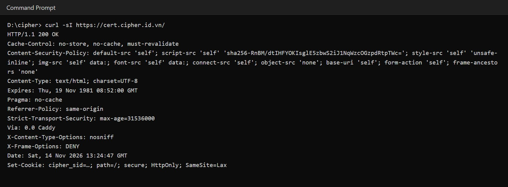

| Header | Giá trị | Chặn điều gì |
|---|---|---|
| Strict-Transport-Security | `max-age=31536000` | Trình duyệt luôn dùng HTTPS với trang này trong một năm, kể cả khi người dùng gõ `http://`; kẻ đứng giữa không hạ được xuống HTTP |
| Content-Security-Policy | `default-src 'self'`; script chỉ là file của chính web và đúng một đoạn nhúng nhận theo mã băm; `frame-ancestors 'none'`; `form-action 'self'`; `object-src 'none'` | Lớp chặn thứ hai cho XSS: nếu một đoạn mã lạ lọt vào trang, trình duyệt cũng không chạy |
| X-Frame-Options | `DENY` | Trang không bị nhúng vào khung của web khác để lừa bấm |
| X-Content-Type-Options | `nosniff` | Trình duyệt không tự đoán kiểu file, tránh chạy nhầm file tải lên như mã |
| Referrer-Policy | `same-origin` | Không gửi địa chỉ trang quản trị cho web bên ngoài khi bấm link |

Cookie phiên có đủ `Secure`, `HttpOnly`, `SameSite=Lax`. Trên máy chủ thật chỉ thư mục `public/` mở ra web: gõ
thẳng `/src/auth.php`, `/config/db.php`, `/database/schema.sql` đều nhận 404. Khi chạy trên máy bằng XAMPP, các
header này không có, vì chúng do máy chủ web của bản chạy thật thêm vào; có một test giữ cho mã băm trong
Content-Security-Policy luôn khớp đoạn script nhúng của web.

## 5. Câu hay được hỏi

| Câu hỏi | Trả lời ngắn | Xem ở |
|---|---|---|
| Chống SQL Injection thế nào? | Mọi câu SQL có dữ liệu người dùng dùng prepared statement của PDO; tên cột để sắp xếp chỉ lấy từ danh sách viết sẵn | `config/db.php`, `menhDeSapXep()` |
| Chống XSS thế nào? | Mọi dữ liệu in ra qua `e()` = `htmlspecialchars`; máy chủ thật thêm Content-Security-Policy | `src/khoi_dong.php` |
| Mật khẩu lưu thế nào? | Băm bằng `password_hash()`, kiểm tra bằng `password_verify()`; không lưu, không gửi lại mật khẩu gốc | `src/auth.php`, `src/nguoi_dung.php` |
| Số ngày còn lại tính ở đâu? | View `v_certificates`, tính mỗi lần đọc, không lưu | `database/schema.sql` |
| Sao không có cron tạo cảnh báo? | Cảnh báo chỉ hiện trong web, nên tạo lúc có người mở trang là đủ; `UNIQUE` chặn tạo trùng | `taoCanhBao()` |
| Hai người gia hạn cùng lúc thì sao? | Giao dịch + `SELECT ... FOR UPDATE`: người sau chờ người trước xong, rồi thấy hạn mới | `giaHanChungChi()` |
| Kiểm tra dữ liệu bằng JS và PHP? | JS chỉ giúp báo lỗi nhanh (có thể bị tắt); PHP kiểm tra lại tất cả; CSDL chặn lần cuối | `app.js`, `src/`, `schema.sql` |
| Sao đọc chứng chỉ thì tự tạo tên miền, tổ chức cấp, còn gõ tay thì không? | Đọc từ máy chủ thì tên lấy từ chứng chỉ thật, không gõ nhầm được, và chỉ tạo khi bấm Thêm. Gõ tay thì nhầm một chữ là đẻ ra danh mục rác, nên chỉ nhận tên đã có | `keHoachDanhMuc()`, `idTheoTen()` |
| Sao Nhân viên không xoá được chứng chỉ? | Xoá làm mất cả lịch sử gia hạn; Nhân viên dùng Thu hồi, dữ liệu vẫn còn | `xoaChungChi()` |
| Xoá người dùng rồi nhật ký có mất tên không? | Không. Xoá chỉ đánh dấu; dòng người dùng vẫn còn để nhật ký trỏ tới, tên hiện kèm "(đã xoá)" | `xoaNguoiDung()`, `tenNguoiSql()` |
| Vì sao chấm hạng bằng chữ, không bằng điểm? | Cộng trừ điểm không biện minh được; hạng lấy theo lỗi nặng nhất, mỗi lỗi có nguồn quy định | `chamDiem()` |

# Phần VI. Hướng dẫn cài đặt, cấu hình và sử dụng

Có hai cách chạy trên máy Windows đã cài [XAMPP](https://www.apachefriends.org) (đã thử với XAMPP 8.2.12):
**Cách 1** bấm một file là chạy; **Cách 2** cài tay từng bước theo kiểu quen thuộc của XAMPP. Không muốn cài thì
dùng bản chạy thật tại <https://cert.cipher.id.vn>.

## 1. Cách 1: bấm đúp `CHAY.bat` (nhanh nhất)

1. **Giải nén** file nén ra một thư mục bất kỳ: bấm chuột phải vào file nén → **Extract All** (Giải nén).
   Không cần chép vào `htdocs`. Bấm `CHAY.bat` ngay bên trong file nén sẽ không chạy, vì chương trình nén
   chỉ bung riêng file đó ra thư mục tạm; khi đó file tự dừng và nhắc giải nén.
2. Bấm đúp **`CHAY.bat`**. Không cần mở XAMPP Control Panel trước.
3. Trình duyệt tự mở trang giới thiệu. Bấm **Đăng nhập**, dùng tài khoản ở mục 3.

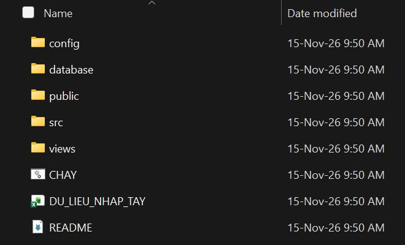

Cửa sổ đen làm thay người dùng 4 bước, mỗi bước in một dòng `[1/4]` … `[4/4]`: tìm XAMPP, bật MySQL nếu chưa bật,
lần đầu tự tạo CSDL `cipher_dev` và nạp dữ liệu mẫu (50 chứng chỉ, 2 tài khoản), rồi chạy web ở
<http://localhost:8000> (cổng bận thì dùng 8001, 8002...). **Đóng cửa sổ đen là tắt web.**

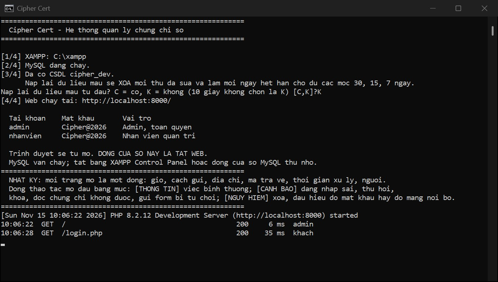

Lần bấm đầu tiên, bước `[3/4]` không hỏi mà ghi `Dang tao CSDL cipher_dev va nap du lieu mau...`, kèm tên ba file
được nạp và dòng `Xong: 50 chung chi mau, 2 tai khoan.` Chữ `admin`, `khach` ở cuối mỗi dòng nhật ký là người mở trang
(`khach` là chưa đăng nhập).

- **Lần bấm sau:** cửa sổ hỏi có nạp lại dữ liệu mẫu không. Bấm `K` hoặc chờ 10 giây là giữ nguyên dữ liệu
  đang có; bấm `C` là xoá hết và nạp lại từ đầu.
- **Windows hiện "Windows protected your PC":** bấm **More info → Run anyway**. File chỉ chạy PHP và MySQL
  của XAMPP; mở bằng Notepad để đọc từng bước, mỗi bước có chú thích.
- **Cửa sổ báo LỖI:** đọc dòng LỖI, làm theo hướng dẫn trong đó, hoặc chuyển sang Cách 2.

**Đọc nhật ký trong cửa sổ đen.** Trong lúc web chạy, mỗi trang được mở in một dòng: giờ, cách gửi (GET, POST),
địa chỉ, mã trả về, thời gian xử lý, người dùng. Mỗi thao tác in thêm một dòng mở đầu bằng mức: `[THONG TIN]` là
việc bình thường; `[CANH BAO]` là đăng nhập sai, thu hồi, khoá, đọc chứng chỉ không được, gửi form bị từ chối;
`[NGUY HIEM]` là xoá, dấu hiệu dò mật khẩu hay dò mạng nội bộ. Chữ không dấu vì cửa sổ lệnh của Windows hay vỡ chữ
tiếng Việt có dấu.

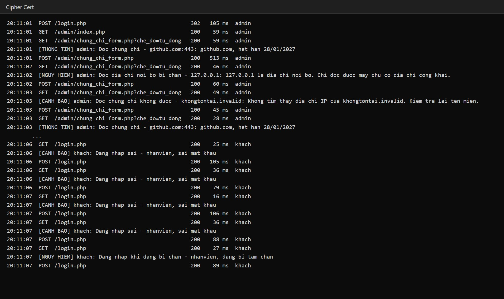

## 2. Cách 2: cài tay từng bước

**Bước 1. Bật Apache và MySQL.** Mở **XAMPP Control Panel**, bấm **Start** ở dòng **Apache** và dòng
**MySQL**. Cả hai chuyển sang nền xanh là được.

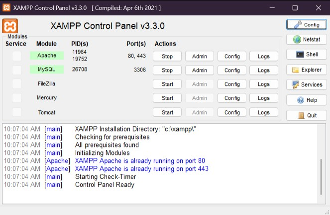

**Bước 2. Chép bài vào `htdocs`.** Chép cả thư mục bài vào `C:\xampp\htdocs` và đặt tên thư mục là
`cipher` (chữ thường, không dấu cách). Kiểm tra: phải có file `C:\xampp\htdocs\cipher\public\index.php`.

**Bước 3. Tạo CSDL.** Mở <http://localhost/phpmyadmin>. Bấm **New** (Mới) ở cột trái. Ô tên gõ `cipher_dev`,
ô bên cạnh chọn `utf8mb4_unicode_ci`, bấm **Create** (Tạo).

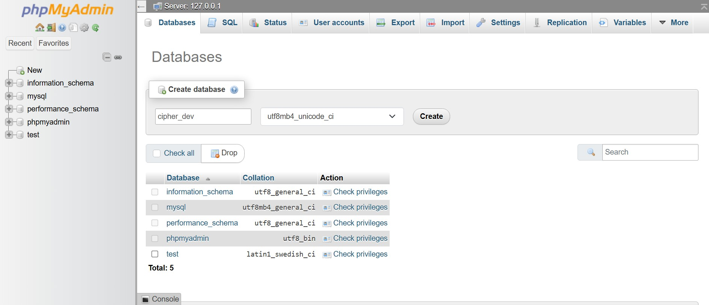

**Bước 4. Nạp dữ liệu, đúng thứ tự 3 file.** Ở cột trái bấm vào `cipher_dev`, chọn tab **Import** (Nhập),
bấm **Choose File** (Chọn tệp), chọn file, kéo xuống cuối bấm **Import** (Nhập). Làm lần lượt:

| Thứ tự | File | Nội dung |
|---|---|---|
| 1 | `database\schema.sql` | Tạo 9 bảng, view tính số ngày còn lại, 2 trigger chặn sửa, xoá nhật ký. Xoá bảng cũ nếu có |
| 2 | `database\seed.sql` | 2 tài khoản, danh mục, 9 chứng chỉ đủ mọi trạng thái và mốc cảnh báo |
| 3 | `database\seed_demo.sql` | Thêm 41 chứng chỉ cho đủ 50, để biểu đồ và phân trang có số liệu |

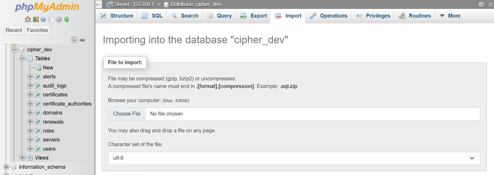

Mỗi file nạp xong, phpMyAdmin báo một dòng xanh: "Import has been successfully finished" (giao diện tiếng
Việt: "Việc nhập vào đã được thực hiện thành công"). Lỡ nạp sai thứ tự thì nạp lại từ file 1. phpMyAdmin hiện tiếng
Anh hay tiếng Việt là theo ngôn ngữ của trình duyệt; vị trí các nút như nhau.

**Bước 5. Mở web.** Vào <http://localhost/cipher/public/>. Nhớ có `/public/` ở cuối: các trang web nằm trong
thư mục này, còn cấu hình và mã xử lý để ngoài (trên máy chủ thật, chúng không mở được từ trình duyệt).

## 3. Tài khoản

| Tài khoản | Mật khẩu | Vai trò |
|---|---|---|
| `admin` | `Cipher@2026` | Admin, toàn quyền |
| `nhanvien` | `Cipher@2026` | Nhân viên quản trị: không xoá chứng chỉ và danh mục, không quản lý người dùng, không xem nhật ký |

Bản chạy thật trên mạng (<https://cert.cipher.id.vn>) có cùng dữ liệu mẫu và cùng hai tài khoản này trong thời gian
chấm bài.

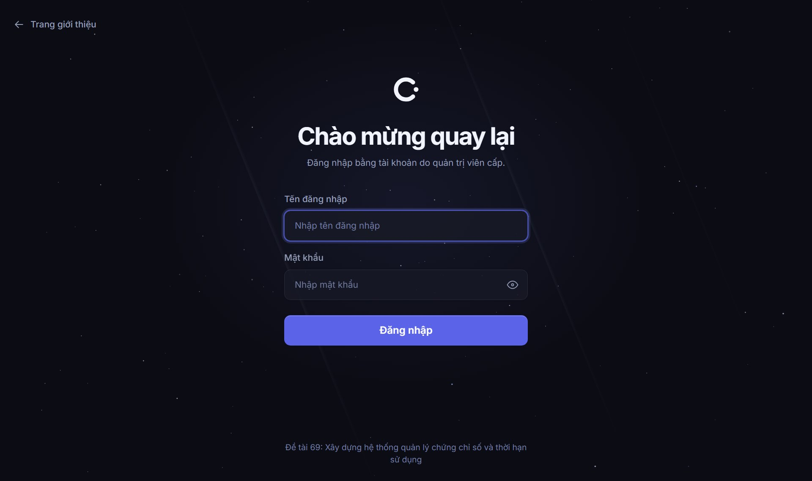

## 4. Cấu hình và lỗi thường gặp

| Gặp | Làm |
|---|---|
| MySQL của máy đã đặt mật khẩu cho `root` | Tạo file `config\config.local.php` với nội dung `<?php return ['pass' => 'mật khẩu của bạn'];` rồi làm theo Cách 2. Mặc định web dùng `root` không mật khẩu, CSDL `cipher_dev` ở `127.0.0.1:3306` (xem `config/db.php`) |
| Muốn đổi tên CSDL hoặc tài khoản MySQL | Cũng trong `config\config.local.php`: `<?php return ['user' => 'ten', 'pass' => 'matkhau', 'dbname' => 'ten_csdl'];` |
| Trang báo lỗi kết nối CSDL | MySQL chưa bật, hoặc chưa tạo `cipher_dev`, hoặc chưa nạp đủ 3 file |
| Mở `localhost/cipher/` chỉ thấy danh sách thư mục | Thêm `/public/` vào cuối địa chỉ |
| Apache không Start được (cổng 80 bị chương trình khác giữ) | Dùng Cách 1: không cần Apache |
| Không thấy đủ cảnh báo 30, 15, 7 ngày | Ngày trong dữ liệu mẫu tính từ lúc nạp, nên lệch dần theo thời gian. Nạp lại: Cách 1 bấm `C`; Cách 2 nạp lại 3 file |
| Đọc chứng chỉ thật từ máy chủ không được | Cần máy có mạng ra internet. XAMPP bật sẵn tiện ích `openssl` của PHP |
| Múi giờ | Không cần chỉnh: code tự đặt giờ Việt Nam cho PHP và CSDL, vì XAMPP mặc định dùng giờ Đức |

## 5. Sử dụng hệ thống

Menu bên trái có hai tầng: thanh biểu tượng là các khu, bấm một khu thì bảng bên cạnh hiện các trang của khu đó.

| Khu | Trang | Ai thấy |
|---|---|---|
| Tổng quan | Dashboard, Thống kê và báo cáo | Mọi người |
| Cảnh báo | Cảnh báo (số đỏ trên chuông là số cảnh báo mới) | Mọi người |
| Chứng chỉ | Danh sách chứng chỉ, Thêm chứng chỉ | Mọi người |
| Hạ tầng | Tên miền, Máy chủ, Tổ chức cấp | Mọi người |
| Hệ thống | Người dùng, Nhật ký | Chỉ Admin |

Đổi mật khẩu, sửa họ tên, đăng xuất ở biểu tượng người dùng cuối menu → **Tài khoản và mật khẩu**, **Đăng xuất**.

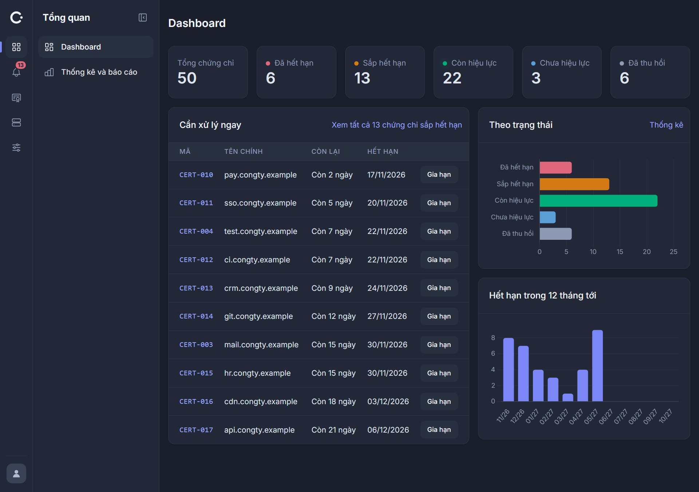

**Thử nhập tay:** mở **`DU_LIEU_NHAP_TAY.xlsx`** (cùng thư mục với `CHAY.bat`). Mỗi trang tính là một form, có dòng
nhập đúng, dòng cố ý sai và kết quả mong đợi; ngày tự tính theo hôm nay. Ô ngày trên web dán được chữ ngày/tháng/năm
chép từ file. Nên nhập theo thứ tự trang tính 1 đến 7, vì trang Chứng chỉ dùng tên miền và tổ chức cấp vừa tạo ở các
trang trước.

**Các việc hay làm:**

1. **Thêm chứng chỉ bằng tay:** Chứng chỉ → **Thêm chứng chỉ** (mở sẵn tab **Nhập thủ công**). Ô Tên miền và Tổ
   chức cấp có gợi ý, chỉ nhận tên đã có trong danh mục.
2. **Thêm chứng chỉ của một website có thật:** cùng trang, tab **Nhập tự động** → khung **Đọc một địa chỉ** → gõ
   tên miền (ví dụ `github.com`), chọn cổng → **Đọc chứng chỉ**. Hệ thống điền sẵn các ô; kiểm tra lại rồi bấm
   **Thêm chứng chỉ**. Tên miền, máy chủ, tổ chức cấp chưa có thì được tạo cùng lúc.
3. **Thêm nhiều chứng chỉ một lúc:** tab **Nhập tự động** → khung **Nhập hàng loạt** ở dưới → dán tối đa 50 địa
   chỉ, mỗi dòng một → xem trước, tick những dòng muốn lưu.
4. **Tìm và lọc:** Danh sách chứng chỉ → bấm nút trạng thái, gõ từ khoá, hoặc mở **Bộ lọc** để chọn tổ chức cấp,
   tên miền, máy chủ, khoảng ngày hết hạn và cách sắp xếp.
5. **Xử lý cảnh báo:** khu **Cảnh báo** → xem chứng chỉ sắp hết hạn → **Gia hạn** hoặc **Đã xem**.
6. **Gia hạn:** mở một chứng chỉ → **Gia hạn** → nhập ngày hết hạn mới (fingerprint, serial mới nếu có). Thông
   tin cũ vào bảng Lịch sử gia hạn ngay dưới.
7. **Xem đánh giá an toàn:** mở một chứng chỉ → thẻ **Đánh giá an toàn** ghi hạng, từng phát hiện và nguồn.
8. **Xuất báo cáo:** Danh sách chứng chỉ hoặc Thống kê → chọn bộ lọc → nút **Xuất CSV** (mở bằng Excel) hoặc
   **Bản in** (in hoặc lưu PDF bằng lệnh In của trình duyệt) ở góc trên bên phải.
9. **Xem ai đã làm gì** (Admin): Hệ thống → **Nhật ký** → lọc theo người làm, mức độ, hành động, khoảng ngày.

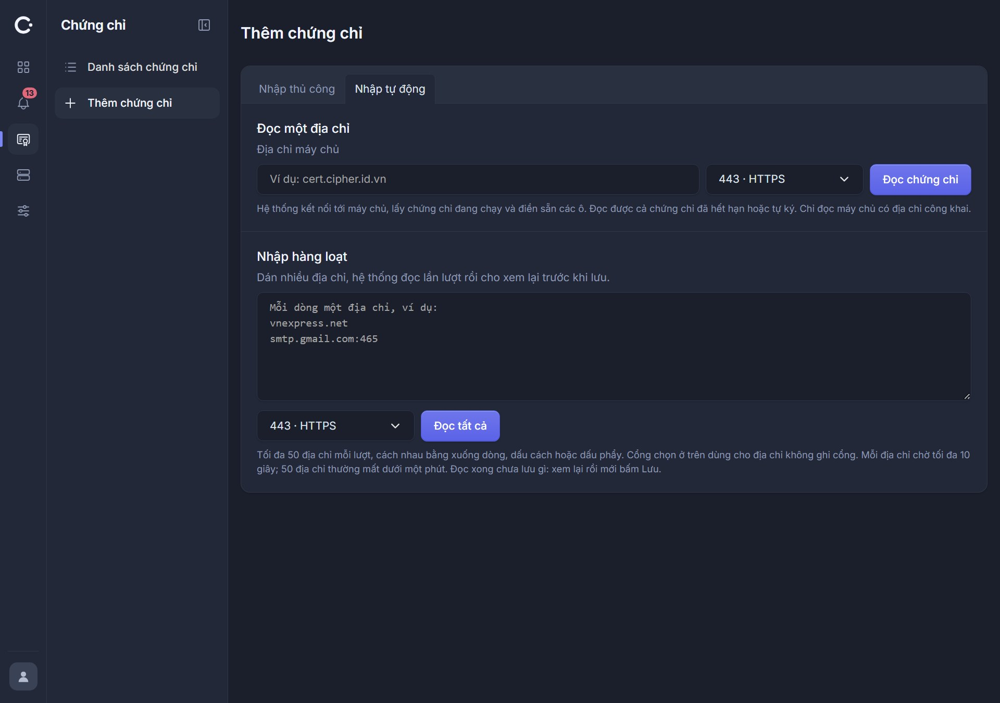

Ảnh màn hình và luồng chi tiết của từng việc nằm ở Phần IV, đặc tả use case.

# Phần VII. Báo cáo kiểm thử

<!-- chen: KIEM_THU.md -->

# Phần VIII. Phân công nhiệm vụ

Chia đều theo nhóm chức năng. Mỗi người phụ trách phần của mình từ CSDL, code đến tài liệu và test; cả nhóm
cùng nắm luồng chung ở Phần V mục 3.1 và 3.5.

| | Nguyễn Đức Trung | Phan Tuấn Anh | Nguyễn Chí Kiên |
|---|---|---|---|
| **Phần phụ trách** | Nền tảng và bảo mật | Chứng chỉ | Danh mục, cảnh báo, báo cáo |
| **Chức năng** | Na Đăng nhập · Nb Người dùng · Ng CSDL, khoá, quan hệ · Ni Bảo mật · Nj Dữ liệu mẫu · Mở rộng 1 Nhật ký · Mở rộng 3 Chấm hạng an toàn | D1 Danh sách chứng chỉ · D4 Ngày cấp, hết hạn · D5 Trạng thái · D7 Gia hạn · Nd Tìm kiếm, lọc · Nf Kiểm tra JS + PHP · Mở rộng 2 Đọc chứng chỉ thật | D2 Tên miền, máy chủ · D3 Tổ chức cấp · D6 Cảnh báo · D8 Thống kê · D9 Xuất báo cáo · Nh Dashboard · Giao diện |
| **Use case** | UC01, UC02, UC12, UC13 | UC04, UC05, UC05a, UC06, UC07, UC11 | UC03, UC08, UC09, UC10 |
| **File chính** | `config/db.php`, `src/auth.php`, `src/nguoi_dung.php`, `src/nhat_ky.php`, `database/`, `login.php`, `logout.php`, trang Người dùng, Nhật ký, Tài khoản, phần chấm hạng trong `src/chung_chi.php`, `CHAY.bat` | `src/chung_chi.php` (phần chứng chỉ, lọc, sắp xếp, gia hạn, đọc chứng chỉ), các trang `chung_chi*.php`, `views/bo_loc.php`, `public/assets/app.js` (kiểm tra form) | `src/danh_muc.php`, `src/chung_chi.php` (phần cảnh báo, thống kê, CSV), Dashboard, `canh_bao.php`, `thong_ke.php`, `bao_cao_*.php`, trang danh mục, trang giới thiệu, `views/`, `app.css` |
| **Số test phụ trách** | 45 | 39 | 51 |
| **Tài liệu** | ERD, hướng dẫn cài đặt, phần bảo mật | Đặc tả use case phần chứng chỉ, sơ đồ trình tự Thêm và Gia hạn | Đặc tả chức năng phần thống kê, cảnh báo, giao diện; báo cáo kiểm thử |

# Phần IX. Kết luận và hướng phát triển

## 1. Kết quả đạt được

- Đủ 19 chức năng của đề (D1–D9, Na–Nj) và 3 tiêu chí; thêm 3 chức năng mở rộng.
- 135 test tự động đều đạt; 34 dòng kịch bản nhập tay đều cho đúng kết quả; kiểm thử bảo mật không tìm thấy lỗ hổng.
- Hệ thống chạy thật trên internet qua HTTPS tại <https://cert.cipher.id.vn>, dùng được trên máy tính và điện thoại.
- Người chấm chạy được trên máy bằng một lần bấm `CHAY.bat`, hoặc cài tay theo cách quen của XAMPP.

## 2. Hạn chế

- Cảnh báo chỉ hiện trong web, chưa gửi qua email hay tin nhắn.
- Đọc chứng chỉ thật chưa hỗ trợ giao thức phải nói trước khi bắt tay TLS (STARTTLS ở cổng 25, 587).
- Chưa kiểm hiệu năng với hàng chục nghìn chứng chỉ; sắp xếp theo độ an toàn phù hợp với vài trăm chứng chỉ.
- Chưa có xác thực hai lớp cho tài khoản quản trị.

## 3. Hướng phát triển

- Gửi cảnh báo qua email hoặc ứng dụng nhắn tin khi chứng chỉ chạm mốc.
- Tự đọc lại chứng chỉ định kỳ từ máy chủ để phát hiện chứng chỉ đã được thay mà chưa ai cập nhật.
- Tự gia hạn qua giao thức ACME cho các tổ chức cấp hỗ trợ, vì thời hạn chứng chỉ sẽ rút xuống 47 ngày vào năm 2029.
- Theo dõi việc chuyển sang thuật toán kháng lượng tử: thống kê theo thuật toán khoá đã là bước đầu.

## 4. Tài liệu tham khảo

- CA/Browser Forum, *Baseline Requirements for the Issuance and Management of Publicly-Trusted TLS Server Certificates*; ballot SC-081v3 về lộ trình rút ngắn thời hạn chứng chỉ.
- NIST SP 800-57 Part 1, *Recommendation for Key Management*; NIST SP 800-131A, *Transitioning the Use of Cryptographic Algorithms and Key Lengths*.
- OWASP, *Logging Cheat Sheet*, *Cross-Site Request Forgery Prevention Cheat Sheet*, *Server-Side Request Forgery Prevention Cheat Sheet*.
- Tài liệu PHP: <https://www.php.net/manual/>; tài liệu MariaDB: <https://mariadb.com/kb/>.
- Tabler: <https://tabler.io>; Chart.js: <https://www.chartjs.org>; font Inter: <https://rsms.me/inter/>.
