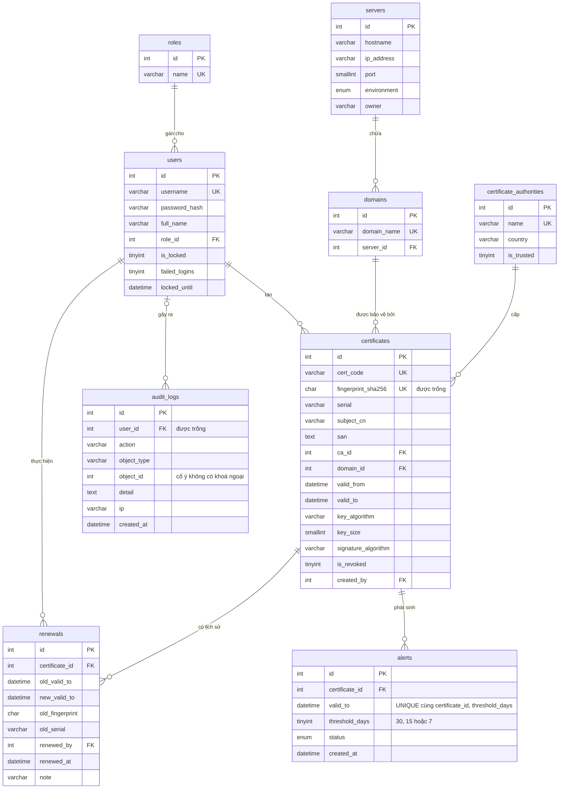

# ERD — Hệ thống quản lý chứng chỉ số và thời hạn sử dụng

Nguồn sự thật là [`database/schema.sql`](../database/schema.sql). Sơ đồ này vẽ lại để dễ đọc. GitHub
hiển thị trực tiếp; VS Code cần tiện ích xem Mermaid.

## Khi xoá bản ghi cha

| Quan hệ | Khi xoá cha | Vì sao |
|---|---|---|
| `certificates` → `renewals`, `alerts` | Xoá kèm | Không còn ý nghĩa khi không còn chứng chỉ |
| Các quan hệ còn lại | Chặn | Không để mất dữ liệu hàng loạt, giữ dấu vết người thao tác |

## Dữ liệu tính ra, không lưu

View `v_certificates` gồm mọi cột của `certificates`, cộng thêm:

- `days_left`: số ngày từ hôm nay đến `valid_to`, âm nếu đã hết hạn.
- `status`, theo thứ tự ưu tiên:

| Giá trị | Nghĩa | Điều kiện |
|---|---|---|
| `revoked` | Đã thu hồi | `is_revoked = 1` |
| `not_yet_valid` | Chưa hiệu lực | `valid_from` sau hiện tại |
| `expired` | Đã hết hạn | `valid_to` trước hiện tại |
| `expiring` | Sắp hết hạn | Còn tối đa 30 ngày |
| `valid` | Còn hiệu lực | Các trường hợp còn lại |

Giao diện dựa vào `status`, không suy từ `days_left`: chứng chỉ hết hạn sáng nay vẫn có `days_left = 0`.
