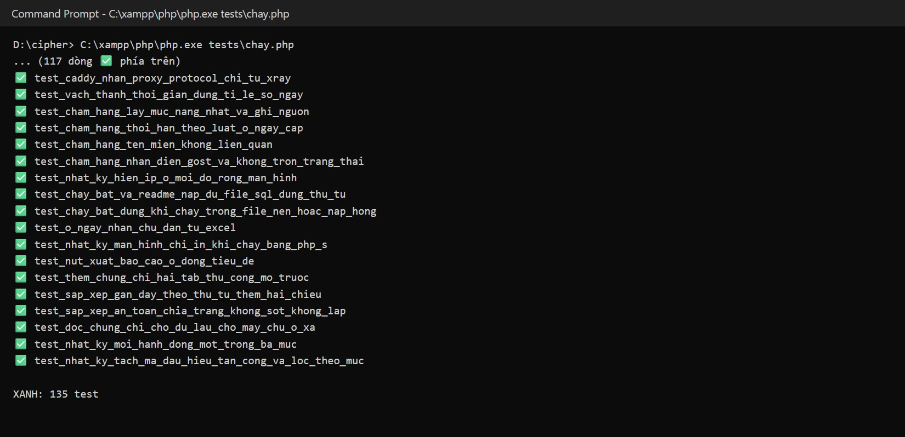
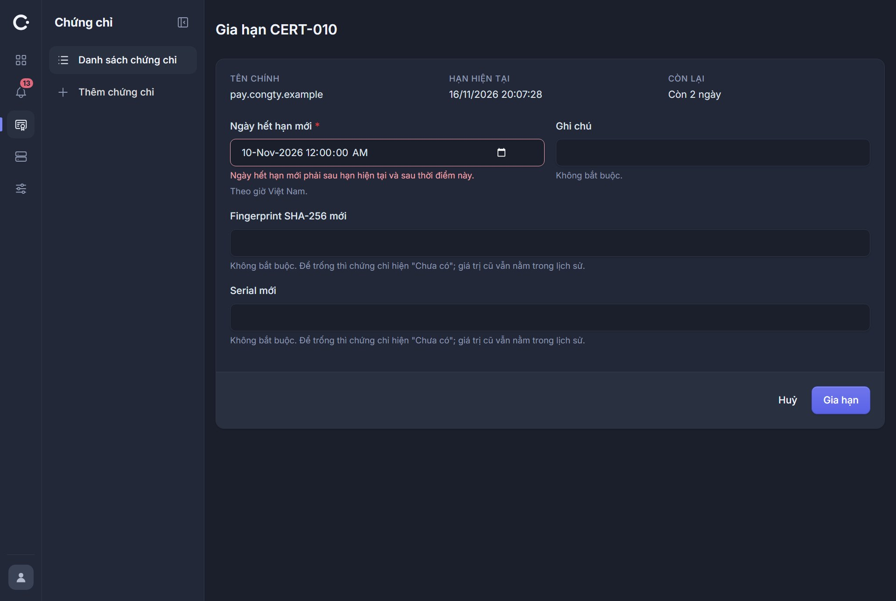
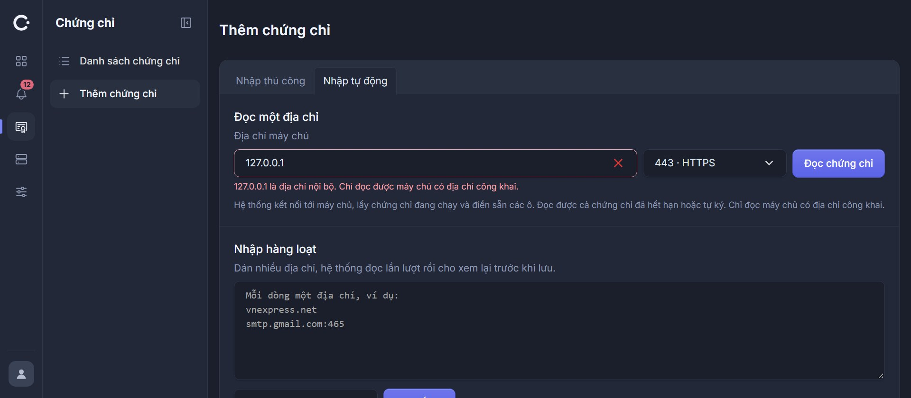
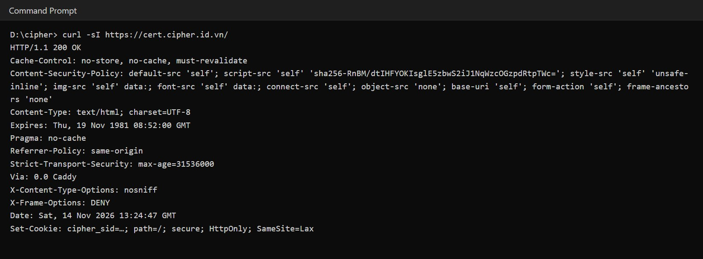
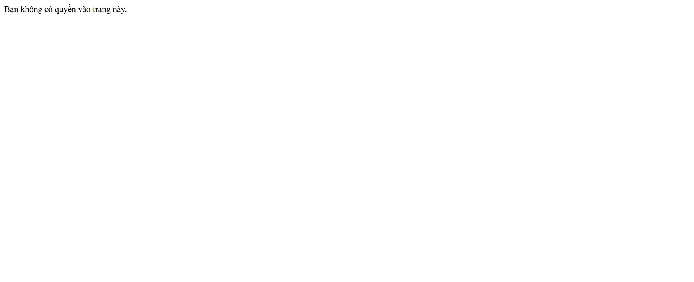
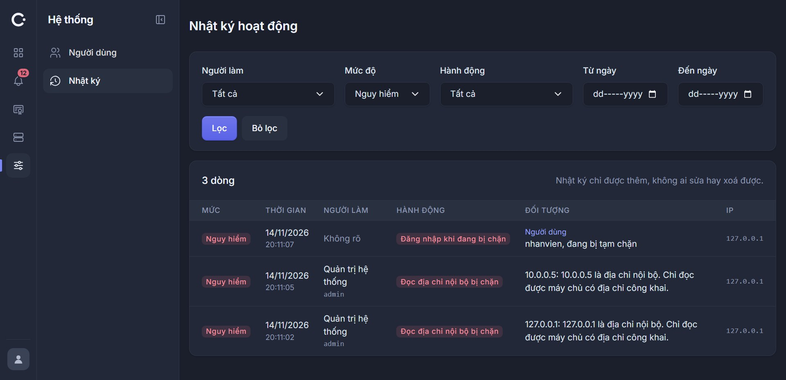

# Báo cáo kiểm thử: Hệ thống quản lý chứng chỉ số và thời hạn sử dụng

## 1. Kết quả

| Hạng mục | Kết quả |
|---|---|
| **Ngày chạy** | 14/11/2026 |
| **Bộ test tự động** | **135/135 đạt**, chạy mất 41 giây |
| **Kiểm tra cú pháp** | Mọi file `.php` qua `php -l`, không lỗi |
| **Kiểm tay theo kịch bản** | 34/34 dòng của file `DU_LIEU_NHAP_TAY.xlsx` cho đúng kết quả mong đợi (mục 4) |
| **Kiểm trên bản chạy thật** | 14/14 ca đạt, đủ 5 header bảo mật (mục 5) |
| **Kiểm thử bảo mật** | SQL Injection, XSS, CSRF, phân quyền, SSRF, phiên: không tìm thấy lỗ hổng (mục 6) |
| **Môi trường** | Windows 11 · XAMPP 8.2.12: PHP 8.2.12, MariaDB 10.4.32 · bản chạy thật: Ubuntu 24.04, PHP-FPM, MariaDB 10.11, Caddy |

## 2. Cách kiểm thử

Hệ thống được kiểm ở 4 lớp:

1. **Cú pháp:** chạy `php -l` trên mọi file `.php`, bắt lỗi gõ sai trước khi chạy.
2. **Bộ test tự động** ([tests/chay.php](../tests/chay.php)), một file PHP thuần, không dùng thư viện test:
   - Mỗi test gọi thẳng hàm trong `src/` trên **CSDL MariaDB thật** tên `cipher_test`, không giả lập CSDL. Nhờ
     vậy ràng buộc `UNIQUE`, `CHECK`, khoá ngoại, trigger, view đều được kiểm thật.
   - **Trước mỗi test**, CSDL `cipher_test` được nạp lại từ `schema.sql` và `seed.sql`, nên các test không ảnh
     hưởng nhau và chạy theo thứ tự nào cũng ra cùng kết quả.
   - Một số test đọc mã nguồn để kiểm quy tắc phải đúng với **mọi** file, ví dụ mọi trang quản trị đều kiểm tra
     đăng nhập, mọi trang nhận POST đều kiểm tra mã CSRF. Thêm trang mới mà quên là test đỏ.
   - Mỗi test có 4 dòng chú thích ngay trên: **Luật** (quy tắc được kiểm), **Vì sao** (lý do có quy tắc),
     **Đỏ nghĩa là** (test đỏ thì cái gì đang hỏng), **Đừng** (cách sửa sai hay gặp). Câu Luật được chép vào
     bảng ở mục 3.
   - Mỗi test mới được viết và **cho chạy đỏ một lần** (khi code chưa có hoặc cố ý làm sai) trước khi viết code
     cho xanh, để chắc test thật sự bắt được lỗi.
3. **Kiểm tay theo kịch bản** (mục 4): nhập từng dòng của file Excel dữ liệu mẫu vào web, so với cột Kết quả
   mong đợi. Đây cũng là bảng để người chấm tự nhập thử.
4. **Kiểm trên bản chạy thật** qua internet (mục 5, 6), và xem giao diện bằng mắt: mọi thay đổi giao diện đều
   được chụp màn hình ở khổ máy tính và khổ điện thoại 390px trước khi giao.

**Chạy lại bộ test:** cần MySQL đang bật và CSDL `cipher_test` đã tạo, rồi chạy `C:\xampp\php\php.exe tests\chay.php`
từ thư mục mã nguồn đầy đủ của nhóm (gói nộp để chạy web không kèm bộ test). Mỗi test in ✅ hoặc ❌ kèm lý do; dòng
cuối là `XANH: 135 test` hoặc `ĐỎ: số test đỏ/135 test`.

## 3. Danh sách test theo chức năng

Tên test viết không dấu, bỏ tiền tố `test_`; tìm đúng tên đó trong `tests/chay.php` để xem code của test.
Cột phải là câu Luật của test. Cả 135 test đều **đạt** ngày 14/11/2026. Nguyễn Đức Trung phụ trách
45 test, Phan Tuấn Anh 39 test, Nguyễn Chí Kiên 51 test.

| Nhóm | Số test | Mã chức năng | Phụ trách |
|---|---|---|---|
| Đăng nhập, phiên, phân quyền | 12 | Na, Ni | Nguyễn Đức Trung |
| Người dùng | 11 | Nb | Nguyễn Đức Trung |
| CSDL, ràng buộc, dữ liệu mẫu | 11 | Ng, Nj | Nguyễn Đức Trung |
| Nhật ký hoạt động (mở rộng 1) | 7 | Mở rộng 1 | Nguyễn Đức Trung |
| Chấm hạng an toàn (mở rộng 3) | 4 | Mở rộng 3 | Nguyễn Đức Trung |
| Chứng chỉ: thêm, sửa, thu hồi, xoá | 12 | D1, D4, D5, Nf | Phan Tuấn Anh |
| Gia hạn | 5 | D7 | Phan Tuấn Anh |
| Đọc chứng chỉ thật (mở rộng 2) | 12 | Mở rộng 2 | Phan Tuấn Anh |
| Danh sách, tìm kiếm, lọc, sắp xếp | 10 | Nd | Phan Tuấn Anh |
| Danh mục: tên miền, máy chủ, tổ chức cấp | 8 | D2, D3, Nc | Nguyễn Chí Kiên |
| Cảnh báo | 8 | D6 | Nguyễn Chí Kiên |
| Dashboard, thống kê, báo cáo | 9 | D8, D9, Ne, Nh | Nguyễn Chí Kiên |
| Giao diện, triển khai | 26 | Giao diện | Nguyễn Chí Kiên |
| **Tổng** | **135** | | |

### Đăng nhập, phiên, phân quyền (12 test, Nguyễn Đức Trung)

| Test | Quy tắc được kiểm |
|---|---|
| `dang_nhap_dung_thi_vao_duoc_va_dem_lai_so_lan_sai` | Đăng nhập đúng thì vào được và số lần sai được đếm lại từ đầu. |
| `sai_mat_khau_hay_sai_ten_deu_bao_cung_mot_loi` | Sai mật khẩu, sai tên, hay đang tạm chặn đều báo đúng một câu lỗi. |
| `tai_khoan_bi_khoa_khong_dang_nhap_duoc` | Tài khoản bị Admin khoá thì nhập đúng mật khẩu cũng không vào được. |
| `sai_5_lan_thi_tam_chan_ke_ca_khi_nhap_dung` | Sai 5 lần thì tài khoản bị tạm chặn 15 phút, kể cả khi sau đó nhập đúng. |
| `het_15_phut_thi_dang_nhap_lai_duoc` | Hết thời gian tạm chặn thì đăng nhập lại được. |
| `nguoi_dung_bi_khoa_giua_phien_thi_bi_day_ra` | Người dùng bị khoá giữa phiên thì bị đẩy ra ở yêu cầu tiếp theo. |
| `nhan_vien_khong_co_quyen_admin` | Nhân viên quản trị không có quyền Admin; Admin thì có. |
| `ma_csrf_sai_bi_tu_choi` | Mã CSRF sai, thiếu, hoặc không phải chuỗi đều bị từ chối. |
| `moi_trang_quan_tri_deu_kiem_tra_dang_nhap` | Mọi file trong public/admin/ đều gọi yeuCauDangNhap() hoặc yeuCauAdmin(). |
| `moi_trang_nhan_post_deu_kiem_tra_csrf` | Mọi trang xử lý yêu cầu POST đều gọi yeuCauCsrf(). |
| `dang_xuat_xong_ve_landing` | Đăng xuất xong thì về landing (index.php), không về trang đăng nhập. |
| `doi_mat_khau_dang_xuat_phien_khac_giu_phien_dang_doi` | Đổi mật khẩu thì các phiên khác của người đó bị đăng xuất; phiên đang đổi giữ nguyên. |

### Người dùng (11 test, Nguyễn Đức Trung)

| Test | Quy tắc được kiểm |
|---|---|
| `khong_xoa_duoc_nguoi_dung_da_co_lich_su` | Người dùng đã có lịch sử không xoá được; người chưa có lịch sử thì xoá được. |
| `du_lieu_nguoi_dung_sai_bi_tu_choi` | Dữ liệu người dùng sai bị từ chối đúng ô: tên, họ tên, vai trò, mật khẩu ngắn, dài, nhập lại lệch. |
| `ten_dang_nhap_trung_bao_loi_ro_rang` | Tên đăng nhập trùng được báo lỗi rõ ràng, không làm hỏng trang. |
| `mat_khau_luon_luu_dang_bam` | Mật khẩu luôn được lưu dạng băm, cả khi thêm, Admin đặt lại, và tự đổi. |
| `admin_khong_tu_khoa_tu_xoa_tu_doi_vai_tro` | Admin không tự khoá, tự xoá, hay tự đổi vai trò của mình. |
| `xoa_nguoi_dung_khong_vao_duoc_nua_nhat_ky_van_giu_ten` | Xoá người dùng chỉ đánh dấu đã xoá: tài khoản không đăng nhập được, biến khỏi danh sách; nhật ký, lịch sử gia hạn vẫn giữ tên kèm "(đã xoá)". |
| `ten_cua_tai_khoan_da_xoa_dung_lai_duoc` | Tên đăng nhập của tài khoản đã xoá dùng lại được; giữa các tài khoản còn dùng vẫn không được trùng (không phân biệt hoa thường). |
| `mo_khoa_xoa_ca_trang_thai_tam_chan` | Mở khoá xoá luôn trạng thái tạm chặn, và người dùng vào được ngay. |
| `doi_mat_khau_phai_dung_mat_khau_cu` | Đổi mật khẩu phải nhập đúng mật khẩu cũ, và mật khẩu mới phải hợp lệ. |
| `trang_quan_ly_nguoi_dung_chi_danh_cho_admin` | Mọi trang quản lý người dùng đều gọi yeuCauAdmin(), không chỉ yeuCauDangNhap(). |
| `mat_khau_moi_phai_co_ca_chu_va_so` | Mật khẩu mới phải đủ 8 ký tự và có cả chữ lẫn số. |

### CSDL, ràng buộc, dữ liệu mẫu (11 test, Nguyễn Đức Trung)

| Test | Quy tắc được kiểm |
|---|---|
| `ket_noi_luon_o_mui_gio_viet_nam_va_che_do_strict` | Kết nối CSDL luôn ở múi giờ Việt Nam và chế độ strict, PHP cũng ở múi giờ Việt Nam. |
| `fingerprint_khong_duoc_trung` | Hai chứng chỉ không được có cùng fingerprint. |
| `ma_quan_ly_bat_buoc_con_fingerprint_duoc_trong_nhung_phai_chuan_hoa` | Mã quản lý là bắt buộc; fingerprint được trống, nhưng nếu có phải ở dạng đã chuẩn hoá. |
| `khong_xoa_duoc_danh_muc_con_du_lieu_phu_thuoc` | Không xoá được vai trò, máy chủ, tên miền, CA khi còn dữ liệu phụ thuộc. |
| `xoa_chung_chi_xoa_kem_canh_bao_va_lich_su` | Xoá chứng chỉ thì xoá kèm cảnh báo và lịch sử gia hạn của nó. |
| `du_lieu_mau_co_du_moc_va_trang_thai` | Dữ liệu mẫu có đủ mốc 30/15/7, mọi trạng thái, lịch sử gia hạn và tài khoản đăng nhập được. |
| `o_form_sai_ma_hoa_hoac_la_mang_duoc_coi_la_trong` | Ô form không phải chuỗi UTF-8 hợp lệ được coi là trống, nên báo lỗi đúng ô thay vì làm chết trang. |
| `du_lieu_demo_du_50_chung_chi_du_trang_thai_va_khong_nap_trung` | seed_demo.sql nạp được sau seed.sql, đủ 50 chứng chỉ, đủ mọi trạng thái và ba mốc cảnh báo; chạy lần hai không thêm gì. |
| `du_lieu_mau_chi_chung_chi_co_y_moi_ra_hang_c_hoac_f` | Trong 50 chứng chỉ mẫu, chỉ những chứng chỉ cố ý làm ví dụ mới ra hạng C hoặc F. |
| `chay_bat_va_readme_nap_du_file_sql_dung_thu_tu` | CHAY.bat, hướng dẫn cài tay trong README và bước nap_mau của VPS nạp đúng mọi file SQL có thật, theo thứ tự schema → seed → seed_demo. |
| `chay_bat_dung_khi_chay_trong_file_nen_hoac_nap_hong` | CHAY.bat dừng và bảo giải nén khi không thấy database\ và public\ cạnh nó, và dừng khi một file SQL nạp hỏng. |

### Nhật ký hoạt động (mở rộng 1) (7 test, Nguyễn Đức Trung)

| Test | Quy tắc được kiểm |
|---|---|
| `moi_thao_tac_deu_ghi_nhat_ky` | Mọi thao tác thay đổi dữ liệu, đăng nhập đúng, đăng nhập sai và đăng xuất đều ghi một dòng nhật ký: ai, làm gì, với đối tượng nào. |
| `csdl_tu_choi_sua_xoa_nhat_ky` | CSDL từ chối UPDATE và DELETE trên audit_logs (trigger), kể cả lệnh gõ thẳng vào CSDL; chỉ TRUNCATE dọn được cả bảng. |
| `nhom_he_thong_tren_menu_va_hai_trang_cua_no_chi_danh_cho_admin` | Trang Nhật ký và Người dùng chỉ Admin vào được, và nhóm "Hệ thống" (hai mục đó) trên menu chỉ hiện với Admin. |
| *(test cấu hình triển khai)* | Máy chủ web chỉ nhận IP gốc của khách từ lớp chuyển tiếp chạy trên chính máy (127.0.0.1); kết nối khác không giả được IP. |
| `nhat_ky_hien_ip_o_moi_do_rong_man_hinh` | Trang Nhật ký có cột IP và cột Hành động ở mọi độ rộng màn hình; điện thoại kéo ngang bảng để xem, không còn dòng IP, nhãn hành động phụ chỉ hiện trên màn hẹp. |
| `nhat_ky_moi_hanh_dong_mot_trong_ba_muc` | Mỗi hành động trong nhật ký có đúng một trong ba mức Thông tin, Cảnh báo, Nguy hiểm; Nguy hiểm là xoá và hai dấu hiệu tấn công. |
| `nhat_ky_tach_ma_dau_hieu_tan_cong_va_loc_theo_muc` | Đọc địa chỉ nội bộ ghi doc_chung_chi_chan, đọc tên miền không có ghi doc_chung_chi_loi, đăng nhập khi đang bị tạm chặn ghi dang_nhap_bi_chan; lọc theo mức ra đúng các dòng đó. |

### Chấm hạng an toàn (mở rộng 3) (4 test, Nguyễn Đức Trung)

| Test | Quy tắc được kiểm |
|---|---|
| `cham_hang_lay_muc_nang_nhat_va_ghi_nguon` | Hạng an toàn là mức nặng nhất trong các phát hiện: chữ ký SHA-1/MD5, RSA dưới 2048, ECDSA dưới 256 là F; tổ chức cấp không tin cậy là C; RSA 2048–3071 là B; không vướng gì là A; mỗi phát hiện có nguồn. |
| `cham_hang_thoi_han_theo_luat_o_ngay_cap` | Thời hạn dài hơn mức tối đa lúc cấp là C: 825 ngày từ 01/03/2018, 398 từ 01/09/2020, 200 từ 15/03/2026, 100 từ 15/03/2027, 47 từ 15/03/2029; cấp trước 01/03/2018 thì không xét. |
| `cham_hang_ten_mien_khong_lien_quan` | Không tên nào trong chứng chỉ (tên chính, tên phụ) thuộc tên miền quản lý thì là C; tên miền con hay wildcard phủ một tầng vẫn tính là thuộc; wildcard chỉ là ghi chú, không hạ hạng. |
| `cham_hang_nhan_dien_gost_va_khong_tron_trang_thai` | Chứng chỉ GOST là B (chỉ dùng được ở Nga), không phải F; hạng không xét hết hạn hay thu hồi. |

### Chứng chỉ: thêm, sửa, thu hồi, xoá (12 test, Phan Tuấn Anh)

| Test | Quy tắc được kiểm |
|---|---|
| `trang_thai_va_so_ngay_tinh_tu_valid_to` | Số ngày và trạng thái tính từ ngày tháng, ưu tiên thu hồi > chưa hiệu lực > hết hạn > sắp hết hạn. |
| `chung_chi_du_lieu_sai_bi_tu_choi_dung_o` | Chứng chỉ có dữ liệu sai bị từ chối đúng ô, và không được lưu. |
| `fingerprint_va_serial_duoc_chuan_hoa_truoc_khi_luu` | Fingerprint và serial được chuẩn hoá trước khi lưu; ô trống lưu thành NULL. |
| `ma_quan_ly_va_fingerprint_trung_bao_loi_ro_rang` | Mã quản lý trùng và fingerprint trùng được báo lỗi đúng ô, kể cả khi viết khác dạng. |
| `ngay_het_han_phai_sau_ngay_bat_dau` | Ngày hết hạn phải sau ngày cấp; bằng nhau cũng bị từ chối. |
| `nhan_vien_khong_xoa_duoc_chung_chi_admin_thi_duoc` | Nhân viên không xoá được chứng chỉ; Admin thì được. |
| `thu_hoi_giu_du_lieu_va_khong_hoan_tac_duoc` | Thu hồi giữ nguyên dữ liệu, đổi trạng thái, và không hoàn tác được qua form sửa. |
| `chung_chi_da_thu_hoi_khong_sua_duoc` | Chứng chỉ đã thu hồi không sửa được, kể cả gửi thẳng tới máy chủ; trang chi tiết không hiện nút Sửa, form sửa đẩy về trang chi tiết. |
| `ma_ke_tiep_khong_trung_ma_da_co` | Mã kế tiếp không trùng mã đã có, và không bị mã tự đặt làm hỏng. |
| `chung_chi_het_han_trong_hom_nay_ghi_het_han_hom_nay` | Chứng chỉ hết hạn trong ngày hôm nay ghi "Hết hạn hôm nay", không ghi "Quá hạn 0 ngày" hay "Còn 0 ngày". |
| `o_go_ten_mien_to_chuc_cap_chi_nhan_ten_co_trong_danh_muc` | Ô gõ Tên miền, Tổ chức cấp chỉ nhận tên có trong danh mục (không phân biệt hoa thường); tên lạ không lưu được. |
| `them_chung_chi_hai_tab_thu_cong_mo_truoc` | Trang Thêm chứng chỉ có hai tab, Nhập thủ công (mở trước) và Nhập tự động (đọc một địa chỉ ở trên, nhập hàng loạt ở dưới); menu Chứng chỉ còn Danh sách và Thêm. |

### Gia hạn (5 test, Phan Tuấn Anh)

| Test | Quy tắc được kiểm |
|---|---|
| `gia_han_luu_thong_tin_cu_va_cap_nhat_chung_chi` | Gia hạn chép hạn, fingerprint, serial cũ vào lịch sử rồi cập nhật chứng chỉ; ô trống lưu NULL. |
| `sau_gia_han_cac_moc_canh_bao_tinh_lai_tu_dau` | Sau khi gia hạn, cảnh báo cũ biến khỏi trang và các mốc được tính lại từ đầu. |
| `chan_gia_han_chung_chi_da_thu_hoi` | Chứng chỉ đã thu hồi hoặc không tồn tại không gia hạn được, và không để lại lịch sử. |
| `han_moi_phai_sau_han_cu_va_sau_hien_tai` | Hạn mới phải sau cả hạn hiện tại lẫn thời điểm gia hạn; dữ liệu sai bị từ chối đúng ô. |
| `gia_han_loi_giua_chung_thi_khong_doi_gi` | Gia hạn lỗi giữa chừng thì không bước nào có hiệu lực. |

### Đọc chứng chỉ thật (mở rộng 2) (12 test, Phan Tuấn Anh)

| Test | Quy tắc được kiểm |
|---|---|
| `doc_chung_chi_chan_dia_chi_noi_bo_va_cong_ngoai_danh_sach` | Đọc chứng chỉ chỉ kết nối tới địa chỉ công khai và cổng TLS trong danh sách; chặn nếu BẤT KỲ IP nào của tên miền là nội bộ. |
| `chung_chi_doc_duoc_dien_dung_cac_o` | Chứng chỉ đọc được điền đúng từng ô của form: tên chính, ngày theo giờ Việt Nam, thuật toán, độ dài khoá, ký, fingerprint, serial. |
| `doc_roi_bo_khong_tao_gi_va_tu_chon_danh_muc_co_san` | Đọc xong chỉ tính kế hoạch: tên miền (trùng hẳn hoặc tên miền cha), tổ chức cấp có sẵn thì chọn, chưa có thì ghi "sẽ tạo"; trước khi bấm Lưu không bản ghi nào được tạo. |
| `ten_hang_gom_ve_tang_hang` | Tổ chức cấp ghi ở tầng hãng: mọi cách viết ô O (và ô CN) của cùng một hãng ra một tên gọn; hãng lạ giữ nguyên ô O. |
| `hang_tin_cay_khi_chuoi_kiem_duoc_voi_kho_ca_goc` | Hãng mới tạo là tin cậy khi có chứng chỉ bên cấp (không tính chứng chỉ lá) trong chuỗi kiểm được với kho CA gốc của máy; chỉ có chứng chỉ lá thì không tin cậy. |
| `luu_tao_du_chuoi_trong_mot_giao_dich` | Bấm Lưu thì tạo đủ máy chủ, tên miền, tổ chức cấp còn thiếu cùng chứng chỉ, mỗi thứ một dòng nhật ký; hỏng ở bước nào thì không bước nào được ghi. |
| `hai_ten_mien_cung_ip_chi_mot_may_chu` | Tên miền mới tìm máy chủ theo IP: trùng IP với máy chủ có sẵn thì dùng chung, không tạo máy chủ mới. |
| `doc_lai_ten_mien_da_co_ip_khac_chi_ghi_chu` | Đọc lại tên miền đã có mà IP khác: dùng tên miền và máy chủ cũ, chỉ ghi chú ip_khac; IP máy chủ chỉ đổi khi người dùng bấm Cập nhật. |
| `hang_co_san_duoc_dung_lai_khong_doi_tin_cay` | Hãng đã có trong danh mục (tên gọn hoặc tên gốc O/CN, không phân biệt hoa thường) thì dùng lại; không tạo bản mới, không đổi mức tin cậy người dùng đã đặt. |
| `nhap_hang_loat_chi_luu_du_lieu_doc_trong_phien` | Nhập hàng loạt nhận tối đa 50 địa chỉ (tách theo xuống dòng, dấu cách, phẩy, chấm phẩy; bỏ trùng); bước Lưu chỉ nhận số thứ tự dòng, dữ liệu chứng chỉ lấy từ phiên. |
| `xem_truoc_nhap_hang_loat_danh_dau_trung_khi_doc_tung_dia_chi` | Bảng xem trước của nhập hàng loạt đánh dấu dòng cùng chứng chỉ với một dòng phía trên, kể cả khi các địa chỉ được đọc lần lượt. |
| `doc_chung_chi_cho_du_lau_cho_may_chu_o_xa` | Đọc chứng chỉ từ máy chủ chờ kết nối và bắt tay TLS ít nhất 10 giây trước khi báo "không trả lời". |

### Danh sách, tìm kiếm, lọc, sắp xếp (10 test, Phan Tuấn Anh)

| Test | Quy tắc được kiểm |
|---|---|
| `danh_sach_phan_trang_va_chung_chi_gan_het_han_len_dau` | Danh sách chia trang 20 dòng, chứng chỉ gấp nhất lên đầu, và hai trang không trùng dòng. |
| `tu_khoa_co_ky_tu_dac_biet_khong_khop_tat_ca` | Từ khoá chứa %, _, dấu gạch ngược, tiếng Việt được hiểu đúng theo chữ, không thành ký tự đại diện. |
| `tim_fingerprint_duoc_du_viet_hoa_hay_co_dau_hai_cham` | Tìm fingerprint và serial được dù viết hoa, viết thường hay có dấu hai chấm. |
| `cac_bo_loc_ket_hop_va_gia_tri_loc_sai_bi_bo_qua` | Các bộ lọc kết hợp với nhau bằng VÀ; giá trị lọc sai bị coi như chưa chọn; ngày cuối được tính trọn. |
| `danh_sach_mac_dinh_xep_theo_muc_gap_thu_hoi_cuoi_cung` | Danh sách mặc định xếp theo mức gấp, đã thu hồi xuống cuối; trong mỗi nhóm, hạn gần hơn đứng trước. |
| `sap_xep_theo_cot_va_gia_tri_la_ve_mac_dinh` | Bấm tiêu đề cột đổi được cách xếp cả hai chiều; cột Còn lại luôn để đã thu hồi ở cuối; giá trị lạ về mặc định. |
| `so_tren_nut_trang_thai_khop_danh_sach_va_giu_bo_loc_khac` | Số trên hàng nút trạng thái khớp số dòng thật, theo đúng thứ tự mức gấp, và tôn trọng các bộ lọc khác. |
| `he_thong_chua_co_chung_chi_van_chay_dung` | Khi chưa có chứng chỉ nào, danh sách, số đếm, cảnh báo và mã kế tiếp vẫn đúng, không lỗi. |
| `sap_xep_gan_day_theo_thu_tu_them_hai_chieu` | Sắp xếp "gần đây" theo thứ tự thêm: mới thêm trước (giam) hoặc thêm lâu nhất trước (tang); ô "Sắp xếp theo" gửi xep = "cột.chiều". |
| `sap_xep_an_toan_chia_trang_khong_sot_khong_lap` | Sắp theo độ an toàn chia trang không sót, không lặp, đúng thứ tự hạng (kém trước: F, C, B, A; hoặc ngược lại). |

### Danh mục: tên miền, máy chủ, tổ chức cấp (8 test, Nguyễn Chí Kiên)

| Test | Quy tắc được kiểm |
|---|---|
| `may_chu_sai_ip_cong_moi_truong_bi_tu_choi` | Máy chủ sai IP, cổng, môi trường, hay thiếu thông tin bắt buộc đều bị từ chối đúng ô. |
| `ten_mien_hop_le_duoc_nhan_va_sai_dinh_dang_bi_tu_choi` | Tên miền hợp lệ gồm cả wildcard thì được nhận, và lưu chữ thường; sai định dạng thì bị từ chối. |
| `ten_mien_trung_va_ten_to_chuc_trung_bao_loi_ro_rang` | Tên miền trùng và tên tổ chức trùng được báo lỗi đúng ô, không làm hỏng trang. |
| `ten_mien_phai_gan_voi_may_chu_co_that` | Tên miền phải gắn với một máy chủ có thật. |
| `xoa_danh_muc_con_du_lieu_con_bao_ly_do_ro_rang` | Xoá danh mục còn dữ liệu con thì báo lý do rõ ràng, và dữ liệu vẫn còn. |
| `xoa_ban_ghi_khong_ton_tai_bao_loi` | Xoá bản ghi không tồn tại thì báo lỗi, không báo đã xoá. |
| `danh_muc_khong_con_du_lieu_con_thi_xoa_duoc` | Danh mục không còn dữ liệu con thì xoá được. |
| `chi_admin_xoa_duoc_may_chu_ten_mien_to_chuc_cap` | Chỉ Admin xoá được máy chủ, tên miền, tổ chức cấp; Nhân viên gửi lệnh thẳng cũng bị từ chối. |

### Cảnh báo (8 test, Nguyễn Chí Kiên)

| Test | Quy tắc được kiểm |
|---|---|
| `khong_tao_canh_bao_trung_trong_cung_chu_ky` | Trong một chu kỳ, mỗi mốc của một chứng chỉ chỉ có một cảnh báo. |
| `sau_gia_han_van_canh_bao_lai_duoc_cung_moc` | Sau khi gia hạn, chứng chỉ vẫn tạo lại được cảnh báo ở cùng mốc. |
| `chung_chi_con_5_ngay_chi_tao_canh_bao_moc_7` | Chứng chỉ chỉ nhận cảnh báo ở mốc gần nhất đã chạm: tối đa 7, 15, 30 ngày. |
| `tao_canh_bao_chay_lai_khong_sinh_them_dong` | Chạy lại việc tạo cảnh báo không sinh thêm dòng và không đổi trạng thái đã xem. |
| `khong_tao_canh_bao_cho_chung_chi_khong_o_trang_thai_sap_het_han` | Chỉ chứng chỉ Sắp hết hạn mới được tạo cảnh báo. |
| `trang_canh_bao_an_chu_ky_cu_va_chung_chi_thu_hoi_nhung_giu_het_han` | Trang Cảnh báo bỏ chu kỳ cũ và chứng chỉ đã thu hồi, nhưng giữ chứng chỉ đã hết hạn. |
| `danh_dau_da_xem_lam_giam_so_canh_bao_moi` | Đánh dấu đã xem làm giảm số cảnh báo mới, cảnh báo vẫn còn trong danh sách. |
| `moi_chung_chi_chi_hien_mot_canh_bao_la_moc_gap_nhat` | Trang Cảnh báo và chuông chỉ tính một cảnh báo cho mỗi chứng chỉ: mốc gấp nhất trong chu kỳ hiện tại. |

### Dashboard, thống kê, báo cáo (9 test, Nguyễn Chí Kiên)

| Test | Quy tắc được kiểm |
|---|---|
| `dashboard_chi_liet_ke_10_chung_chi_sap_het_han_gan_nhat` | Bảng Cần xử lý ngay chỉ gồm chứng chỉ sắp hết hạn, tối đa 10 dòng, gần hạn nhất trước. |
| `thong_ke_to_chuc_va_thuat_toan_khop_tong_va_theo_bo_loc` | Thống kê theo tổ chức cấp và thuật toán có tổng khớp số chứng chỉ, nhiều nhất trước, và theo bộ lọc. |
| `het_han_theo_thang_du_12_thang_bo_thu_hoi_va_da_qua_han` | Biểu đồ hết hạn theo tháng đủ 12 tháng liên tiếp, không tính đã thu hồi và đã quá hạn. |
| `het_han_theo_thang_khong_nhay_coc_khi_hom_nay_la_ngay_31` | Hôm nay là ngày 31 thì 12 tháng vẫn liên tiếp, không nhảy cóc qua tháng ngắn. |
| `csv_vo_hieu_hoa_cong_thuc_va_giu_nguyen_du_lieu_thuong` | Ô CSV bắt đầu bằng = + - @ bị vô hiệu hoá, kể cả khi có khoảng trắng đầu ô; dữ liệu thường giữ nguyên. |
| `csv_ngay_dang_nam_thang_ngay_khong_nham_ngay_thang` | Ngày trong CSV ở dạng năm-tháng-ngày, không kèm giờ. |
| `xuat_bao_cao_lay_du_ket_qua_khong_chia_trang_va_theo_bo_loc` | Báo cáo lấy đủ kết quả, không bị chia trang, theo đúng bộ lọc và cách xếp đang chọn. |
| `bieu_do_thong_ke_giu_tran_truc_khi_loc` | Bốn biểu đồ Thống kê giữ trần trục theo toàn bộ chứng chỉ; lọc thì cột ngắn lại trên cùng một thước. |
| `nut_xuat_bao_cao_o_dong_tieu_de` | Nút Xuất CSV, Bản in nằm ở dòng tiêu đề của Danh sách và Thống kê, mang theo bộ lọc và cách xếp đang xem. |

### Giao diện, triển khai (26 test, Nguyễn Chí Kiên)

| Test | Quy tắc được kiểm |
|---|---|
| *(test cấu hình triển khai)* | Trang giới thiệu công khai và CSS, JS của nó không nhắc tới phần mềm hạ tầng riêng chạy trên máy chủ. |
| `landing_khong_dung_mau_chu_dao_mac_dinh_cua_tabler` | Landing không dùng màu xanh chủ đạo mặc định của Tabler (btn-primary, --tblr-primary). |
| `dau_trang_dung_yen_khi_chuyen_trang_nho_nhung_font_va_giu_cho_thanh_cuon` | Font nhúng sẵn trong inter.css và trang luôn giữ chỗ thanh cuộn, để đầu trang đứng yên khi chuyển trang. |
| `chuyen_canh_chi_bat_o_landing_va_dang_nhap` | Chuyển cảnh giữa hai trang chỉ bật ở landing và trang đăng nhập; trang quản trị chuyển trang tức thì. |
| `landing_khong_co_hieu_ung_theo_cuon_phim_the_tu_chay` | Landing không có hiệu ứng theo độ cuộn; phim thẻ chứng chỉ luôn tự chạy lặp như video (chỉ landing có, trang đăng nhập đã bỏ). |
| `trang_dang_nhap_mot_cot_giua_khong_video` | Trang đăng nhập theo trang đăng nhập của Better Stack: một cột giữa trên nền sao, logo, tiêu đề, form; không video thẻ, không nút sáng/tối. |
| `trang_dang_nhap_cao_theo_man_hinh_nhin_thay_va_form_nhich_len` | Trang đăng nhập cao đúng phần màn hình nhìn thấy (100svh) và form nhích lên trên tâm, không nằm đúng giữa. |
| `mau_trang_thai_theo_mot_bo_bien_va_chi_to_chi_tiet_nho` | Màu trạng thái lấy từ một bộ biến (--cc-xanh, --cc-vang, --cc-cam, --cc-do theo Better Stack); thẻ chứng chỉ chỉ tô màu trạng thái ở chi tiết nhỏ, số lớn và quầng sáng không đổi màu theo trạng thái. |
| `chu_quan_trong_trong_quan_tri_la_chu_trang` | Chữ quan trọng trong khu quản trị là chữ trắng (tên mục menu, tiêu đề trang, tiêu đề thẻ, chữ trong bảng); màu xám chỉ cho chữ phụ và biểu tượng. |
| `moi_bang_quan_tri_keo_ngang_tren_dien_thoai` | Mọi bảng của khu quản trị hiện đủ cột ở mọi cỡ màn hình; dưới 1200px chữ không xuống dòng (trừ ô dài đánh dấu o-xuong-dong) và bảng tràn thì kéo ngang; tên chính ở bảng Cần xử lý ngay của Dashboard không xuống dòng ở mọi cỡ, và ở 1200–1399px bảng đó thu lề ô để nút Gia hạn không bị đẩy ra ngoài khung. Trang danh sách chứng chỉ không có nút Thêm riêng. |
| `web_chi_co_giao_dien_toi` | Web chỉ có giao diện tối: thẻ <html> luôn data-bs-theme="dark", không nạp tabler-theme.min.js, không còn nút hay mục đổi giao diện. |
| `ban_in_luon_nen_trang_chu_toi` | Bản in luôn nền trắng chữ tối, dù màn hình là giao diện tối. |
| `menu_quan_tri_hai_tang_nam_khu` | Menu quản trị hai tầng theo app Better Stack: thanh khu Tổng quan, Cảnh báo, Chứng chỉ, Hạ tầng (+ Hệ thống cho Admin), bảng phụ chỉ cho khu nhiều trang, tài khoản ở đáy thanh; điện thoại là ngăn kéo trượt từ phải. |
| `nen_trang_tri_chi_la_gradient_khong_luoi_cham` | Nền trang trí là gradient; chấm chỉ được rải như sao trên nền vũ trụ (vị trí ngẫu nhiên cố định, cỡ và độ sáng khác nhau), không lưới chấm lặp đều. |
| `landing_chi_dung_anh_chup_that` | Landing không có hình minh hoạ vẽ giả giao diện, cũng không còn khung giữ chỗ: mọi ảnh là ảnh chụp thật của hệ thống ($anhGiaoDien), tệp có thật trong assets/landing/. |
| `moi_the_tinh_nang_va_buoc_tren_landing_co_cho_cho_anh` | Mỗi thẻ tính năng và mỗi bước trên landing có ảnh giao diện ($anhGiaoDien). |
| `logo_va_ten_thuong_hieu_dung_mot_cho` | Logo và tên thương hiệu dựng một chỗ ($thuongHieu trong dau_trang.php): dấu "vòng thời hạn" một màu, chữ "Cert" nhạt hơn; trang chỉ in biến đó. |
| `css_js_cua_he_thong_co_so_phien_ban_theo_file` | app.css và app.js được nạp qua urlTep(), địa chỉ kèm ?v= là thời điểm sửa file. |
| `chi_cham_con_hieu_luc_tren_dashboard_co_vong_sang` | Chỉ chấm "Còn hiệu lực" trên thẻ số Dashboard có vòng sáng lan ra (cham-song); máy giảm chuyển động thì đứng yên. |
| `tab_trinh_duyet_ghi_ten_trang_roi_ten_thuong_hieu` | Tab trình duyệt ghi "Tên trang | Cipher Cert"; tên thương hiệu khai báo một chỗ (TEN_THUONG_HIEU). |
| `ten_mien_chi_xuong_dong_o_dau_cham` | Tên miền trong bảng chỉ được xuống dòng ngay sau dấu chấm, và vẫn được thoát ký tự HTML. |
| `web_co_dia_chi_khong_duoi_cong` | Web có địa chỉ không đuôi cổng: cổng 80, Alt-Svc và cả địa chỉ gõ kèm :8443 đều dẫn về địa chỉ không đuôi, dữ liệu mẫu ghi cổng 443. |
| `csp_chi_cho_script_cua_web_va_dung_ma_bam_script_nhung` | CSP trong deploy/caddy-cipher.conf chỉ cho chạy script là file của chính web và đúng một đoạn script nhúng (views/dau_trang.php), nhận theo mã băm. |
| `vach_thanh_thoi_gian_dung_ti_le_so_ngay` | Vạch 30, 15, 7 và "Hết hạn" trên thanh thời gian của thẻ minh hoạ nằm đúng tỉ lệ số ngày; HTML và app.js dùng chung một thang (data-ld-ngay-dau). |
| `o_ngay_nhan_chu_dan_tu_excel` | Mọi ô ngày (date, datetime-local) nhận chữ dán dạng ngày/tháng/năm như ô ngày trong file Excel dữ liệu mẫu. |
| `nhat_ky_man_hinh_chi_in_khi_chay_bang_php_s` | Nhật ký ra màn hình chỉ in khi web chạy bằng php -S (CHAY.bat), mỗi lần một dòng có giờ, chữ bỏ dấu; CHAY.bat chạy php -S với -q. |

## 4. Kiểm tay theo kịch bản: file Excel dữ liệu mẫu

File `DU_LIEU_NHAP_TAY.xlsx` (nằm trong gói nộp) có 7 trang tính, mỗi trang là một form của web, cột xếp theo
đúng thứ tự ô trên form. Mỗi dòng ghi rõ là dòng **Đúng** (phải lưu được) hay dòng **Sai** (phải bị chặn), kết quả
mong đợi và lớp nào chặn (JavaScript hay PHP). Ô ngày là công thức tính theo hôm nay, nên mở file ngày nào cũng ra
đúng số ngày còn lại. Ngày 14/11/2026, cả 34 dòng đã được nhập vào web vừa nạp dữ liệu mẫu và đều cho đúng kết quả
mong đợi.

| Trang tính | Mở form | Dòng đúng | Dòng sai | Dòng sai kiểm điều gì |
|---|---|---|---|---|
| 1. Tổ chức cấp | Hạ tầng → Tổ chức cấp → Thêm | 2 | 2 | Tên trùng; tên để trống |
| 2. Máy chủ | Hạ tầng → Máy chủ → Thêm | 2 | 2 | IP không hợp lệ; cổng ngoài 1–65535 |
| 3. Tên miền | Hạ tầng → Tên miền → Thêm | 2 | 2 | Tên miền trùng; sai định dạng |
| 4. Chứng chỉ | Chứng chỉ → Thêm chứng chỉ, tab Nhập thủ công | 5 | 3 | Fingerprint trùng; ngày hết hạn trước ngày cấp; tên miền chưa có trong danh mục |
| 5. Gia hạn | Mở một chứng chỉ → Gia hạn | 1 | 2 | Hạn mới không sau hạn cũ; fingerprint trùng |
| 6. Người dùng | Hệ thống → Người dùng → Thêm | 1 | 3 | Mật khẩu không đủ chữ và số; tên đăng nhập trùng; hai lần nhập mật khẩu lệch nhau |
| 7. Nhập tự động | Chứng chỉ → Thêm chứng chỉ, tab Nhập tự động | 3 | 2 | Địa chỉ nội bộ 127.0.0.1; tên miền không có thật |
| **Cộng** | | **16** | **18** | |

Năm dòng đúng của trang Chứng chỉ rơi vào năm tình huống khác nhau (còn hiệu lực, sắp hết hạn ở các mốc, đã hết
hạn, chưa hiệu lực), nên nhập xong là thấy ngay trạng thái, số ngày còn lại và cảnh báo tự tính đúng. Dòng đúng của
trang Gia hạn làm chứng chỉ rời trang Cảnh báo và để lại một dòng trong Lịch sử gia hạn.

## 5. Kiểm trên bản chạy thật

Ngày 14/11/2026, kiểm từ máy ở ngoài, gửi yêu cầu tới <https://cert.cipher.id.vn> khi chưa đăng nhập.

| Ca kiểm | Kết quả mong đợi | Kết quả thật | Đạt |
|---|---|---|---|
| Mở trang giới thiệu | 200, hiện trang | 200 | ✅ |
| Mở trang đăng nhập | 200, hiện form | 200 | ✅ |
| Mở Dashboard khi chưa đăng nhập | Chuyển về trang đăng nhập | 302 → `/login.php` | ✅ |
| Tải báo cáo CSV khi chưa đăng nhập | Chuyển về trang đăng nhập, không có dữ liệu | 302 → `/login.php` | ✅ |
| Mở trang Nhật ký khi chưa đăng nhập | Chuyển về trang đăng nhập | 302 → `/login.php` | ✅ |
| Mở thẳng file code `/src/auth.php` | Không tìm thấy | 404 | ✅ |
| Mở thẳng file cấu hình `/config/db.php` | Không tìm thấy | 404 | ✅ |
| Mở thẳng `/database/schema.sql` | Không tìm thấy | 404 | ✅ |
| Mở thẳng `/README.md`, `/CHAY.bat` | Không tìm thấy | 404, 404 | ✅ |
| Đăng xuất bằng đường link (GET) | Từ chối, chỉ nhận nút trên trang | 405 | ✅ |
| Gửi form đăng nhập không có mã CSRF | Từ chối | 403 | ✅ |
| Mở địa chỉ `http://` | Chuyển sang `https://` | 301 → `https://cert.cipher.id.vn/` | ✅ |
| Mở địa chỉ không tồn tại | Không tìm thấy, không chạy trang khác thay | 404 | ✅ |
| Đọc header trả về của trang đầu | Đủ 5 header bảo mật, cookie phiên có `Secure`, `HttpOnly`, `SameSite=Lax` | Đủ cả 5, cookie đúng | ✅ |

Bản chạy thật dùng cùng dữ liệu mẫu và cùng hai tài khoản như gói nộp trong thời gian chấm bài, nên người chấm
thấy cùng một thứ ở máy mình và ở trên mạng. Ngày 14/11/2026 đã rà lại trên bản này: đủ 9 chức năng của đề 69,
3 tiêu chí và 10 chức năng nền tảng.

Hai cách cài trong hướng dẫn cũng đã được chạy thử trên máy sạch dữ liệu: bấm `CHAY.bat` (kể cả trường hợp bấm
ngay trong file nén, file sẽ dừng và bảo giải nén), và cài tay vào `htdocs` bằng Apache với phpMyAdmin. Nạp xong
có 2 tài khoản, 50 chứng chỉ đủ 5 trạng thái (6 đã hết hạn, 13 sắp hết hạn, 22 còn hiệu lực, 3 chưa hiệu lực, 6 đã
thu hồi). Số chứng chỉ theo trạng thái sẽ đổi dần theo ngày nạp.

## 6. Kiểm thử bảo mật

Đợt kiểm thử toàn diện ngày 12/11/2026 thử các kiểu tấn công thường gặp lên hệ thống đang chạy. Không tìm thấy lỗ
hổng; các điểm cần sửa về chức năng tìm ra trong đợt này đều đã sửa và có test (mục 7).

| Phép thử | Cách thử | Kết quả |
|---|---|---|
| SQL Injection | Gõ dấu nháy, `%`, `_`, câu lệnh SQL vào ô tìm kiếm, bộ lọc, tham số sắp xếp trên địa chỉ trang | Dữ liệu được hiểu đúng theo chữ; tên cột lạ về cách xếp mặc định |
| XSS | Lưu tên chứa thẻ `<script>` vào các ô chữ rồi mở mọi trang hiện tên đó | Thẻ hiện ra dạng chữ, không chạy |
| CSRF | Gửi form đổi dữ liệu không kèm mã, hoặc mã sai | Bị từ chối, dữ liệu không đổi |
| Phân quyền | Đăng nhập Nhân viên rồi gõ thẳng địa chỉ trang của Admin, gửi thẳng lệnh xoá | Nhận lỗi 403 hoặc câu từ chối, dữ liệu không đổi |
| SSRF | Cho hệ thống đọc chứng chỉ ở `127.0.0.1`, `10.0.0.5`, IPv6 giấu IPv4, cổng ngoài danh sách | Bị chặn trước khi kết nối, nhật ký ghi mức Nguy hiểm |
| Phiên | Khoá, xoá tài khoản hoặc đổi mật khẩu khi người đó đang đăng nhập ở nơi khác | Phiên kia bị đẩy về trang đăng nhập ở yêu cầu tiếp theo |
| Dò mật khẩu | Nhập sai liên tiếp 5 lần, lần 6 nhập đúng | Lần 6 vẫn bị từ chối trong 15 phút, cùng một câu báo |

## 7. Lỗi phát hiện trong quá trình làm

Mỗi lỗi khi sửa đều kèm đúng một test bắt lỗi đó, để lỗi không quay lại.

| Ngày | Lỗi | Nguyên nhân | Test giữ lỗi không quay lại |
|---|---|---|---|
| 06/11/2026 | Gửi form có ký tự sai mã hoá làm trang lỗi 500 | CSDL chế độ strict từ chối byte không phải UTF-8 | `o_form_sai_ma_hoa_hoac_la_mang_duoc_coi_la_trong` |
| 07/11/2026 | Ngày 31 thì biểu đồ 12 tháng mất tháng 2 | Trong PHP, 31/01 cộng 1 tháng ra 03/03 | `het_han_theo_thang_khong_nhay_coc_khi_hom_nay_la_ngay_31` |
| 08/11/2026 | Tên miền bị bẻ dòng giữa chữ trên điện thoại | Cột hẹp, trình duyệt tự bẻ ở chỗ bất kỳ | `ten_mien_chi_xuong_dong_o_dau_cham` |
| 09/11/2026 | Chứng chỉ đã thu hồi vẫn sửa được, lách được luật chặn gia hạn | Form Sửa không xét cờ thu hồi | `chung_chi_da_thu_hoi_khong_sua_duoc` |
| 12/11/2026 | Chứng chỉ còn 4 ngày hiện cả cảnh báo "7 ngày" lẫn "15 ngày", chuông đếm thừa | Trang hiện mọi mốc đã tạo trong chu kỳ | `moi_chung_chi_chi_hien_mot_canh_bao_la_moc_gap_nhat` |
| 12/11/2026 | Hạn rơi vào hôm nay ghi "Quá hạn 0 ngày" | Câu mô tả chỉ xét dấu của số ngày | `chung_chi_het_han_trong_hom_nay_ghi_het_han_hom_nay` |
| 12/11/2026 | Mật khẩu "abcdefgh" được chấp nhận | Chỉ kiểm độ dài | `mat_khau_moi_phai_co_ca_chu_va_so` |
| 12/11/2026 | Đổi mật khẩu xong, phiên ở máy khác vẫn dùng tiếp được | Phiên chỉ nhớ mã người dùng | `doi_mat_khau_dang_xuat_phien_khac_giu_phien_dang_doi` |
| 12/11/2026 | 20/50 chứng chỉ mẫu ra hạng C | Dữ liệu mẫu đặt thời hạn 365–730 ngày, trái luật 200 ngày | `du_lieu_mau_chi_chung_chi_co_y_moi_ra_hang_c_hoac_f` |
| 13/11/2026 | Bấm `CHAY.bat` ngay trong file nén thì báo "Xong" rồi web không chạy | Chương trình nén chỉ bung riêng file đó ra thư mục tạm | `chay_bat_dung_khi_chay_trong_file_nen_hoac_nap_hong` |
| 14/11/2026 | Máy chủ ở xa bị báo "không trả lời" dù vẫn chạy | Chỉ chờ 5 giây, trong khi bắt tay TLS có lúc mất đúng 5 giây | `doc_chung_chi_cho_du_lau_cho_may_chu_o_xa` |

## 8. Giới hạn, chưa kiểm

- **Phần JavaScript** (kiểm tra form trên trình duyệt, biểu đồ, thanh tiến trình, dán ngày) không có test tự động
  chạy trong trình duyệt; test chỉ kiểm rằng đoạn xử lý có mặt, còn hành vi thì kiểm bằng tay. Mọi quy tắc dữ liệu
  đều được PHP kiểm lại và có test.
- **Đọc chứng chỉ thật** kết nối ra internet: test kiểm phần chặn địa chỉ và phần đổi chứng chỉ thành giá trị
  các ô bằng chứng chỉ mẫu, không kết nối mạng thật, để test không phụ thuộc mạng. Phần kết nối thật đã thử bằng
  tay: nhập hàng loạt 50 site thật ngày 09/11/2026 đọc mất 41 giây, lưu được 50/50; ngày 14/11/2026 đọc lại
  github.com, vnexpress.net, expired.badssl.com đều được.
- Chưa kiểm hiệu năng với số lượng lớn (hàng chục nghìn chứng chỉ) và nhiều người dùng cùng lúc. Sắp xếp theo độ
  an toàn chấm hạng bằng PHP trên toàn bộ kết quả lọc, hợp với vài trăm chứng chỉ.
