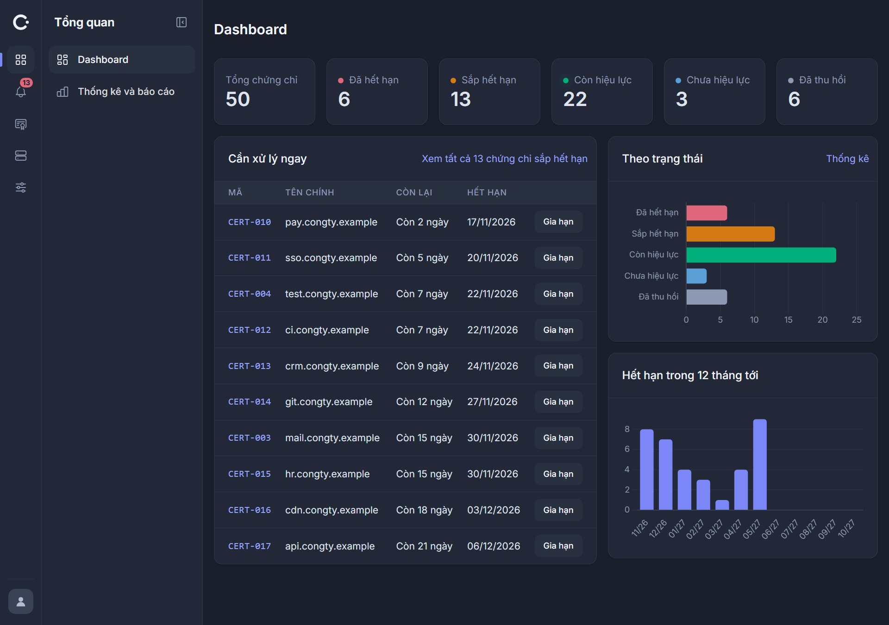
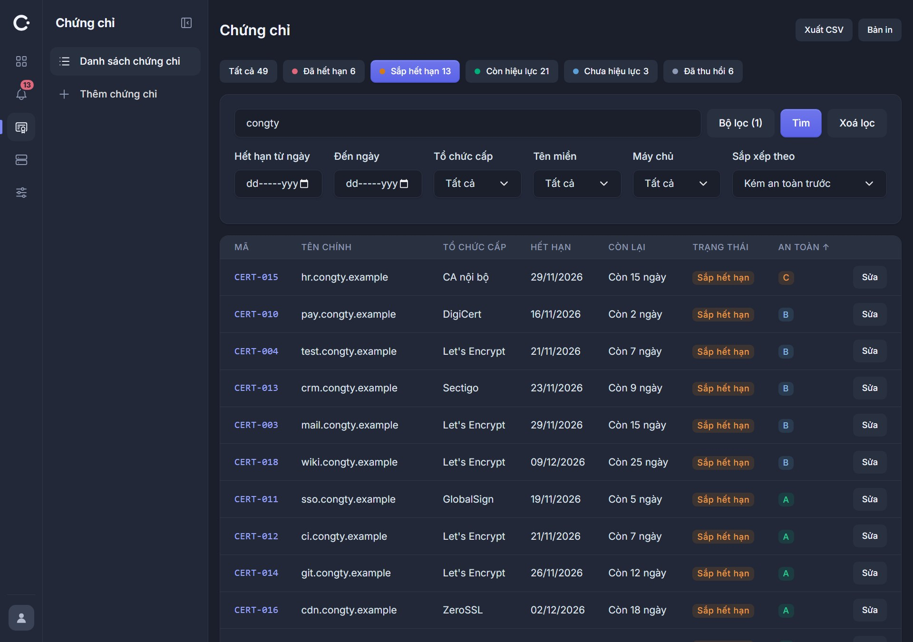
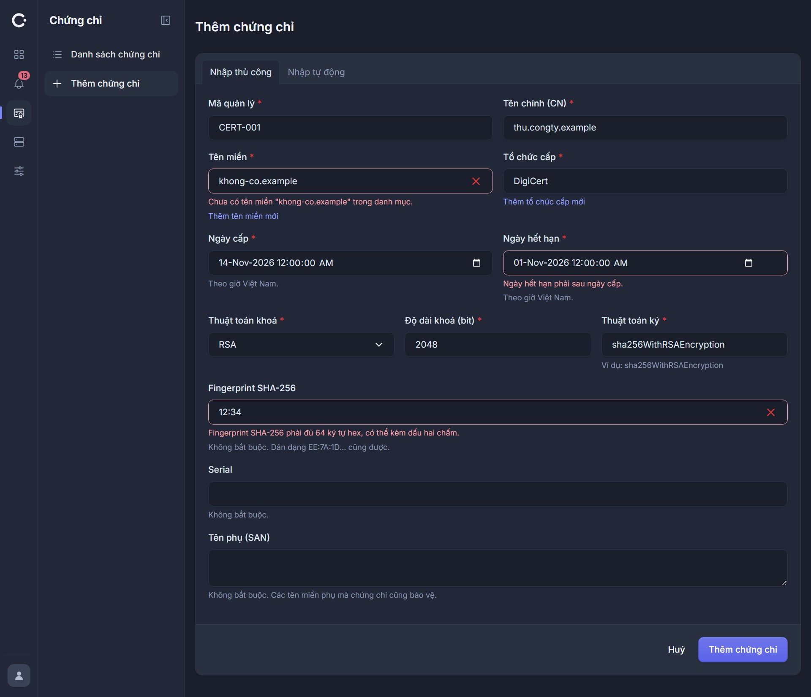
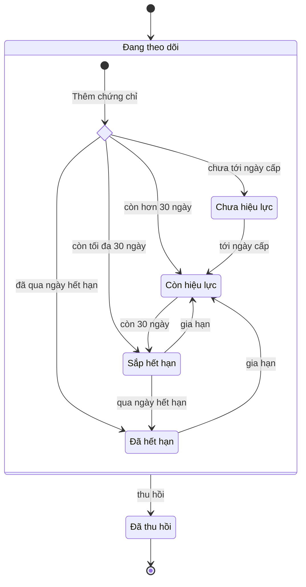
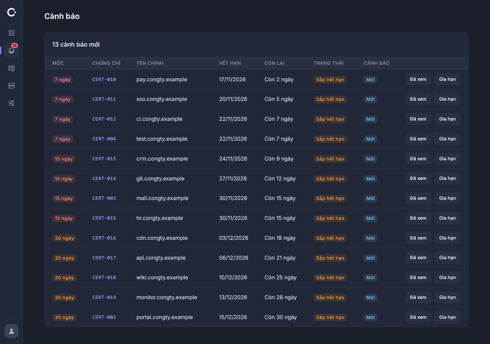
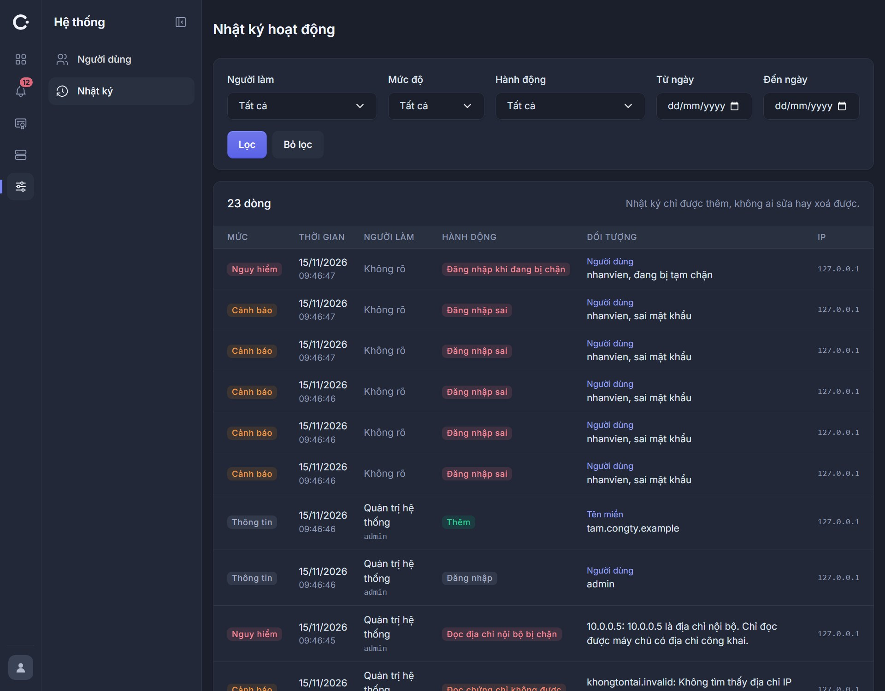
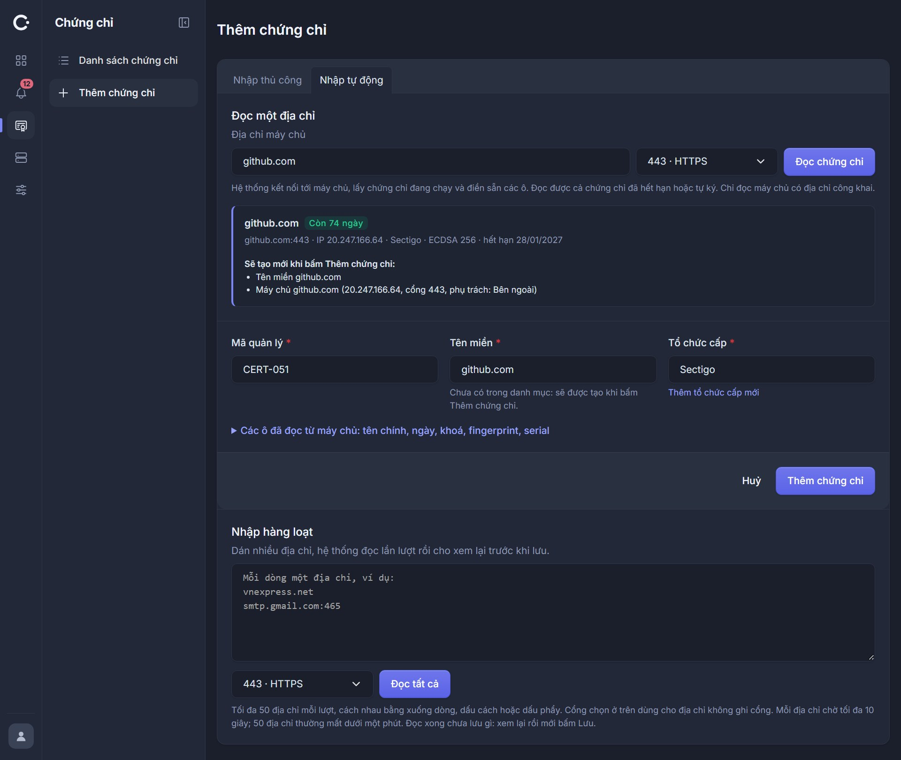
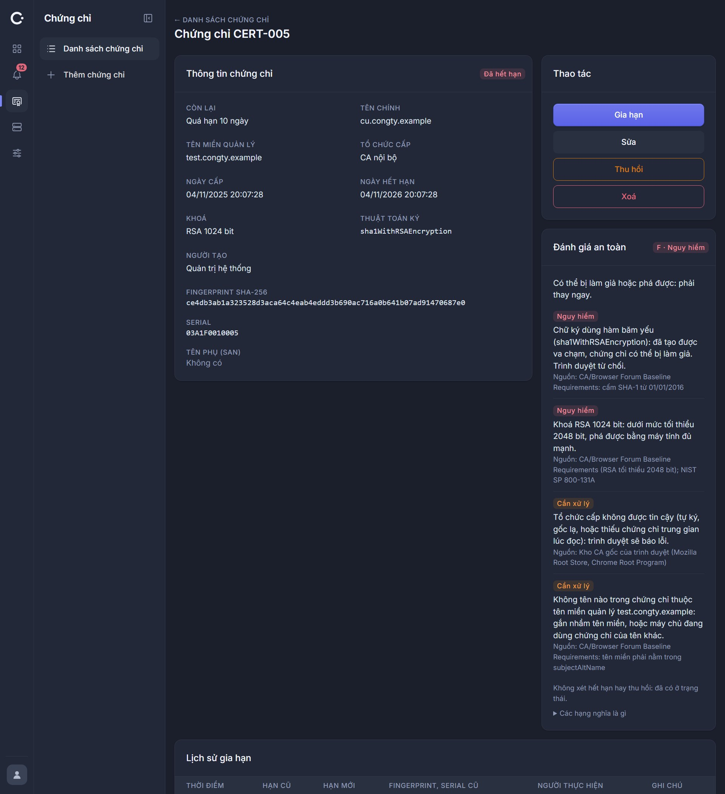
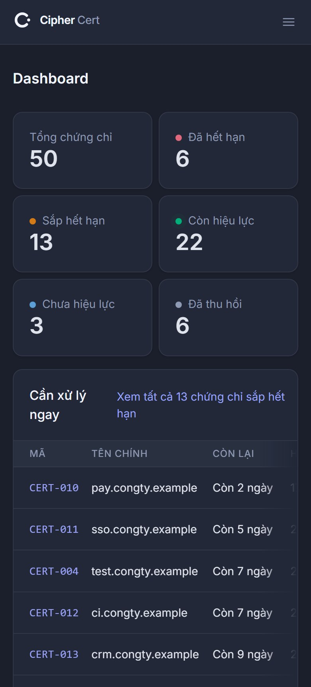

# Đặc tả chức năng: Hệ thống quản lý chứng chỉ số và thời hạn sử dụng

**Đề tài 69.** Quản lý chứng chỉ số SSL/TLS của website, máy chủ và các dịch vụ trong tổ chức: theo dõi
thời hạn, cảnh báo trước khi hết hạn, lưu lịch sử gia hạn, thống kê và xuất báo cáo.

**Tên gọi:** tên đầy đủ trên dùng trong báo cáo, trang giới thiệu và trang đăng nhập; tên ngắn **Cipher Cert**
dùng trên logo, menu và tab trình duyệt.

**Người dùng:** quản trị viên trong tổ chức, xem [USECASE.md](USECASE.md). **Dữ liệu:** xem [ERD.md](ERD.md).
**Code thực hiện từng luồng:** xem mục Luồng xử lý của các chức năng chính trong [BAO_CAO.md](BAO_CAO.md).

Đề yêu cầu 19 chức năng: 9 chức năng riêng của đề (mã D) và 10 chức năng nền tảng (mã N). Hệ thống làm đủ 19
và thêm 3 chức năng mở rộng (mục 8).

## 1. Yêu cầu chức năng nghiệp vụ

| Mã | Chức năng | Người dùng | Đầu vào | Kiểm tra | Kết quả |
|---|---|---|---|---|---|
| D1 | Quản lý danh sách chứng chỉ | Admin, Nhân viên; chỉ Admin được xoá | Mã quản lý, fingerprint, serial, tên chính, tên phụ, tổ chức cấp, tên miền, thuật toán, độ dài khoá. Trang Thêm có 2 tab: Nhập thủ công (mở trước) và Nhập tự động (mục 8.2) | Xem mục 3.1 | Chứng chỉ được thêm, sửa hoặc xoá; danh sách có phân trang |
| D2 | Quản lý tên miền và máy chủ | Admin, Nhân viên; chỉ Admin được xoá | Máy chủ: tên, IP, cổng, môi trường, người phụ trách. Tên miền: tên, máy chủ | Xem mục 3.2 | Bản ghi được thêm, sửa, xoá; danh sách tên miền kèm số chứng chỉ, lọc danh sách chứng chỉ theo tên miền để xem từng cái |
| D3 | Lưu thông tin tổ chức cấp | Admin, Nhân viên; chỉ Admin được xoá | Tên, quốc gia, có được tin cậy không | Tên không trùng; không xoá khi còn chứng chỉ | Danh sách tổ chức cấp để chọn khi thêm chứng chỉ |
| D4 | Quản lý ngày cấp và ngày hết hạn | Admin, Nhân viên | Ngày cấp, ngày hết hạn | Ngày hết hạn phải sau ngày cấp | Hiển thị hai ngày và số ngày còn hiệu lực, tự tính |
| D5 | Theo dõi trạng thái | Admin, Nhân viên | Không nhập; thu hồi bằng nút riêng | Xem mục 4 | Mỗi chứng chỉ có một trạng thái, tự tính khi xem |
| D6 | Cảnh báo sắp hết hạn | Admin, Nhân viên | Đánh dấu đã xem | Xem mục 5 | Danh sách cảnh báo theo mốc 30, 15, 7 ngày, mỗi chứng chỉ một dòng; số cảnh báo mới trên biểu tượng chuông của menu, thấy ở mọi trang |
| D7 | Quản lý lịch sử gia hạn | Admin, Nhân viên | Ngày hết hạn mới, fingerprint và serial mới, ghi chú | Xem mục 6 | Chứng chỉ được cập nhật; thêm một dòng lịch sử giữ thông tin cũ |
| D8 | Thống kê theo trạng thái | Admin, Nhân viên | Khoảng ngày hết hạn, bộ lọc | Giá trị lọc sai bị coi như chưa chọn | Năm biểu đồ Chart.js, mỗi biểu đồ kèm bảng số: theo trạng thái, hết hạn theo tháng (12 tháng, không tính đã thu hồi và đã quá hạn), theo tổ chức cấp, theo thuật toán khoá, theo hạng an toàn. Trần trục số tính trên toàn bộ chứng chỉ, không theo bộ lọc: lọc thì cột ngắn lại trên cùng một thước, so được với lúc chưa lọc |
| D9 | Xuất báo cáo | Admin, Nhân viên | Bộ lọc và cách xếp đang chọn | Giá trị lọc sai bị coi như chưa chọn | File CSV và bản in chỉ gồm bảng số; lấy đủ kết quả, không chia trang. Hai nút Xuất CSV, Bản in nằm ở dòng tiêu đề của trang Danh sách và trang Thống kê |

**Tiêu chí của đề, ánh xạ vào hệ thống:**

| Tiêu chí | Cách đáp ứng |
|---|---|
| Mỗi chứng chỉ có mã quản lý hoặc fingerprint | `cert_code` bắt buộc và không trùng; `fingerprint_sha256` tuỳ chọn, nếu có thì không trùng |
| Tự động tính số ngày còn hiệu lực | View `v_certificates`, cột `days_left` |
| Cảnh báo theo mốc 30, 15, 7 ngày | Bảng `alerts`, quy tắc ở mục 5 |

## 2. Yêu cầu chức năng nền tảng

| Mã | Chức năng | Cách đáp ứng |
|---|---|---|
| Na | Đăng nhập, đăng xuất | Mật khẩu băm bằng `password_hash`; tài khoản bị khoá không đăng nhập được; sai 5 lần thì tạm chặn tài khoản 15 phút; đổi mã phiên sau khi đăng nhập; đổi mật khẩu thì các phiên khác của người đó bị đăng xuất |
| Nb | Quản lý người dùng | Admin thêm, sửa, khoá, mở khoá, xoá và gán vai trò; xem mục 3.3 |
| Nc | CRUD đầy đủ | Chứng chỉ, tên miền, máy chủ, tổ chức cấp, người dùng |
| Nd | Tìm kiếm, lọc | Từ khoá trong mã, tên chính, tên phụ, serial, fingerprint (viết hoa hay có dấu `:` đều tìm được). Lọc theo trạng thái (hàng nút có số đếm), tổ chức cấp, tên miền, máy chủ, khoảng ngày hết hạn. Danh sách mặc định xếp theo mức gấp: đã hết hạn, sắp hết hạn, còn hiệu lực, chưa hiệu lực, đã thu hồi; trong mỗi nhóm, hạn gần hơn đứng trước. Ô **Sắp xếp theo** trong bộ lọc có thêm: mới thêm trước, thêm lâu nhất trước, hết hạn gần nhất trước, hết hạn xa nhất trước, kém an toàn trước, an toàn nhất trước. Bấm tiêu đề cột cũng đổi được cách xếp |
| Ne | Thống kê, báo cáo | Bảng và biểu đồ, xem D8, D9 |
| Nf | Kiểm tra dữ liệu bằng JavaScript và PHP | JavaScript báo lỗi nhanh trên form; PHP kiểm tra lại mọi dữ liệu; ràng buộc CSDL là lớp chặn cuối. Ô ngày nhận cả chữ dán dạng ngày/tháng/năm (ví dụ `24/11/2026 00:00` chép từ Excel) |
| Ng | Khoá chính, khoá ngoại, quan hệ | 9 bảng, xem ERD |
| Nh | Dashboard tổng quan | 6 thẻ số (tổng và từng trạng thái, bấm vào là danh sách đã lọc), bảng Cần xử lý ngay gồm 10 chứng chỉ sắp hết hạn gần nhất (cột Còn lại đứng trước cột Hết hạn), 2 biểu đồ (theo trạng thái, hết hạn trong 12 tháng tới). Chứng chỉ đã quá hạn chỉ hiện ở thẻ số, để chứng chỉ quá hạn lâu không che mất việc còn cứu được |
| Ni | Bảo mật | Xem mục 7 |
| Nj | Dữ liệu mẫu | `database/seed.sql` có 2 tài khoản và 9 chứng chỉ, đủ mọi trạng thái và mốc cảnh báo; `database/seed_demo.sql` nạp nối tiếp để đủ 50 chứng chỉ. Chứng chỉ mẫu của tổ chức cấp công khai có thời hạn tối đa 200 ngày, đúng luật hiện hành; phân bố hạng an toàn là A 25, B 15, C 7, F 3, trong đó C và F là các ví dụ cố ý. Kèm file Excel `DU_LIEU_NHAP_TAY.xlsx` để người chấm tự nhập tay |

## 3. Ràng buộc và quy tắc kiểm tra dữ liệu

### 3.1. Dữ liệu chứng chỉ

| Trường | Quy tắc |
|---|---|
| Mã quản lý | Bắt buộc, tối đa 30 ký tự, không trùng. Form gợi ý sẵn mã kế tiếp, ví dụ `CERT-051` |
| Fingerprint SHA-256 | Không bắt buộc. Bỏ dấu `:` và khoảng trắng, đổi về chữ thường, phải đúng 64 ký tự hex, không trùng |
| Tên chính | Bắt buộc, tối đa 255 ký tự |
| Tổ chức cấp, tên miền | Bắt buộc. Ô gõ có gợi ý, nhưng chỉ nhận tên đã có trong danh mục (không phân biệt hoa thường); tên lạ bị từ chối kèm link thêm vào danh mục. Ngoại lệ duy nhất: đúng tên mà lần đọc chứng chỉ vừa rồi định tạo (mục 8.2) |
| Ngày cấp, ngày hết hạn | Bắt buộc, ngày hết hạn phải sau ngày cấp; bằng nhau cũng bị từ chối |
| Thuật toán khoá, độ dài khoá, thuật toán ký | Bắt buộc; độ dài khoá là số dương |

- Form sửa dùng để sửa thông tin nhập sai và không ghi lịch sử. Chứng chỉ được cấp lại thì phải dùng chức năng Gia hạn.
- Xoá chứng chỉ phải xác nhận, và xoá kèm cảnh báo cùng lịch sử gia hạn của nó. Chỉ Admin được xoá.
- Thu hồi phải xác nhận và không hoàn tác được; dữ liệu vẫn được giữ.
- Chứng chỉ đã thu hồi chỉ còn để tra cứu: không sửa, không gia hạn được, kể cả khi gửi lệnh thẳng tới máy chủ. Nhập sai từ trước khi thu hồi thì Admin xoá rồi thêm lại.
- Chứng chỉ hết hạn trong ngày hôm nay ghi "Hết hạn hôm nay", không ghi "Còn 0 ngày" hay "Quá hạn 0 ngày".

### 3.2. Dữ liệu tên miền, máy chủ và tổ chức cấp

- IP phải là IPv4 hoặc IPv6 hợp lệ. Cổng từ 1 đến 65535. Môi trường là `production`, `staging` hoặc `development`.
- Tên miền đúng định dạng (được dùng dạng `*.congty.vn`), lưu chữ thường và không trùng. Tên tổ chức cấp không trùng.
- Máy chủ còn tên miền, tên miền hay tổ chức cấp còn chứng chỉ thì không xoá được; hệ thống báo rõ lý do.
- Chỉ Admin xoá được máy chủ, tên miền, tổ chức cấp. Nhân viên không thấy nút Xoá, tự gửi lệnh xoá cũng bị từ chối với câu "Chỉ Admin được xoá danh mục. Bạn vẫn có thể sửa."

### 3.3. Dữ liệu người dùng

- Tên đăng nhập bắt buộc, 3–50 ký tự gồm chữ không dấu, số, dấu chấm, gạch dưới, gạch ngang; không trùng giữa các tài khoản còn dùng (không phân biệt hoa thường).
- Mật khẩu mới phải có ít nhất 8 ký tự, gồm cả chữ và số, tối đa 72 ký tự. Luật này áp cho mật khẩu đặt mới. Admin đặt lại được mật khẩu cho người khác mà không cần mật khẩu cũ, vì hệ thống không có chức năng quên mật khẩu.
- Đổi mật khẩu phải nhập đúng mật khẩu cũ. Đổi xong, các phiên đăng nhập khác của người đó bị đẩy ra; phiên đang đổi giữ nguyên.
- Mở khoá thì xoá luôn trạng thái tạm chặn do nhập sai mật khẩu.
- Xoá người dùng là đánh dấu đã xoá: tài khoản không đăng nhập được nữa, biến khỏi danh sách, phiên đang mở bị đẩy ra. Nhật ký, chứng chỉ, lịch sử gia hạn vẫn giữ tên người đó kèm chữ "(đã xoá)". Tên đăng nhập của tài khoản đã xoá dùng lại được cho tài khoản mới.
- Admin không tự khoá, tự xoá, hay tự đổi vai trò của mình, để hệ thống luôn còn ít nhất một Admin.

## 4. Mô hình trạng thái của chứng chỉ

Hệ thống xét lần lượt từ trên xuống và lấy dòng đầu tiên đúng:

| Trạng thái | Điều kiện | Vì sao ở vị trí này |
|---|---|---|
| Đã thu hồi | Đã bấm thu hồi | Dù còn hạn cũng không được tin |
| Chưa hiệu lực | Chưa tới ngày cấp | Chưa dùng được |
| Đã hết hạn | Đã qua ngày hết hạn | |
| Sắp hết hạn | Còn tối đa 30 ngày | |
| Còn hiệu lực | Các trường hợp còn lại | |

Trạng thái và số ngày không lưu trong bảng, mà tính mỗi lần đọc, nên luôn đúng theo ngày hiện tại.

Sơ đồ trạng thái UML: mũi tên là điều làm chứng chỉ đổi trạng thái. Thời gian trôi tự đẩy chứng chỉ sang
trạng thái sau; người dùng chỉ tác động bằng hai việc: gia hạn và thu hồi. Bốn trạng thái còn theo dõi được
gom vào trạng thái lớn "Đang theo dõi", vì từ trạng thái nào trong đó cũng thu hồi được. Hình thoi là chỗ rẽ
nhánh: chứng chỉ thêm vào rơi thẳng vào trạng thái đúng với ngày của nó.

Gia hạn mà hạn mới vẫn còn tối đa 30 ngày thì chứng chỉ ở lại Sắp hết hạn. Đã thu hồi là trạng thái cuối:
không gia hạn, không sửa, không hoàn tác được.

## 5. Quy tắc cảnh báo hết hạn

- Chỉ tạo cảnh báo cho chứng chỉ ở trạng thái **Sắp hết hạn**.
- Tạo theo **mốc gần nhất** đã chạm: còn tối đa 7 ngày là mốc 7, tối đa 15 ngày là mốc 15, tối đa 30 ngày là mốc 30. Ví dụ thêm một chứng chỉ còn 5 ngày thì chỉ tạo cảnh báo mốc 7.
- Mỗi mốc chỉ tạo một lần trong một chu kỳ. Sau khi gia hạn, ngày hết hạn đổi nên các mốc được tính lại từ đầu.
- Việc tạo cảnh báo chạy khi mở Dashboard hoặc trang Cảnh báo. Cảnh báo chỉ hiển thị trong hệ thống, nên chỉ cần tạo khi có người xem.
- Trang Cảnh báo và con số trên chuông chỉ tính **một cảnh báo cho mỗi chứng chỉ**: mốc gấp nhất trong chu kỳ hiện tại. Chứng chỉ đi từ mốc 15 xuống mốc 7 thì chỉ còn hiện dòng mốc 7. Cảnh báo cũ vẫn được giữ trong CSDL.
- Chứng chỉ đã hết hạn vẫn hiện cảnh báo, vì đó là trường hợp gấp nhất. Chứng chỉ đã thu hồi thì không hiện, vì không còn việc gì để xử lý.
- "Đã xem" tính chung cho mọi người dùng: một người đánh dấu thì mọi người đều thấy là đã xem.

## 6. Quy tắc gia hạn

- Chặn gia hạn chứng chỉ đã thu hồi; muốn dùng lại thì thêm chứng chỉ mới.
- Ngày hết hạn mới phải sau ngày hết hạn hiện tại và sau thời điểm gia hạn. Được gia hạn chứng chỉ đã hết hạn.
- Fingerprint và serial mới là tuỳ chọn, cùng quy tắc ở mục 3.1. Để trống thì chứng chỉ hiện "Chưa có", vì giá trị cũ không còn đúng với chứng chỉ mới; giá trị cũ vẫn nằm trong lịch sử.
- Gia hạn không đổi ngày cấp. Cần sửa ngày này thì dùng form Sửa; thay đổi đó không ghi vào lịch sử gia hạn.
- Lưu lịch sử và cập nhật chứng chỉ nằm trong một giao dịch: lỗi ở bước nào thì không bước nào có hiệu lực.

## 7. Yêu cầu phi chức năng: bảo mật và vận hành

| Nội dung | Cách làm |
|---|---|
| SQL Injection | Mọi truy vấn có dữ liệu người dùng đều dùng Prepared Statements qua PDO; tên cột để sắp xếp chỉ lấy từ danh sách viết sẵn |
| Phân quyền | Kiểm tra trong PHP ở mọi yêu cầu, không chỉ ẩn nút |
| Dò mật khẩu | Sai 5 lần thì tạm chặn tài khoản 15 phút; sai tên hay sai mật khẩu đều báo cùng một câu |
| Mật khẩu | Lưu dạng băm; mật khẩu mới ít nhất 8 ký tự gồm cả chữ và số |
| Phiên | Cookie `HttpOnly`, `SameSite=Lax`, `Secure` khi chạy HTTPS; đổi mã phiên sau khi đăng nhập; đọc lại người dùng ở mỗi yêu cầu nên người bị khoá, bị xoá hay vừa đổi mật khẩu ở nơi khác bị đẩy ra ngay |
| Mượn máy chủ dò mạng nội bộ (SSRF) | Đọc chứng chỉ thật chỉ kết nối tới địa chỉ công khai và cổng TLS trong danh sách, xem mục 8.2 |
| Lộ file nguồn | Trên máy chủ thật, web chỉ mở thư mục `public/`; `src/`, `config/`, `database/` không truy cập được từ trình duyệt |
| Giả mạo yêu cầu (CSRF) | Thao tác thay đổi dữ liệu dùng POST kèm mã xác thực |
| Chèn mã độc (XSS) | Dữ liệu hiển thị đều qua `htmlspecialchars`; máy chủ thật gửi thêm header Content-Security-Policy chỉ cho chạy script của chính web |
| Header bảo mật của máy chủ thật | Strict-Transport-Security (luôn dùng HTTPS), Content-Security-Policy, X-Frame-Options, X-Content-Type-Options, Referrer-Policy |
| Báo cáo CSV | Có BOM UTF-8 để Excel hiển thị đúng tiếng Việt; ô bắt đầu bằng `=`, `+`, `-`, `@` được vô hiệu hoá để không chạy thành công thức |
| Múi giờ | `Asia/Ho_Chi_Minh` cho PHP và `+07:00` cho CSDL, đặt trong code |

## 8. Các chức năng mở rộng

Ngoài yêu cầu của đề, làm sau khi đủ 19 chức năng.

| Chức năng | Mô tả |
|---|---|
| Mở rộng 1: Nhật ký hoạt động | Ai làm gì, lúc nào, từ IP nào, ở mức nào; không ai sửa hay xoá được nhật ký (chi tiết ở 8.1) |
| Mở rộng 2: Đọc chứng chỉ thật | Gõ tên miền (hoặc dán tối đa 50 địa chỉ), hệ thống kết nối tới máy chủ, đọc chứng chỉ rồi tự điền form Thêm; chặn địa chỉ nội bộ (chi tiết ở 8.2) |
| Mở rộng 3: Chấm hạng an toàn | Mỗi chứng chỉ có hạng A, B, C hoặc F theo lỗi nặng nhất; mỗi phát hiện ghi nguồn quy định (chi tiết ở 8.3) |

### 8.1. Nhật ký hoạt động

- **Ghi những gì:** thêm, sửa, xoá chứng chỉ, máy chủ, tên miền, tổ chức cấp, người dùng; gia hạn và thu hồi chứng chỉ; khoá, mở khoá người dùng; đổi mật khẩu, đổi họ tên; đăng nhập, đăng xuất, đăng nhập sai (sai tên, sai mật khẩu, tài khoản đã khoá), đăng nhập khi tài khoản đang bị tạm chặn; đọc chứng chỉ từ máy chủ, đọc được hay không cũng ghi, để biết ai đã cho máy chủ kết nối đi đâu.
- **Mỗi dòng gồm:** mức, thời điểm, người làm (để trống khi đăng nhập sai, vì chưa biết là ai), hành động, loại và mã đối tượng, tên đối tượng lúc đó (vẫn đọc được sau khi đối tượng bị xoá), địa chỉ IP thật của khách. IP lấy từ máy chủ web, không đọc header `X-Forwarded-For` vì khách tự gõ được header đó để giả IP.
- **Ba mức**, tính từ mã hành động, không lưu cột riêng:

| Mức | Hành động | Vì sao |
|---|---|---|
| Thông tin | Thêm, sửa, gia hạn, mở khoá, đổi mật khẩu, đăng nhập, đăng xuất, đọc chứng chỉ được | Việc bình thường hằng ngày |
| Cảnh báo | Đăng nhập sai, đọc chứng chỉ không được, khoá người dùng, thu hồi chứng chỉ | Cần để mắt: có thể là nhầm, có thể là dấu hiệu sớm |
| Nguy hiểm | Xoá; đăng nhập khi đang bị tạm chặn; đọc địa chỉ nội bộ bị chặn | Không hoàn tác được, hoặc là dấu hiệu dò mật khẩu, mượn web dò mạng nội bộ |

- **Ghi ở đâu:** ngay trong các hàm xử lý dữ liệu, sau khi thao tác thành công; gia hạn ghi trong cùng giao dịch. Nhờ vậy không trang nào quên ghi.
- **Ai xem:** chỉ Admin, ở trang Nhật ký: lọc theo người làm (kể cả người đã xoá), mức độ, hành động, khoảng ngày; 50 dòng một trang; đối tượng còn tồn tại thì có link tới nó.
- **Không sửa, xoá được:** web không có chức năng này, và CSDL có trigger từ chối mọi lệnh `UPDATE`, `DELETE` trên bảng nhật ký, kể cả lệnh gõ thẳng vào CSDL. Giới hạn: người quản trị CSDL vẫn dọn được cả bảng bằng `TRUNCATE` hoặc gỡ trigger; bảng trống trơn thì nhìn là biết đã bị dọn.
- **Bản in ra màn hình:** khi chạy trên máy bằng `CHAY_WEB.bat`, cửa sổ đen in mỗi trang được mở một dòng (giờ, cách gửi, địa chỉ, mã trả về, thời gian xử lý, người dùng) và mỗi thao tác một dòng mở đầu bằng `[THONG TIN]`, `[CANH BAO]` hoặc `[NGUY HIEM]`. Trên máy chủ thật không in gì ra màn hình.

### 8.2. Thu thập chứng chỉ trực tiếp từ máy chủ

- **Ở đâu:** trang Thêm chứng chỉ có 2 tab. Tab **Nhập thủ công** mở trước, là form trống. Tab **Nhập tự động** có
  khung **Đọc một địa chỉ** ở trên và khung **Nhập hàng loạt** ở dưới. Form Sửa chỉ có nhập thủ công. Đọc một địa
  chỉ không cần JavaScript: nút Đọc gửi form về chính trang đó.
- **Nhập:** tên miền hoặc IP, có thể kèm `https://`, `:cổng`, đường dẫn; cổng chọn trong danh sách. Cổng gõ kèm
  địa chỉ thắng cổng chọn.
- **Cổng được phép:** 443, 8443, 9443 (HTTPS), 465 (SMTP qua TLS), 993 (IMAP), 995 (POP3), 636 (LDAP), 853 (DNS qua
  TLS), 5061 (SIP). Cổng khác bị từ chối, để không ai dùng hệ thống quét cổng tuỳ ý. Không có cổng 25, 587 vì
  phải nói giao thức thư trước khi bắt tay TLS.
- **Chặn địa chỉ nội bộ:** tra DNS lấy mọi IP; **bất kỳ** IP nào là nội bộ (loopback, mạng riêng, link-local,
  dải dành riêng, CGNAT, kể cả IPv4 giấu trong IPv6 như `::ffff:127.0.0.1`) thì từ chối. Sau đó kết nối tới
  đúng IP vừa kiểm, không tra DNS lần hai, để kẻ xấu không kịp đổi tên miền sang `127.0.0.1` giữa hai lần tra.
- **Đọc gì:** tên chính (không có CN thì lấy tên phụ đầu tiên), tên phụ, ngày cấp và ngày hết hạn theo giờ Việt
  Nam, thuật toán khoá (RSA, ECDSA; loại khác để trống cho người dùng chọn), độ dài khoá, thuật toán ký,
  fingerprint SHA-256, serial. Chứng chỉ hết hạn, tự ký, sai tên vẫn đọc được, vì đó là thứ cần theo dõi.
- **Tự lo danh mục:** đọc xong, thẻ tóm tắt ghi "Sẽ tạo mới khi bấm Thêm chứng chỉ: …"; bấm Thêm thì tạo phần còn
  thiếu cùng chứng chỉ trong một giao dịch. Đọc rồi bỏ thì không tạo gì.
  - *Tên miền:* trùng hẳn, hoặc tên miền cha dài nhất, thì dùng luôn cùng máy chủ của nó. Chưa có thì tạo.
  - *Máy chủ:* chỉ tìm khi tên miền mới: trùng IP với máy chủ có sẵn thì dùng chung, không thì tạo (tên = tên miền,
    IP và cổng vừa đọc, môi trường Đang chạy thật, người phụ trách = tổ chức ghi trong chứng chỉ).
  - *IP đổi:* chứng chỉ gắn với tên miền, không với IP; site dùng CDN đổi IP theo phút. Tên miền đã có mà IP lúc
    đọc khác thì chỉ ghi chú, kèm nút **Cập nhật IP máy chủ**. Không có gì chạy ngầm để dò IP.
  - *Tổ chức cấp ở tầng hãng:* YE1, R10, WE2 là chứng chỉ trung gian, không phải hãng. Các cách viết của một hãng
    gộp về một tên gọn (GlobalSign nv-sa → GlobalSign, SSL Corp → SSL.com, COMODO → Sectigo); hãng lạ giữ nguyên.
    Hãng có sẵn (tên gọn hoặc tên gốc) thì dùng lại, không đổi mức tin cậy người dùng đã đặt.
  - *Tin cậy* của hãng mới: có chứng chỉ bên cấp trong chuỗi kiểm được với kho CA gốc của máy. Tự ký, gốc lạ thì
    ra không tin cậy.
- **Nhập hàng loạt:** dán tối đa 50 địa chỉ (xuống dòng, dấu cách hoặc phẩy). Hệ thống đọc lần lượt, có thanh tiến
  trình ghi "Đã đọc 3/4: …" khi trình duyệt bật JavaScript (50 site thật mất 41 giây, đo 09/11/2026), rồi hiện bảng
  xem trước: đọc được, trùng chứng chỉ đã có, cùng chứng chỉ với dòng phía trên, lỗi vì sao. Dòng lưu được tick sẵn;
  bấm Lưu thì thêm các dòng đã tick. Kết quả đọc giữ trong phiên, bước Lưu chỉ nhận số thứ tự dòng, nên không gửi
  được dữ liệu giả.
- **Báo trùng:** chứng chỉ vừa đọc đã có trong hệ thống (cùng fingerprint) thì báo ngay kèm link, trước khi bấm Lưu.
- **Giới hạn:** chờ tối đa 10 giây mỗi địa chỉ (máy chủ ở xa có khi bắt tay mất tới 5 giây). Không đọc được qua
  STARTTLS. Chỉ điền form, người dùng vẫn phải kiểm tra rồi bấm Thêm; mọi quy tắc ở mục 3.1 vẫn áp dụng.

### 8.3. Đánh giá xếp hạng an toàn

- **Hạng chữ theo lỗi nặng nhất**, không cộng trừ điểm: F nguy hiểm, C cần xử lý, B lưu ý, không vướng gì là A.
  Hạng chữ thay cho điểm 0–100 vì cộng trừ điểm không biện minh được ("vì sao lỗi này trừ 10?"). Thang lấy theo
  SSL Labs, không có hạng D.
- **Mỗi tiêu chí lấy từ quy định có thật** và ghi nguồn ngay cạnh phát hiện, để người xem tự kiểm:

| Mức | Phát hiện | Nguồn |
|---|---|---|
| F | Chữ ký dùng hàm băm yếu SHA-1, MD5 | CA/Browser Forum Baseline Requirements: cấm SHA-1 từ 01/01/2016 |
| F | Khoá RSA dưới 2048 bit | Baseline Requirements; NIST SP 800-131A |
| F | Khoá ECDSA dưới 256 bit | Baseline Requirements (P-256, P-384, P-521) |
| C | Tổ chức cấp không được tin cậy (tự ký, gốc lạ, thiếu chứng chỉ trung gian lúc đọc) | Kho CA gốc của trình duyệt (Mozilla Root Store, Chrome Root Program) |
| C | Không tên nào trong chứng chỉ thuộc tên miền quản lý (tên miền con và wildcard phủ một tầng vẫn tính là thuộc) | Baseline Requirements: tên miền phải nằm trong subjectAltName |
| C | Thời hạn dài hơn mức tối đa ở ngày cấp: 825 ngày từ 01/03/2018, 398 từ 01/09/2020, 200 từ 15/03/2026, 100 từ 15/03/2027, 47 từ 15/03/2029 | Baseline Requirements; ballot SC-081v3 |
| B | Khoá RSA 2048–3071 bit: đủ an toàn tới hết 2030 | NIST SP 800-57 phần 1 và SP 800-131A |
| B | Thuật toán GOST: chuẩn mật mã Nga, trình duyệt phổ thông không mở được | GOST R 34.10-2012, GOST R 34.11-2012 |
| Ghi chú | Chứng chỉ wildcard: lộ khoá thì mọi tên miền con cùng bị ảnh hưởng. Không hạ hạng | Khuyến nghị chung |

- **Không trộn với trạng thái:** hạng không xét hết hạn, sắp hết hạn hay thu hồi, vì đã có trạng thái riêng; xét
  nữa là tính một lỗi hai lần.
- **Tính lúc xem** từ các cột đã có, không lưu, nên không bao giờ cũ và không cần thêm bảng.
- **Hiện ở đâu:** thẻ Đánh giá an toàn ở trang chi tiết (hạng, từng phát hiện kèm nguồn, mục "Các hạng nghĩa là
  gì"); cột An toàn ở Danh sách, có chú giải dưới bảng, xếp được theo hạng; biểu đồ Theo hạng an toàn ở Thống kê.

## 9. Yêu cầu giao diện người dùng

- **Chỉ có giao diện tối.** Khu quản trị nền xám xanh, dịu mắt khi dùng cả ngày; trang giới thiệu và trang đăng
  nhập nền đen xanh. Bản in luôn nền trắng chữ tối.
- **Menu hai tầng** bên trái. Thanh khu gồm: Tổng quan (Dashboard, Thống kê và báo cáo), Cảnh báo (một trang, số
  cảnh báo mới hiện trên biểu tượng chuông), Chứng chỉ (Danh sách chứng chỉ, Thêm chứng chỉ), Hạ tầng (Tên miền,
  Máy chủ, Tổ chức cấp), Hệ thống (Người dùng, Nhật ký; chỉ Admin thấy). Biểu tượng tài khoản ở đáy thanh mở
  menu Tài khoản và mật khẩu, Đăng xuất. Trên điện thoại menu là ngăn kéo trượt từ phải.
- **Màu trạng thái** dùng một bộ: xanh lá là còn hiệu lực, cam là sắp hết hạn, đỏ là đã hết hạn, xanh dương là chưa
  hiệu lực, xám là đã thu hồi.
- **Điện thoại:** mọi trang dùng được ở độ rộng 390px; bảng hiện đủ cột và kéo ngang được, mép bảng mờ dần ở phía
  còn cột.
- **Trang giới thiệu** (`index.php`) cho khách chưa đăng nhập: giới thiệu hệ thống bằng ảnh chụp thật của giao
  diện và một thẻ chứng chỉ tự chạy qua các mốc 30, 15, 7 ngày; có nút Đăng nhập. Đăng xuất xong cũng về trang này.
- **Logo "vòng thời hạn":** vòng gần kín vừa là chữ C, vừa là vòng đếm ngược; chấm ở chỗ hở là ngày hết hạn đang tới.
- **Tab trình duyệt** ghi "Tên trang | Cipher Cert".

**Ngoài phạm vi:** tự gia hạn qua ACME, quét cả dải mạng, xác thực hai lớp, gửi cảnh báo qua email.
