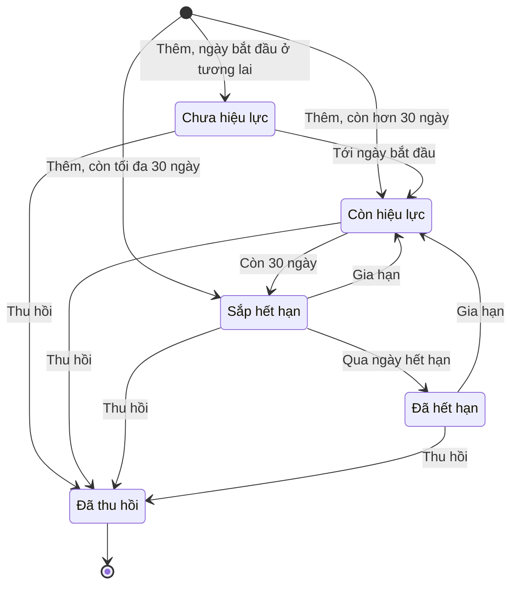

# Đặc tả chức năng — Hệ thống quản lý chứng chỉ số và thời hạn sử dụng

**Đề tài 69.** Quản lý chứng chỉ số SSL/TLS của website, máy chủ và các dịch vụ trong tổ chức: theo dõi
thời hạn, cảnh báo trước khi hết hạn, lưu lịch sử gia hạn, thống kê và xuất báo cáo.

**Tên gọi:** tên đầy đủ trên dùng trong báo cáo, trang giới thiệu và trang đăng nhập; tên ngắn **Cipher Cert**
dùng trên logo, menu và tab trình duyệt.

**Người dùng:** quản trị viên trong tổ chức, xem [USECASE.md](USECASE.md). **Dữ liệu:** xem [ERD.md](ERD.md).
**Code thực hiện từng luồng:** xem [README mục 5](../README.md#5-sổ-tay-mỗi-luồng-chính-chạy-qua-đâu).

Đề yêu cầu 19 chức năng: 9 chức năng riêng của đề (mã D) và 10 chức năng nền tảng (mã N).

## 1. Chức năng riêng của đề

| Mã | Chức năng | Người dùng | Đầu vào | Kiểm tra | Kết quả |
|---|---|---|---|---|---|
| D1 | Quản lý danh sách chứng chỉ | Admin, Nhân viên; chỉ Admin được xoá | Mã quản lý, fingerprint, serial, tên chính, tên phụ, tổ chức cấp, tên miền, thuật toán, độ dài khoá. Form Thêm có 2 tab: Đọc từ máy chủ (mục 8.2) và Nhập thủ công | Xem mục 3.1 | Chứng chỉ được thêm, sửa hoặc xoá; danh sách có phân trang |
| D2 | Quản lý tên miền và máy chủ | Admin, Nhân viên | Máy chủ: tên, IP, cổng, môi trường, người phụ trách. Tên miền: tên, máy chủ | Xem mục 3.2 | Bản ghi được thêm, sửa, xoá; danh sách tên miền kèm số chứng chỉ, lọc danh sách chứng chỉ theo tên miền để xem từng cái |
| D3 | Lưu thông tin tổ chức cấp | Admin, Nhân viên | Tên, quốc gia, có được tin cậy không | Tên không trùng; không xoá khi còn chứng chỉ | Danh sách tổ chức cấp để chọn khi thêm chứng chỉ |
| D4 | Quản lý ngày cấp và ngày hết hạn | Admin, Nhân viên | Ngày bắt đầu, ngày hết hạn | Ngày hết hạn phải sau ngày bắt đầu | Hiển thị hai ngày và số ngày còn hiệu lực, tự tính |
| D5 | Theo dõi trạng thái | Admin, Nhân viên | Không nhập; thu hồi bằng nút riêng | Xem mục 4 | Mỗi chứng chỉ có một trạng thái, tự tính khi xem |
| D6 | Cảnh báo sắp hết hạn | Admin, Nhân viên | Đánh dấu đã xem | Xem mục 5 | Danh sách cảnh báo theo mốc 30, 15, 7 ngày; số cảnh báo mới cạnh mục Cảnh báo trên menu, thấy ở mọi trang |
| D7 | Quản lý lịch sử gia hạn | Admin, Nhân viên | Ngày hết hạn mới, fingerprint và serial mới, ghi chú | Xem mục 6 | Chứng chỉ được cập nhật; thêm một dòng lịch sử giữ thông tin cũ |
| D8 | Thống kê theo trạng thái | Admin, Nhân viên | Khoảng ngày hết hạn, bộ lọc | Giá trị lọc sai bị coi như chưa chọn | Bốn biểu đồ Chart.js, mỗi biểu đồ kèm bảng số: theo trạng thái, hết hạn theo tháng (12 tháng, không tính đã thu hồi và đã quá hạn), theo tổ chức cấp, theo thuật toán khoá. Trần trục số tính trên toàn bộ chứng chỉ, không theo bộ lọc: lọc thì cột ngắn lại trên cùng một thước, so được với lúc chưa lọc |
| D9 | Xuất báo cáo | Admin, Nhân viên | Bộ lọc đang chọn | Giá trị lọc sai bị coi như chưa chọn | File CSV và bản in chỉ gồm bảng số; lấy đủ kết quả, không chia trang |

**Tiêu chí của đề, ánh xạ vào hệ thống:**

| Tiêu chí | Cách đáp ứng |
|---|---|
| Mỗi chứng chỉ có mã quản lý hoặc fingerprint | `cert_code` bắt buộc và không trùng; `fingerprint_sha256` tuỳ chọn, nếu có thì không trùng |
| Tự động tính số ngày còn hiệu lực | View `v_certificates`, cột `days_left` |
| Cảnh báo theo mốc 30, 15, 7 ngày | Bảng `alerts`, quy tắc ở mục 5 |

## 2. Chức năng nền tảng

| Mã | Chức năng | Cách đáp ứng |
|---|---|---|
| Na | Đăng nhập, đăng xuất | Mật khẩu băm bằng `password_hash`; tài khoản bị khoá không đăng nhập được; sai 5 lần thì tạm chặn tài khoản 15 phút; đổi mã phiên sau khi đăng nhập |
| Nb | Quản lý người dùng | Admin thêm, sửa, khoá, mở khoá, xoá và gán vai trò; xem mục 3.3 |
| Nc | CRUD đầy đủ | Chứng chỉ, tên miền, máy chủ, tổ chức cấp, người dùng |
| Nd | Tìm kiếm, lọc | Từ khoá trong mã, tên chính, tên phụ, serial, fingerprint (viết hoa hay có dấu `:` đều tìm được). Lọc theo trạng thái (hàng nút có số đếm), tổ chức cấp, tên miền, máy chủ, khoảng ngày hết hạn. Danh sách mặc định xếp theo mức gấp: đã hết hạn, sắp hết hạn, còn hiệu lực, chưa hiệu lực, đã thu hồi; trong mỗi nhóm, hạn gần hơn đứng trước. Bấm tiêu đề cột để đổi cách xếp |
| Ne | Thống kê, báo cáo | Bảng và biểu đồ, xem D8, D9 |
| Nf | Kiểm tra dữ liệu bằng JavaScript và PHP | JavaScript báo lỗi nhanh trên form; PHP kiểm tra lại mọi dữ liệu; ràng buộc CSDL là lớp chặn cuối |
| Ng | Khoá chính, khoá ngoại, quan hệ | 9 bảng, xem ERD |
| Nh | Dashboard tổng quan | 6 thẻ số (tổng và từng trạng thái, bấm vào là danh sách đã lọc), bảng Cần xử lý ngay gồm 10 chứng chỉ sắp hết hạn gần nhất, 2 biểu đồ (theo trạng thái, hết hạn trong 12 tháng tới). Chứng chỉ đã quá hạn chỉ hiện ở thẻ số, để chứng chỉ quá hạn lâu không che mất việc còn cứu được. Số cảnh báo mới nằm cạnh mục Cảnh báo trên menu |
| Ni | Bảo mật | Xem mục 7 |
| Nj | Dữ liệu mẫu | `database/seed.sql` có 9 chứng chỉ, đủ mọi trạng thái và mốc cảnh báo; `database/seed_demo.sql` nạp nối tiếp để đủ 50 chứng chỉ |

## 3. Quy tắc kiểm tra dữ liệu

### 3.1. Chứng chỉ

| Trường | Quy tắc |
|---|---|
| Mã quản lý | Bắt buộc, tối đa 30 ký tự, không trùng |
| Fingerprint SHA-256 | Không bắt buộc. Bỏ dấu `:` và khoảng trắng, đổi về chữ thường, phải đúng 64 ký tự hex, không trùng |
| Tên chính | Bắt buộc, tối đa 255 ký tự |
| Tổ chức cấp, tên miền | Bắt buộc. Ô gõ có gợi ý, nhưng chỉ nhận tên đã có trong danh mục (không phân biệt hoa thường); tên lạ bị từ chối kèm link thêm vào danh mục, hệ thống không tự tạo |
| Ngày bắt đầu, ngày hết hạn | Bắt buộc, ngày hết hạn phải sau ngày bắt đầu |
| Thuật toán khoá, độ dài khoá, thuật toán ký | Bắt buộc; độ dài khoá là số dương |

- Form sửa dùng để sửa thông tin nhập sai và không ghi lịch sử. Chứng chỉ được cấp lại thì phải dùng chức năng Gia hạn.
- Xoá chứng chỉ phải xác nhận, và xoá kèm cảnh báo cùng lịch sử gia hạn của nó.
- Thu hồi phải xác nhận và không hoàn tác được; dữ liệu vẫn được giữ.

### 3.2. Tên miền, máy chủ

- IP phải là IPv4 hoặc IPv6 hợp lệ. Cổng từ 1 đến 65535. Môi trường là `production`, `staging` hoặc `development`.
- Tên miền đúng định dạng và không trùng.
- Máy chủ còn tên miền, tên miền còn chứng chỉ thì không xoá được; hệ thống báo rõ lý do.

### 3.3. Người dùng

- Tên đăng nhập bắt buộc, 3–50 ký tự gồm chữ không dấu, số, dấu chấm, gạch dưới, gạch ngang; không trùng.
- Mật khẩu 8–72 ký tự. Admin đặt lại được mật khẩu cho người khác mà không cần mật khẩu cũ, vì hệ thống không có chức năng quên mật khẩu.
- Mở khoá thì xoá luôn trạng thái tạm chặn do nhập sai mật khẩu.
- Người dùng đã có lịch sử thao tác không xoá được, chỉ khoá được; hệ thống báo rõ lý do. Người chưa có lịch sử thì xoá được.
- Admin không tự khoá, tự xoá, hay tự đổi vai trò của mình, để hệ thống luôn còn ít nhất một Admin.
- Đổi mật khẩu phải nhập đúng mật khẩu cũ.

## 4. Trạng thái chứng chỉ

Hệ thống xét lần lượt từ trên xuống và lấy dòng đầu tiên đúng:

| Trạng thái | Điều kiện | Vì sao ở vị trí này |
|---|---|---|
| Đã thu hồi | Đã bấm thu hồi | Dù còn hạn cũng không được tin |
| Chưa hiệu lực | Chưa tới ngày bắt đầu | Chưa dùng được |
| Hết hạn | Đã qua ngày hết hạn | |
| Sắp hết hạn | Còn tối đa 30 ngày | |
| Còn hiệu lực | Các trường hợp còn lại | |

Trạng thái và số ngày không lưu trong bảng, mà tính mỗi lần đọc, nên luôn đúng theo ngày hiện tại.

Sơ đồ trạng thái UML: mũi tên là điều làm chứng chỉ đổi trạng thái. Thời gian trôi tự đẩy chứng chỉ sang
trạng thái sau; người dùng chỉ tác động bằng hai việc: gia hạn và thu hồi.

Gia hạn mà hạn mới vẫn còn tối đa 30 ngày thì chứng chỉ ở lại Sắp hết hạn. Đã thu hồi là trạng thái cuối:
không gia hạn, không hoàn tác được.

## 5. Cảnh báo

- Chỉ tạo cảnh báo cho chứng chỉ ở trạng thái **Sắp hết hạn**.
- Tạo theo **mốc gần nhất** đã chạm: còn tối đa 7 ngày là mốc 7, tối đa 15 ngày là mốc 15, tối đa 30 ngày là mốc 30. Ví dụ thêm một chứng chỉ còn 5 ngày thì chỉ tạo cảnh báo mốc 7.
- Mỗi mốc chỉ tạo một lần trong một chu kỳ. Sau khi gia hạn, ngày hết hạn đổi nên các mốc được tính lại từ đầu.
- Việc tạo cảnh báo chạy khi mở Dashboard hoặc trang Cảnh báo. Cảnh báo chỉ hiển thị trong hệ thống, nên chỉ cần tạo khi có người xem.
- Trang Cảnh báo chỉ hiện cảnh báo của chu kỳ hiện tại. Cảnh báo cũ vẫn được giữ.
- Chứng chỉ đã hết hạn vẫn hiện cảnh báo, vì đó là trường hợp gấp nhất. Chứng chỉ đã thu hồi thì không hiện, vì không còn việc gì để xử lý.
- "Đã xem" tính chung cho mọi người dùng: một người đánh dấu thì mọi người đều thấy là đã xem.

## 6. Gia hạn

- Chặn gia hạn chứng chỉ đã thu hồi; muốn dùng lại thì thêm chứng chỉ mới.
- Ngày hết hạn mới phải sau ngày hết hạn hiện tại và sau thời điểm gia hạn. Được gia hạn chứng chỉ đã hết hạn.
- Fingerprint và serial mới là tuỳ chọn, cùng quy tắc ở mục 3.1. Để trống thì chứng chỉ hiện "Chưa có", vì giá trị cũ không còn đúng với chứng chỉ mới; giá trị cũ vẫn nằm trong lịch sử.
- Gia hạn không đổi ngày bắt đầu. Cần sửa ngày này thì dùng form Sửa; thay đổi đó không ghi vào lịch sử gia hạn.
- Lưu lịch sử và cập nhật chứng chỉ nằm trong một giao dịch: lỗi ở bước nào thì không bước nào có hiệu lực.

## 7. Yêu cầu bảo mật và vận hành

| Nội dung | Cách làm |
|---|---|
| SQL Injection | Mọi truy vấn có dữ liệu người dùng đều dùng Prepared Statements qua PDO |
| Phân quyền | Kiểm tra trong PHP ở mọi yêu cầu |
| Dò mật khẩu | Sai 5 lần thì tạm chặn tài khoản 15 phút; sai tên hay sai mật khẩu đều báo cùng một câu |
| Phiên | Cookie `HttpOnly`, `SameSite=Lax`, `Secure` khi chạy HTTPS; đổi mã phiên sau khi đăng nhập; đọc lại người dùng ở mỗi yêu cầu nên người bị khoá bị đẩy ra ngay |
| Mượn máy chủ dò mạng nội bộ (SSRF) | Đọc chứng chỉ thật chỉ kết nối tới địa chỉ công khai và cổng TLS trong danh sách, xem mục 8.2 |
| Lộ file nguồn | Web chỉ mở thư mục `public/`; `src/`, `config/`, `database/` không truy cập được từ trình duyệt |
| Giả mạo yêu cầu (CSRF) | Thao tác thay đổi dữ liệu dùng POST kèm mã xác thực |
| Chèn mã độc (XSS) | Dữ liệu hiển thị đều qua `htmlspecialchars` |
| Báo cáo CSV | Có BOM UTF-8 để Excel hiển thị đúng tiếng Việt; ô bắt đầu bằng `=`, `+`, `-`, `@` được vô hiệu hoá để không chạy thành công thức |
| Múi giờ | `Asia/Ho_Chi_Minh` cho PHP và `+07:00` cho CSDL, đặt trong code |

## 8. Chức năng mở rộng

Ngoài yêu cầu của đề, chỉ làm sau khi đủ 19 chức năng. Báo cáo ghi rõ là "chức năng mở rộng".

| Chức năng | Mô tả |
|---|---|
| Nhật ký hoạt động | **Đã làm.** Ai làm gì, lúc nào; không ai sửa hay xoá được nhật ký (chi tiết ở 8.1) |
| Đọc chứng chỉ thật | **Đã làm.** Gõ tên miền, hệ thống kết nối tới máy chủ, đọc chứng chỉ rồi tự điền form Thêm; chặn địa chỉ nội bộ (chi tiết ở 8.2) |
| Chấm điểm an toàn | **Chưa làm**, chỉ làm nếu còn thời gian. Cảnh báo SHA-1, RSA dưới 2048 bit, chứng chỉ tự ký, chuỗi thiếu; nhận diện thuật toán GOST |

### 8.1. Nhật ký hoạt động

- **Ghi những gì:** thêm, sửa, xoá chứng chỉ, máy chủ, tên miền, tổ chức cấp, người dùng; gia hạn và thu hồi chứng chỉ; khoá, mở khoá người dùng; đổi mật khẩu, đổi họ tên; đăng nhập, đăng xuất, đăng nhập sai (sai tên, sai mật khẩu, đang tạm chặn, tài khoản đã khoá).
- **Mỗi dòng gồm:** thời điểm, người làm (để trống khi đăng nhập sai, vì chưa biết là ai), hành động, loại và mã đối tượng, tên đối tượng lúc đó (vẫn đọc được sau khi đối tượng bị xoá), địa chỉ IP thật của khách. IP lấy từ máy chủ web, không đọc header `X-Forwarded-For` vì khách tự gõ được header đó để giả IP. Trên điện thoại, IP hiện ngay dưới tên người làm.
- **Đọc chứng chỉ từ máy chủ** cũng được ghi (hành động "Đọc chứng chỉ"), đọc được hay không cũng ghi, để biết ai đã cho máy chủ kết nối đi đâu.
- **Ghi ở đâu:** ngay trong các hàm xử lý dữ liệu, sau khi thao tác thành công; gia hạn ghi trong cùng giao dịch. Nhờ vậy không trang nào quên ghi.
- **Ai xem:** chỉ Admin, ở trang Nhật ký: lọc theo người làm, hành động, khoảng ngày; 50 dòng một trang; đối tượng còn tồn tại thì có link tới nó.
- **Không sửa, xoá được:** web không có chức năng này, và CSDL có trigger từ chối mọi lệnh `UPDATE`, `DELETE` trên bảng nhật ký, kể cả lệnh gõ thẳng vào CSDL. Giới hạn: người quản trị CSDL vẫn dọn được cả bảng bằng `TRUNCATE` (dùng để làm sạch trước khi demo) hoặc gỡ trigger; bảng trống trơn thì nhìn là biết đã bị dọn.
- **Hệ quả:** người dùng đã có dòng nhật ký đứng tên (kể cả chỉ đăng nhập) không xoá được nữa, chỉ khoá được; như vậy dấu vết luôn còn người làm.

### 8.2. Đọc chứng chỉ thật từ máy chủ

- **Ở đâu:** form Thêm chứng chỉ có 2 tab. Tab **Đọc từ máy chủ** mở trước; tab **Nhập thủ công** là form trống.
  Form Sửa chỉ có nhập thủ công. Không cần JavaScript: nút Đọc gửi form về chính trang đó.
- **Nhập:** tên miền hoặc IP, có thể kèm `https://`, `:cổng`, đường dẫn; cổng chọn trong danh sách. Cổng gõ kèm
  địa chỉ thắng cổng chọn.
- **Cổng được phép:** 443, 8443, 9443 (HTTPS), 465 (SMTP qua TLS), 993 (IMAP), 995 (POP3), 636 (LDAP), 853 (DNS qua
  TLS), 5061 (SIP). Cổng khác bị từ chối, để không ai dùng hệ thống quét cổng tuỳ ý. Không có cổng 25, 587 vì
  phải nói giao thức thư trước khi bắt tay TLS.
- **Chặn địa chỉ nội bộ:** tra DNS lấy mọi IP; **bất kỳ** IP nào là nội bộ (loopback, mạng riêng, link-local,
  dải dành riêng, CGNAT, kể cả IPv4 giấu trong IPv6 như `::ffff:127.0.0.1`) thì từ chối. Sau đó kết nối tới
  đúng IP vừa kiểm, không tra DNS lần hai, để kẻ xấu không kịp đổi tên miền sang `127.0.0.1` giữa hai lần tra.
- **Đọc gì:** tên chính (không có CN thì lấy tên phụ đầu tiên), tên phụ, ngày bắt đầu và hết hạn theo giờ Việt
  Nam, thuật toán khoá (RSA, ECDSA; loại khác để trống cho người dùng chọn), độ dài khoá, thuật toán ký,
  fingerprint SHA-256, serial. Chứng chỉ hết hạn, tự ký, sai tên vẫn đọc được, vì đó là thứ cần theo dõi.
- **Tự chọn danh mục:** tên miền trùng hẳn, hoặc tên miền cha dài nhất; tổ chức cấp trùng tên với O hoặc CN của
  bên cấp. Không trùng thì để trống kèm gợi ý; không bao giờ tự tạo bản ghi danh mục.
- **Báo trùng:** chứng chỉ vừa đọc đã có trong hệ thống (cùng fingerprint) thì báo ngay kèm link, trước khi bấm Lưu.
- **Giới hạn:** chờ tối đa 5 giây. Không đọc được qua STARTTLS. Chỉ điền form, người dùng vẫn phải kiểm tra rồi
  bấm Lưu; mọi quy tắc ở mục 3.1 vẫn áp dụng.

## 9. Giao diện

- **Menu dọc** bên trái, 4 nhóm: Tổng quan (Dashboard, Cảnh báo kèm số cảnh báo mới), Chứng chỉ (Danh sách,
  Thống kê và báo cáo), Hạ tầng (Tên miền, Máy chủ, Tổ chức cấp), Hệ thống (Người dùng, Nhật ký; chỉ Admin
  thấy). Trên điện thoại menu thu vào nút ở thanh trên cùng.
- **Sáng, tối:** nút đổi giao diện ở thanh trên; lựa chọn được giữ khi chuyển trang và khi mở lại trình duyệt.
- **Điện thoại:** mọi trang dùng được ở độ rộng 390px; bảng ẩn bớt cột phụ thay vì bắt kéo ngang.
- **Trang giới thiệu** (`index.php`) cho khách chưa đăng nhập: giới thiệu hệ thống, có nút Đăng nhập. Đăng xuất
  xong cũng về trang này.
- **Tab trình duyệt** ghi "Tên trang | Cipher Cert".

**Ngoài phạm vi:** tự gia hạn qua ACME, quét cả dải mạng, xác thực hai lớp, gửi cảnh báo qua email.
