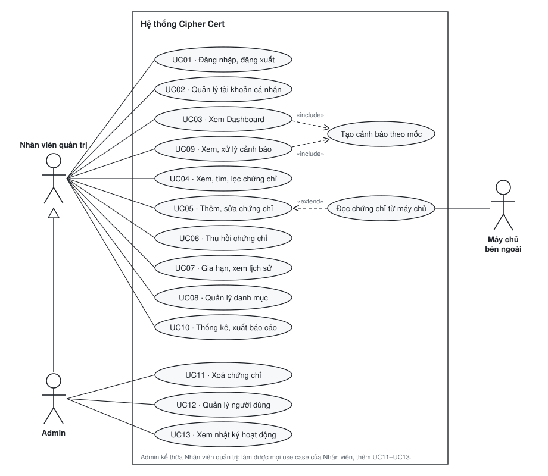
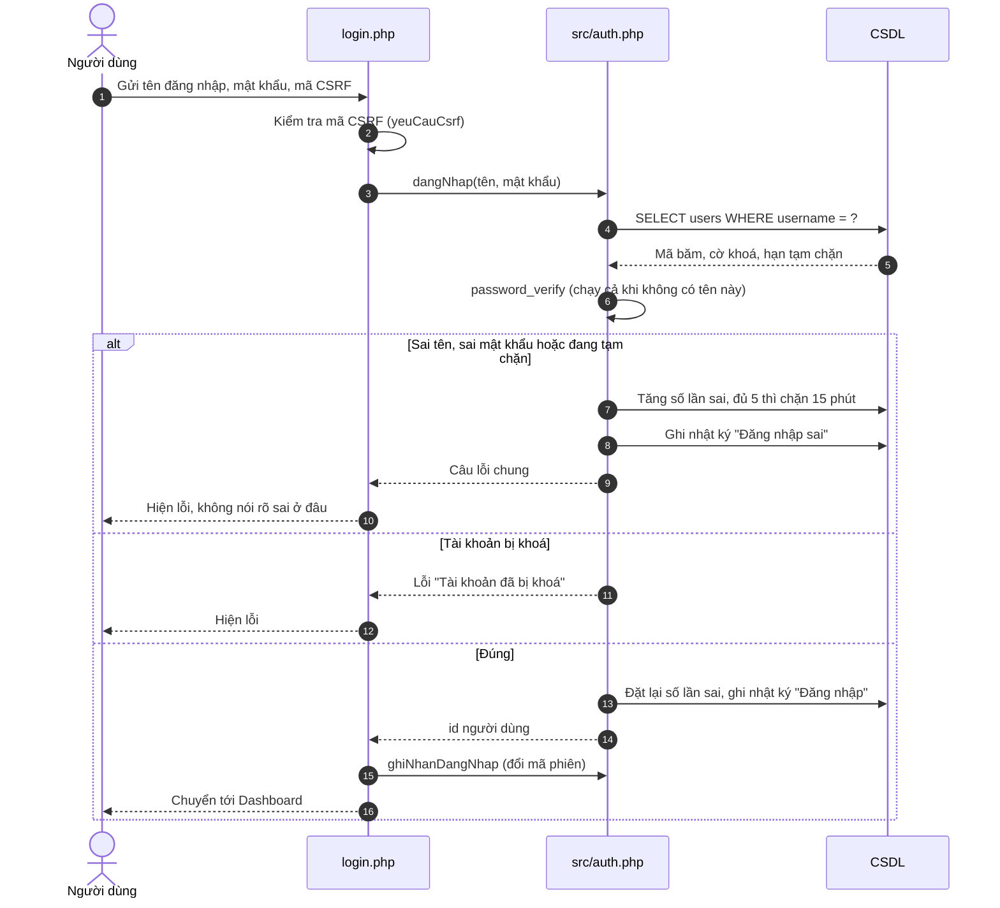
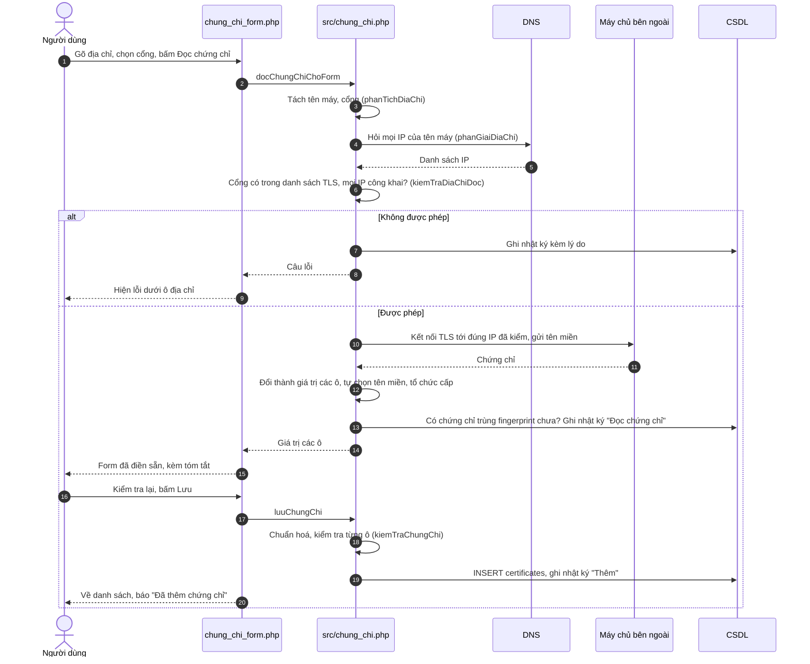
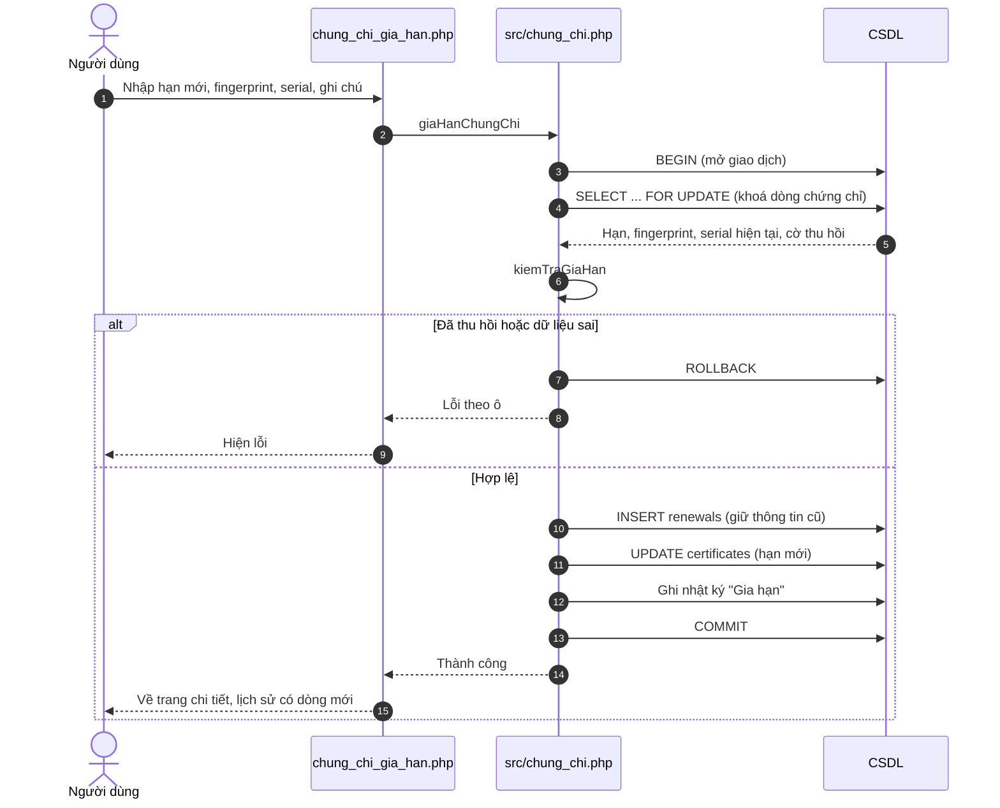
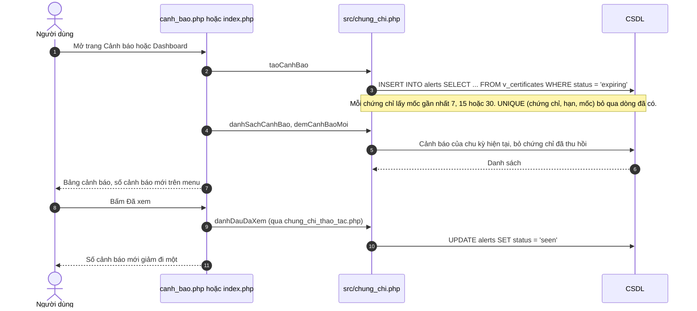

# Use Case: Hệ thống quản lý chứng chỉ số và thời hạn sử dụng

Tài liệu gồm: tác nhân và phân quyền (mục 1), sơ đồ use case (mục 2), đặc tả từng use case (mục 3), sơ đồ
trình tự của 4 luồng chính (mục 4). Quy tắc chi tiết của từng chức năng nằm ở [SPEC.md](SPEC.md); file và
hàm thực hiện từng luồng nằm ở [README mục 5](../README.md#5-sổ-tay-mỗi-luồng-chính-chạy-qua-đâu).

## 1. Tác nhân và phân quyền

| Tác nhân | Là ai | Làm được |
|---|---|---|
| **Nhân viên quản trị** | Người theo dõi chứng chỉ hằng ngày | Quản lý chứng chỉ và danh mục, xử lý cảnh báo, xem thống kê, xuất báo cáo |
| **Admin** | Người quản lý hệ thống | Mọi việc của Nhân viên, thêm: xoá chứng chỉ, quản lý người dùng, xem nhật ký |
| **Máy chủ bên ngoài** (tác nhân phụ) | Website, máy chủ thư... đang chạy chứng chỉ cần theo dõi | Trả chứng chỉ khi hệ thống kết nối tới để đọc (UC05a) |

Không có trang đăng ký công khai: Admin tạo mọi tài khoản. Khách chưa đăng nhập chỉ xem được trang giới thiệu
và trang đăng nhập.

| Thao tác | Admin | Nhân viên quản trị | Khách |
|---|---|---|---|
| Xem trang giới thiệu, đăng nhập | ✅ | ✅ | ✅ |
| Dashboard, xem và lọc chứng chỉ, cảnh báo, thống kê, báo cáo | ✅ | ✅ | ❌ |
| Thêm, sửa, thu hồi, gia hạn chứng chỉ; đọc chứng chỉ từ máy chủ | ✅ | ✅ | ❌ |
| Thêm, sửa, xoá tên miền, máy chủ, tổ chức cấp | ✅ | ✅ | ❌ |
| Xoá chứng chỉ | ✅ | ❌ | ❌ |
| Quản lý người dùng, xem nhật ký | ✅ | ❌ | ❌ |

Quyền được kiểm tra trong PHP ở mọi yêu cầu, không chỉ bằng cách ẩn nút: Nhân viên tự gõ địa chỉ trang của
Admin thì nhận lỗi 403, tự gửi lệnh xoá thì bị từ chối.

## 2. Sơ đồ use case

Cách đọc theo ký hiệu UML:

- **Đường liền** nối tác nhân với use case: tác nhân đó dùng use case đó.
- **Mũi tên tam giác rỗng** từ Admin lên Nhân viên quản trị (kế thừa): Admin làm được mọi use case của Nhân
  viên, nên chỉ cần nối Admin với 3 use case riêng của mình.
- **«include»** (bao gồm): use case gốc luôn chạy use case kia. Mở Dashboard (UC03) hay trang Cảnh báo (UC09)
  đều luôn tạo các cảnh báo còn thiếu trước khi hiện.
- **«extend»** (mở rộng): use case kia là một nhánh tuỳ chọn của use case gốc. Khi thêm chứng chỉ (UC05),
  người dùng **có thể** đọc chứng chỉ từ máy chủ để tự điền form, hoặc bỏ qua và nhập tay.

| Mã | Use case | Tác nhân | Chức năng của đề |
|---|---|---|---|
| UC01 | Đăng nhập, đăng xuất | Nhân viên, Admin | Na |
| UC02 | Quản lý tài khoản cá nhân | Nhân viên, Admin | Na |
| UC03 | Xem Dashboard | Nhân viên, Admin | Nh |
| UC04 | Xem, tìm kiếm, lọc chứng chỉ | Nhân viên, Admin | D1, D4, D5, Nd |
| UC05 | Thêm, sửa chứng chỉ | Nhân viên, Admin | D1, D4, Nc, Nf |
| UC05a | Đọc chứng chỉ từ máy chủ | Nhân viên, Admin, Máy chủ bên ngoài | Mở rộng 2 |
| UC06 | Thu hồi chứng chỉ | Nhân viên, Admin | D5 |
| UC07 | Gia hạn chứng chỉ, xem lịch sử | Nhân viên, Admin | D7 |
| UC08 | Quản lý tên miền, máy chủ, tổ chức cấp | Nhân viên, Admin | D2, D3, Nc |
| UC09 | Xem, xử lý cảnh báo | Nhân viên, Admin | D6 |
| UC10 | Xem thống kê, xuất báo cáo | Nhân viên, Admin | D8, D9, Ne |
| UC11 | Xoá chứng chỉ | Admin | D1 |
| UC12 | Quản lý người dùng | Admin | Nb |
| UC13 | Xem nhật ký hoạt động | Admin | Mở rộng 1 |

## 3. Đặc tả use case

Mọi use case trừ UC01 đều có chung **điều kiện trước**: người dùng đã đăng nhập và tài khoản không bị khoá;
chưa đăng nhập thì bị chuyển về trang đăng nhập. Mọi thao tác đổi dữ liệu đều kiểm tra mã CSRF; mã sai (ví dụ
để trang mở quá lâu) thì hệ thống báo "Phiên làm việc đã hết hạn" và không đổi gì. Hai ngoại lệ chung này
không nhắc lại ở từng use case.

Đánh số luồng: `3a` là nhánh rẽ ở bước 3 của luồng chính.

### UC01. Đăng nhập, đăng xuất

- **Tác nhân:** Nhân viên quản trị, Admin.
- **Mục đích:** vào hệ thống bằng tài khoản được cấp; rời hệ thống an toàn.
- **Điều kiện trước:** có tài khoản do Admin tạo.
- **Kết quả:** đăng nhập thì có phiên làm việc mới và vào Dashboard; đăng xuất thì phiên bị huỷ. Cả hai đều ghi
  một dòng nhật ký.

**Luồng chính**

1. Người dùng mở trang giới thiệu, bấm **Đăng nhập**.
2. Hệ thống hiện form tên đăng nhập, mật khẩu.
3. Người dùng nhập rồi bấm **Đăng nhập**.
4. Hệ thống tìm tài khoản, so mật khẩu với mã băm đã lưu.
5. Hệ thống đặt lại số lần sai về 0, đổi mã phiên, ghi nhật ký "Đăng nhập", chuyển tới Dashboard.
6. Khi muốn rời đi, người dùng mở menu tên mình, bấm **Đăng xuất**.
7. Hệ thống ghi nhật ký "Đăng xuất", huỷ phiên và cookie, về trang giới thiệu.

**Luồng thay thế**

- 1a. Người dùng đã đăng nhập mà mở trang đăng nhập: hệ thống chuyển thẳng tới Dashboard.

**Ngoại lệ**

- 4a. Sai tên đăng nhập hoặc sai mật khẩu: hệ thống báo "Sai tên đăng nhập hoặc mật khẩu. Sai quá 5 lần, tài
  khoản bị tạm chặn 15 phút.", tăng số lần sai, ghi nhật ký "Đăng nhập sai". Câu báo giống hệt nhau, để người
  dò không biết tên nào có thật.
- 4b. Sai đến lần thứ 5: tài khoản bị tạm chặn 15 phút. Trong thời gian đó nhập đúng mật khẩu vẫn nhận đúng câu
  báo ở 4a. Hết 15 phút thì đăng nhập lại được.
- 4c. Tài khoản bị Admin khoá: người nhập đúng mật khẩu nhận câu "Tài khoản đã bị khoá. Hãy liên hệ Admin."
- 5a. Người dùng bị khoá trong lúc đang dùng: ở yêu cầu tiếp theo, hệ thống đẩy họ về trang đăng nhập.
- 6a. Có trang lạ cố đăng xuất người dùng bằng một đường link (yêu cầu GET): hệ thống từ chối, chỉ nhận nút
  Đăng xuất trên trang.

### UC02. Quản lý tài khoản cá nhân

- **Tác nhân:** Nhân viên quản trị, Admin.
- **Mục đích:** tự sửa họ tên, tự đổi mật khẩu.
- **Kết quả:** họ tên hoặc mật khẩu mới được lưu (mật khẩu ở dạng băm); một dòng nhật ký.

**Luồng chính**

1. Người dùng mở menu tên mình, chọn **Tài khoản của tôi**.
2. Hệ thống hiện tên đăng nhập, vai trò, họ tên, và form đổi mật khẩu.
3. Người dùng nhập mật khẩu cũ, mật khẩu mới, nhập lại mật khẩu mới, bấm lưu.
4. Hệ thống kiểm tra mật khẩu cũ đúng, mật khẩu mới dài 8–72 ký tự và hai lần nhập khớp nhau.
5. Hệ thống lưu mật khẩu mới dạng băm, ghi nhật ký "Đổi mật khẩu", báo thành công.

**Luồng thay thế**

- 3a. Người dùng sửa họ tên thay vì đổi mật khẩu: hệ thống kiểm tra họ tên không trống, tối đa 100 ký tự, lưu
  và ghi nhật ký.

**Ngoại lệ**

- 4a. Mật khẩu cũ sai, mật khẩu mới quá ngắn, quá dài hoặc hai lần nhập lệch nhau: hệ thống báo lỗi ngay dưới ô
  sai, không đổi gì.

### UC03. Xem Dashboard

- **Tác nhân:** Nhân viên quản trị, Admin.
- **Mục đích:** nắm nhanh tình hình chứng chỉ và việc cần làm ngay.
- **Kết quả:** người dùng thấy số liệu tổng quan; các cảnh báo còn thiếu được tạo.

**Luồng chính**

1. Người dùng đăng nhập xong, hoặc bấm **Dashboard** trên menu.
2. Hệ thống tạo các cảnh báo còn thiếu (use case «include» *Tạo cảnh báo theo mốc*, xem UC09).
3. Hệ thống hiện 6 thẻ số: tổng số chứng chỉ và số chứng chỉ ở từng trạng thái (Đã hết hạn, Sắp hết hạn, Còn
   hiệu lực, Chưa hiệu lực, Đã thu hồi).
4. Hệ thống hiện bảng **Cần xử lý ngay**: tối đa 10 chứng chỉ sắp hết hạn gần nhất, mỗi dòng có nút Gia hạn.
5. Hệ thống hiện 2 biểu đồ: theo trạng thái, và số chứng chỉ hết hạn trong 12 tháng tới.

**Luồng thay thế**

- 3a. Người dùng bấm một thẻ số: hệ thống mở danh sách chứng chỉ đã lọc theo trạng thái đó (UC04).
- 4a. Không có chứng chỉ nào sắp hết hạn: bảng hiện "Không có chứng chỉ nào sắp hết hạn."
- 4b. Bấm Gia hạn ở một dòng: chuyển sang UC07.
- 4c. Hệ thống chưa có chứng chỉ nào: các thẻ hiện 0, bảng và biểu đồ trống, không báo lỗi.

### UC04. Xem, tìm kiếm, lọc chứng chỉ

- **Tác nhân:** Nhân viên quản trị, Admin.
- **Mục đích:** tìm một chứng chỉ, hoặc xem nhóm chứng chỉ theo điều kiện.
- **Kết quả:** danh sách khớp điều kiện; trang chi tiết của chứng chỉ được chọn.

**Luồng chính**

1. Người dùng bấm **Danh sách chứng chỉ**.
2. Hệ thống hiện 20 chứng chỉ một trang, xếp theo mức gấp: đã hết hạn, sắp hết hạn, còn hiệu lực, chưa hiệu
   lực, đã thu hồi; trong mỗi nhóm, hạn gần hơn đứng trước. Mỗi dòng có mã, tên chính, tổ chức cấp, ngày
   hết hạn, số ngày còn lại, trạng thái (trên điện thoại ẩn bớt tổ chức cấp và ngày hết hạn). Trên bảng là hàng nút trạng thái kèm số đếm.
3. Người dùng gõ từ khoá (tìm trong mã quản lý, tên chính, tên phụ, serial, fingerprint) và/hoặc chọn tổ chức
   cấp, tên miền, máy chủ, khoảng ngày hết hạn, rồi bấm lọc.
4. Hệ thống áp mọi điều kiện cùng lúc (phải khớp tất cả), cập nhật danh sách và số đếm trên hàng nút.
5. Người dùng bấm một chứng chỉ.
6. Hệ thống hiện trang chi tiết: đầy đủ thông tin, các nút thao tác (Gia hạn, Sửa, Thu hồi; Xoá nếu là Admin),
   và bảng lịch sử gia hạn.

**Luồng thay thế**

- 3a. Bấm một nút trạng thái: lọc theo trạng thái đó, giữ các điều kiện khác.
- 3b. Bấm tiêu đề cột: đổi cách xếp theo cột đó, bấm lần nữa để đảo chiều.
- 3c. Fingerprint, serial gõ viết hoa, viết thường hay có dấu `:` đều tìm được.
- 4a. Không có chứng chỉ nào khớp: bảng báo không có kết quả.

**Ngoại lệ**

- 4b. Địa chỉ trang bị sửa tay thành giá trị lọc sai (ví dụ trạng thái không tồn tại): hệ thống coi như chưa
  chọn điều kiện đó, vẫn hiện trang bình thường.
- 6a. Chứng chỉ không còn tồn tại (người khác vừa xoá): hệ thống báo "Chứng chỉ không còn tồn tại." và về danh
  sách.

### UC05. Thêm, sửa chứng chỉ

- **Tác nhân:** Nhân viên quản trị, Admin.
- **Mục đích:** đưa một chứng chỉ vào hệ thống để theo dõi, hoặc sửa thông tin nhập sai.
- **Điều kiện trước:** tên miền và tổ chức cấp của chứng chỉ đã có trong danh mục (UC08).
- **Kết quả:** chứng chỉ được lưu, trạng thái và số ngày còn lại tự tính; một dòng nhật ký "Thêm" hoặc "Sửa".

**Luồng chính** (thêm bằng tay)

1. Người dùng bấm **Thêm chứng chỉ** ở trang danh sách.
2. Hệ thống mở form có 2 tab, tab **Đọc từ máy chủ** mở trước. Người dùng chọn tab **Nhập thủ công**.
3. Hệ thống điền sẵn mã quản lý kế tiếp (ví dụ `CERT-051`).
4. Người dùng nhập: tên chính, tên phụ, tên miền, tổ chức cấp (gõ có gợi ý), ngày bắt đầu, ngày hết hạn,
   thuật toán khoá, độ dài khoá, thuật toán ký; fingerprint SHA-256 và serial nếu có. Bấm **Lưu**.
5. JavaScript kiểm tra ngay trên trình duyệt: ô bắt buộc, định dạng, ngày hết hạn sau ngày bắt đầu.
6. Hệ thống chuẩn hoá fingerprint, serial (bỏ dấu `:` và khoảng trắng), rồi kiểm tra lại toàn bộ bằng PHP theo
   [SPEC mục 3.1](SPEC.md#31-chứng-chỉ).
7. Hệ thống lưu, ghi nhật ký "Thêm", về danh sách với thông báo "Đã thêm chứng chỉ."

**Luồng thay thế**

- 2a. Người dùng ở lại tab Đọc từ máy chủ: chuyển sang UC05a, xong thì quay lại bước 4 với các ô đã điền sẵn.
- 1a. Sửa: từ trang chi tiết bấm **Sửa**. Form điền sẵn giá trị hiện tại, chỉ có nhập thủ công. Lưu xong về
  trang chi tiết với thông báo "Đã lưu thay đổi." Sửa không ghi lịch sử gia hạn; chứng chỉ được cấp lại thì
  phải dùng UC07.

**Ngoại lệ**

- 5a. Ô sai: JavaScript tô đỏ ô và hiện câu lỗi ngay dưới, chưa gửi đi.
- 6a. Dữ liệu sai lọt qua JavaScript (ví dụ trình duyệt tắt JavaScript): PHP báo lỗi dưới đúng ô, giữ nguyên
  những gì người dùng đã nhập.
- 6b. Mã quản lý hoặc fingerprint đã có ở chứng chỉ khác (kể cả viết khác dạng như `AB:CD` và `abcd`): báo
  "Mã quản lý này đã tồn tại." hoặc "Fingerprint này đã có ở chứng chỉ khác."
- 6c. Gõ tên miền hoặc tổ chức cấp chưa có trong danh mục: báo "Chưa có tên miền "…" trong danh mục.", kèm link
  thêm mới. Hệ thống không tự tạo bản ghi danh mục.
- 6d. Ngày hết hạn không sau ngày bắt đầu (bằng nhau cũng không được): báo dưới ô ngày hết hạn.

### UC05a. Đọc chứng chỉ từ máy chủ (mở rộng của UC05)

- **Tác nhân:** Nhân viên quản trị, Admin. **Tác nhân phụ:** Máy chủ bên ngoài.
- **Mục đích:** lấy thông tin chứng chỉ đang chạy thật trên máy chủ, khỏi gõ tay và gõ sai.
- **Điều kiện trước:** đang ở form Thêm chứng chỉ; máy chủ web có mạng ra ngoài.
- **Kết quả:** các ô của form được điền sẵn; một dòng nhật ký "Đọc chứng chỉ" ghi địa chỉ đã đọc và kết quả.

**Luồng chính**

1. Ở tab **Đọc từ máy chủ**, người dùng gõ địa chỉ (ví dụ `cert.cipher.id.vn`, có thể kèm `https://` hoặc
   `:cổng`), chọn cổng trong danh sách (mặc định 443), bấm **Đọc chứng chỉ**.
2. Hệ thống tách tên máy và cổng, hỏi DNS lấy mọi IP của tên máy.
3. Hệ thống kiểm tra cổng nằm trong danh sách cổng TLS được phép, và mọi IP đều là địa chỉ công khai.
4. Hệ thống kết nối TLS tới đúng IP vừa kiểm, gửi tên miền kèm theo, và nhận chứng chỉ máy chủ trả về. Chứng
   chỉ hết hạn, tự ký hay sai tên vẫn đọc được, vì đó chính là thứ cần theo dõi.
5. Hệ thống điền sẵn: tên chính, tên phụ, ngày bắt đầu, ngày hết hạn (giờ Việt Nam), thuật toán khoá, độ dài
   khoá, thuật toán ký, fingerprint, serial. Tên miền và tổ chức cấp được tự chọn nếu trùng tên với danh mục
   (tên miền cha cũng được: `cert.cipher.id.vn` khớp `cipher.id.vn`). Hệ thống hiện tóm tắt chứng chỉ vừa đọc,
   kèm số ngày còn lại.
6. Hệ thống ghi nhật ký "Đọc chứng chỉ".
7. Người dùng kiểm tra lại, bấm **Lưu**. Tiếp tục từ bước 5 của UC05.

**Luồng thay thế**

- 5a. Chưa có tên miền nào khớp: ô tên miền để trống, kèm gợi ý "Chưa có tên miền nào khớp … Thêm tên miền mới
  rồi đọc lại."
- 5b. Tổ chức cấp chưa có trong danh mục: ô để trống, gợi ý ghi tên bên cấp mà máy chủ báo.
- 5c. Chứng chỉ đã có trong hệ thống (trùng fingerprint): hệ thống báo trước "Chứng chỉ này đã có trong hệ
  thống", kèm link tới chứng chỉ đó.
- 5d. Thuật toán khoá không phải RSA hay ECDSA (ví dụ Ed25519, GOST): ô thuật toán để trống cho người dùng chọn.

**Ngoại lệ** (mọi trường hợp đều ghi nhật ký kèm lý do)

- 2a. Địa chỉ sai định dạng: "Địa chỉ không hợp lệ. Ví dụ đúng: cert.cipher.id.vn".
- 2b. Không tìm thấy IP của tên miền: báo kiểm tra lại tên miền.
- 3a. Cổng không nằm trong danh sách cổng TLS (443, 8443, 9443, 465, 993, 995, 636, 853, 5061): báo cổng không
  được phép. Nhờ vậy người dùng không mượn được hệ thống để quét cổng tuỳ ý.
- 3b. Bất kỳ IP nào là địa chỉ nội bộ (127.0.0.1, 10.x, 192.168.x...): "… trỏ tới địa chỉ nội bộ. Chỉ đọc được
  máy chủ có địa chỉ công khai."
- 4a. Máy chủ không trả lời trong 5 giây, từ chối kết nối, hoặc không dùng TLS ở cổng đó: báo không đọc được.
- 4b. Máy chủ không gửi chứng chỉ: báo lỗi.

### UC06. Thu hồi chứng chỉ

- **Tác nhân:** Nhân viên quản trị, Admin.
- **Mục đích:** đánh dấu chứng chỉ không còn được tin dù chưa hết hạn (ví dụ lộ khoá riêng).
- **Điều kiện trước:** chứng chỉ chưa bị thu hồi.
- **Kết quả:** trạng thái thành Đã thu hồi; dữ liệu và lịch sử giữ nguyên; không còn cảnh báo, không gia hạn
  được; một dòng nhật ký "Thu hồi".

**Luồng chính**

1. Ở trang chi tiết, người dùng bấm **Thu hồi**.
2. Hệ thống hỏi lại: "Thu hồi chứng chỉ … ? Không thể hoàn tác."
3. Người dùng đồng ý.
4. Hệ thống đặt cờ thu hồi, ghi nhật ký, báo "Đã thu hồi chứng chỉ."

**Luồng thay thế**

- 3a. Người dùng huỷ: không đổi gì.

**Ngoại lệ**

- 4a. Chứng chỉ đã được thu hồi trước đó hoặc không còn tồn tại (người khác vừa thao tác): báo lỗi, không đổi
  gì.
- 4b. Không có cách hoàn tác: form Sửa không có ô thu hồi. Muốn dùng lại thì thêm chứng chỉ mới.

### UC07. Gia hạn chứng chỉ, xem lịch sử gia hạn

- **Tác nhân:** Nhân viên quản trị, Admin.
- **Mục đích:** ghi nhận chứng chỉ đã được cấp lại, giữ dấu vết bản cũ.
- **Điều kiện trước:** chứng chỉ chưa bị thu hồi (đã hết hạn vẫn gia hạn được).
- **Kết quả:** chứng chỉ có hạn mới; bảng lịch sử thêm một dòng giữ hạn, fingerprint, serial cũ; các mốc cảnh
  báo tính lại từ đầu; một dòng nhật ký "Gia hạn".

**Luồng chính**

1. Người dùng bấm **Gia hạn** ở trang chi tiết (hoặc ở Dashboard, trang Cảnh báo).
2. Hệ thống hiện form kèm hạn hiện tại: ngày hết hạn mới, fingerprint mới, serial mới, ghi chú.
3. Người dùng nhập rồi bấm **Gia hạn**.
4. Hệ thống mở một giao dịch, khoá dòng chứng chỉ để người khác không gia hạn chen vào, kiểm tra dữ liệu.
5. Hệ thống chép hạn, fingerprint, serial cũ vào lịch sử; cập nhật chứng chỉ; ghi nhật ký; xác nhận giao dịch.
6. Hệ thống về trang chi tiết. Bảng **Lịch sử gia hạn** có dòng mới: hạn cũ, hạn mới, người gia hạn, thời
   điểm, ghi chú.

**Luồng thay thế**

- 3a. Để trống fingerprint, serial mới: chứng chỉ hiện "Chưa có", vì giá trị cũ không còn đúng với chứng chỉ
  mới; giá trị cũ vẫn nằm trong lịch sử.
- 6a. Chỉ xem lịch sử: mở trang chi tiết, bảng ở cuối trang; chưa gia hạn lần nào thì báo "Chưa gia hạn lần
  nào."

**Ngoại lệ**

- 1a. Chứng chỉ đã thu hồi: không có nút Gia hạn; gửi lệnh thẳng thì bị chặn với câu "Chứng chỉ đã thu hồi không
  gia hạn được. Muốn dùng lại, hãy thêm chứng chỉ mới."
- 4a. Ngày hết hạn mới không sau hạn hiện tại, hoặc không sau thời điểm này: báo dưới ô ngày.
- 4b. Fingerprint mới đã có ở chứng chỉ khác, hoặc sai định dạng: báo dưới ô fingerprint.
- 5a. Lỗi ở bất kỳ bước nào: huỷ cả giao dịch, không bước nào có hiệu lực (không có lịch sử thừa, chứng chỉ
  giữ hạn cũ).

### UC08. Quản lý tên miền, máy chủ, tổ chức cấp

- **Tác nhân:** Nhân viên quản trị, Admin.
- **Mục đích:** giữ danh mục để chọn khi thêm chứng chỉ.
- **Kết quả:** bản ghi danh mục được thêm, sửa hoặc xoá; một dòng nhật ký.

**Luồng chính**

1. Người dùng chọn **Tên miền**, **Máy chủ** hoặc **Tổ chức cấp** trong nhóm Hạ tầng.
2. Hệ thống hiện danh sách; tên miền và tổ chức cấp có kèm số chứng chỉ đang gắn.
3. Người dùng bấm thêm mới hoặc **Sửa**, nhập:
   - Máy chủ: tên máy, địa chỉ IP, cổng, môi trường (production, staging, development), người phụ trách.
   - Tên miền: tên miền (được dùng dạng `*.congty.vn`), máy chủ đặt tên miền đó.
   - Tổ chức cấp: tên, quốc gia, có được tin cậy không.
4. Hệ thống kiểm tra, lưu (tên miền lưu chữ thường), ghi nhật ký, về danh sách.

**Luồng thay thế**

- 3a. Xoá: người dùng bấm Xoá, xác nhận; hệ thống xoá nếu bản ghi không còn dữ liệu phụ thuộc.
- 2a. Xem chứng chỉ của một tên miền: lọc danh sách chứng chỉ theo tên miền đó (UC04).

**Ngoại lệ**

- 4a. IP không phải IPv4 hay IPv6 hợp lệ, cổng ngoài 1–65535, tên miền sai định dạng, ô bắt buộc để trống: báo
  dưới đúng ô.
- 4b. Tên miền hoặc tên tổ chức đã tồn tại: "Tên miền này đã tồn tại." / "Tên tổ chức này đã tồn tại."
- 3b. Xoá máy chủ còn tên miền, xoá tên miền hoặc tổ chức còn chứng chỉ: hệ thống báo rõ lý do (ví dụ "Tổ chức
  này còn chứng chỉ, hãy chuyển hoặc xoá chứng chỉ trước."), dữ liệu vẫn còn.

### UC09. Xem, xử lý cảnh báo

- **Tác nhân:** Nhân viên quản trị, Admin.
- **Mục đích:** không để chứng chỉ nào hết hạn mà không ai biết.
- **Kết quả:** người dùng thấy các chứng chỉ cần xử lý; cảnh báo được đánh dấu đã xem hoặc chứng chỉ được gia
  hạn.

**Luồng chính**

1. Người dùng thấy số cảnh báo mới cạnh mục **Cảnh báo** trên menu, bấm vào.
2. Hệ thống tạo các cảnh báo còn thiếu (use case «include» *Tạo cảnh báo theo mốc*, bên dưới).
3. Hệ thống hiện cảnh báo của chu kỳ hiện tại: chưa xem lên đầu, hạn gần trước; mốc 7 ngày màu đỏ, 15 ngày màu
   cam, 30 ngày màu vàng.
4. Người dùng xử lý: bấm **Gia hạn** (sang UC07), hoặc bấm **Đã xem** khi đã nắm thông tin.
5. Hệ thống đánh dấu đã xem, giảm số cảnh báo mới trên menu. Cảnh báo vẫn còn trong danh sách.

**Use case được bao gồm: Tạo cảnh báo theo mốc.** Hệ thống lấy mọi chứng chỉ Sắp hết hạn (còn tối đa 30 ngày)
và tạo một cảnh báo ở **mốc gần nhất** đã chạm: còn tối đa 7 ngày là mốc 7, tối đa 15 là mốc 15, còn lại là
mốc 30. Mỗi mốc chỉ tạo một lần trong một chu kỳ hạn; chạy lại bao nhiêu lần cũng không sinh thêm dòng và không
đổi trạng thái đã xem. Sau khi gia hạn, chu kỳ mới bắt đầu nên các mốc được tạo lại từ đầu.

**Luồng thay thế**

- 3a. Chứng chỉ đã hết hạn vẫn hiện cảnh báo, vì đó là trường hợp gấp nhất. Chứng chỉ đã thu hồi thì không hiện.
- 3b. Cảnh báo của chu kỳ cũ (trước lần gia hạn) không hiện nữa, nhưng vẫn được giữ trong CSDL.
- 5a. "Đã xem" tính chung: một người đánh dấu thì mọi người đều thấy là đã xem.

**Ngoại lệ**

- 5b. Cảnh báo đã được người khác đánh dấu trước đó: báo "Cảnh báo đã được đánh dấu trước đó, hoặc không còn
  tồn tại."

### UC10. Xem thống kê, xuất báo cáo

- **Tác nhân:** Nhân viên quản trị, Admin.
- **Mục đích:** nhìn bức tranh chung và lấy báo cáo để gửi hoặc lưu.
- **Kết quả:** biểu đồ và bảng số theo bộ lọc; file CSV hoặc bản in.

**Luồng chính**

1. Người dùng bấm **Thống kê và báo cáo**.
2. Hệ thống hiện 4 biểu đồ, mỗi biểu đồ kèm bảng số ngay dưới: theo trạng thái; hết hạn trong 12 tháng tới
   (không tính đã thu hồi và đã quá hạn); theo tổ chức cấp; theo thuật toán khoá.
3. Người dùng chọn bộ lọc (cùng bộ lọc với danh sách chứng chỉ). Hệ thống vẽ lại; trục số giữ nguyên thước đo
   của toàn bộ dữ liệu, nên cột ngắn lại và so được với lúc chưa lọc.
4. Người dùng bấm **Xuất CSV**. Hệ thống tải về file `bao-cao-chung-chi-<ngày>.csv` gồm đủ mọi chứng chỉ khớp bộ
   lọc (không chia trang); Excel mở đúng tiếng Việt.
5. Hoặc bấm **Bản in**: hệ thống mở trang in gồm mô tả bộ lọc, bảng số theo trạng thái và danh sách; người dùng
   in hoặc lưu PDF bằng lệnh In của trình duyệt.

**Luồng thay thế**

- 3a. Không chứng chỉ nào khớp bộ lọc: hiện "Không có chứng chỉ nào khớp bộ lọc."
- 4a. Xuất CSV, Bản in cũng có ở trang Danh sách chứng chỉ, theo bộ lọc và cách xếp đang chọn ở đó.

**Ngoại lệ**

- 4b. Ô trong CSV bắt đầu bằng `=`, `+`, `-`, `@`: hệ thống thêm dấu nháy để Excel coi là chữ, không chạy thành
  công thức.

### UC11. Xoá chứng chỉ

- **Tác nhân:** Admin.
- **Mục đích:** gỡ hẳn chứng chỉ nhập nhầm khỏi hệ thống.
- **Kết quả:** chứng chỉ bị xoá cùng cảnh báo và lịch sử gia hạn của nó; nhật ký vẫn còn dòng "Xoá" kèm mã chứng
  chỉ lúc đó.

**Luồng chính**

1. Ở trang chi tiết, Admin bấm **Xoá**.
2. Hệ thống hỏi lại: "Xoá chứng chỉ … cùng cảnh báo và lịch sử gia hạn?"
3. Admin đồng ý.
4. Hệ thống ghi nhật ký (kèm tên chứng chỉ trước khi mất), xoá, về danh sách với thông báo "Đã xoá chứng chỉ."

**Luồng thay thế**

- 3a. Admin huỷ: không đổi gì.

**Ngoại lệ**

- 1a. Nhân viên quản trị không thấy nút Xoá. Gửi lệnh xoá thẳng tới hệ thống thì bị từ chối: "Chỉ Admin được xoá
  chứng chỉ. Bạn có thể dùng Thu hồi."
- 4a. Chứng chỉ không còn tồn tại: "Bản ghi này không còn tồn tại."

### UC12. Quản lý người dùng

- **Tác nhân:** Admin.
- **Mục đích:** cấp, sửa, khoá, xoá tài khoản.
- **Kết quả:** tài khoản được thêm, sửa, khoá, mở khoá hoặc xoá; một dòng nhật ký.

**Luồng chính**

1. Admin bấm **Người dùng** trong nhóm Hệ thống.
2. Hệ thống hiện danh sách tài khoản: tên đăng nhập, họ tên, vai trò, trạng thái khoá.
3. Admin bấm thêm mới, nhập tên đăng nhập, họ tên, vai trò, mật khẩu, nhập lại mật khẩu.
4. Hệ thống kiểm tra: tên đăng nhập 3–50 ký tự (chữ không dấu, số, `.`, `_`, `-`) và không trùng; họ tên bắt
   buộc; mật khẩu 8–72 ký tự, hai lần nhập khớp.
5. Hệ thống lưu mật khẩu dạng băm, ghi nhật ký, về danh sách.

**Luồng thay thế**

- 3a. Sửa: để trống mật khẩu nghĩa là giữ nguyên; nhập mật khẩu mới là đặt lại (đường duy nhất cứu tài khoản quên
  mật khẩu, vì hệ thống không có chức năng quên mật khẩu).
- 3b. Khoá: tài khoản không đăng nhập được nữa và bị đẩy ra ngay nếu đang dùng.
- 3c. Mở khoá: xoá luôn trạng thái tạm chặn do sai mật khẩu, người dùng vào được ngay.
- 3d. Xoá: chỉ xoá được người chưa có dòng nhật ký nào.

**Ngoại lệ**

- 4a. Tên đăng nhập đã có: báo dưới ô tên đăng nhập.
- 3e. Admin tự khoá, tự xoá hoặc tự đổi vai trò của mình: bị từ chối, để hệ thống luôn còn ít nhất một Admin.
- 3f. Xoá người đã có lịch sử thao tác: "Người dùng này đã có lịch sử thao tác nên không xoá được, chỉ có thể
  khoá."
- 1a. Nhân viên quản trị không thấy nhóm Hệ thống; tự gõ địa chỉ trang thì nhận lỗi 403.

### UC13. Xem nhật ký hoạt động

- **Tác nhân:** Admin.
- **Mục đích:** biết ai đã làm gì, lúc nào, từ đâu.
- **Kết quả:** danh sách thao tác theo bộ lọc.

**Luồng chính**

1. Admin bấm **Nhật ký** trong nhóm Hệ thống.
2. Hệ thống hiện 50 dòng một trang, mới nhất trước. Mỗi dòng: thời điểm, người làm, hành động (nhãn màu), đối
   tượng (có link nếu đối tượng còn tồn tại), chi tiết, địa chỉ IP.
3. Admin lọc theo người làm, hành động, khoảng ngày.
4. Hệ thống hiện kết quả, giữ bộ lọc khi chuyển trang.

**Luồng thay thế**

- 3a. Lọc người làm "Không rõ (đăng nhập sai)": các lần đăng nhập sai tên, chưa biết là ai.
- 2a. Trên điện thoại: cột IP ẩn, IP hiện ngay dưới tên người làm.

**Ngoại lệ**

- 1a. Nhân viên quản trị: không thấy mục Nhật ký; tự gõ địa chỉ thì nhận lỗi 403.
- 2b. Không có nút sửa hay xoá dòng nhật ký. Lệnh sửa, xoá gõ thẳng vào CSDL cũng bị trigger từ chối.

## 4. Sơ đồ trình tự

Sơ đồ trình tự (sequence diagram) cho thấy các bên gửi yêu cầu cho nhau theo thứ tự thời gian, từ trên xuống.
Tên trong ngoặc là hàm PHP thực hiện bước đó.

### 4.1. Đăng nhập (UC01)

### 4.2. Thêm chứng chỉ bằng cách đọc từ máy chủ (UC05, UC05a)

### 4.3. Gia hạn (UC07)

### 4.4. Cảnh báo (UC03, UC09)

