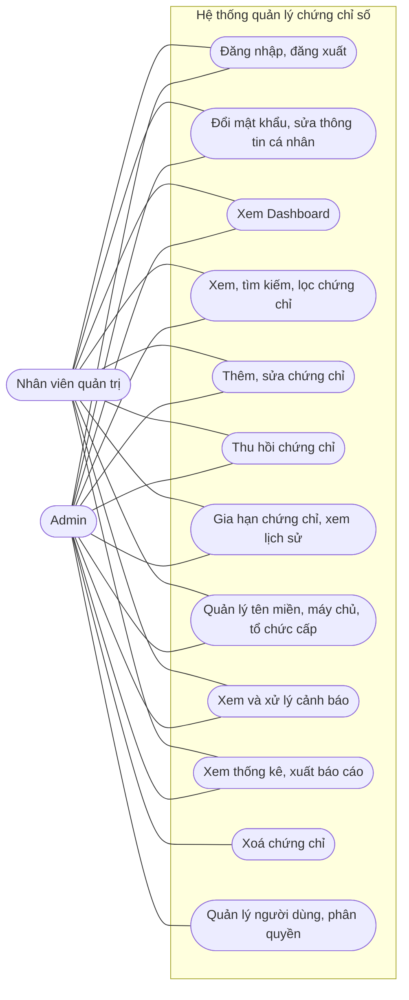

# Use Case — Hệ thống quản lý chứng chỉ số và thời hạn sử dụng

Hệ thống có hai tác nhân, và không có trang đăng ký công khai: Admin tạo mọi tài khoản.

- **Admin:** toàn quyền.
- **Nhân viên quản trị:** quản lý chứng chỉ và danh mục, nhưng không quản lý người dùng và không xoá chứng chỉ.

Mô tả chi tiết từng chức năng nằm ở [SPEC.md](SPEC.md).

## Bảng phân quyền

| Thao tác | Admin | Nhân viên quản trị | Khách chưa đăng nhập |
|---|---|---|---|
| Xem trang giới thiệu, đăng nhập | ✅ | ✅ | ✅ |
| Dashboard, xem và lọc chứng chỉ, cảnh báo, thống kê, báo cáo | ✅ | ✅ | ❌ |
| Thêm, sửa, thu hồi, gia hạn chứng chỉ | ✅ | ✅ | ❌ |
| Thêm, sửa, xoá tên miền, máy chủ, tổ chức cấp | ✅ | ✅ | ❌ |
| Xoá chứng chỉ | ✅ | ❌ | ❌ |
| Quản lý người dùng | ✅ | ❌ | ❌ |

Quyền được kiểm tra trong PHP ở mọi yêu cầu, không chỉ bằng cách ẩn nút trên giao diện.
